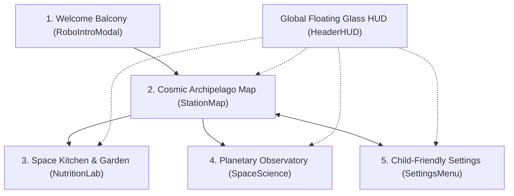
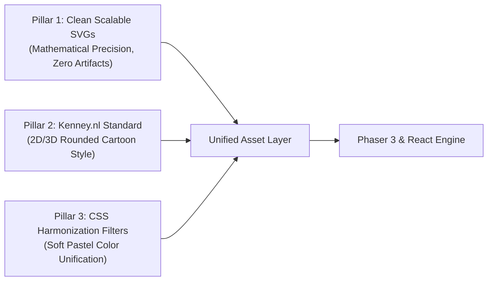
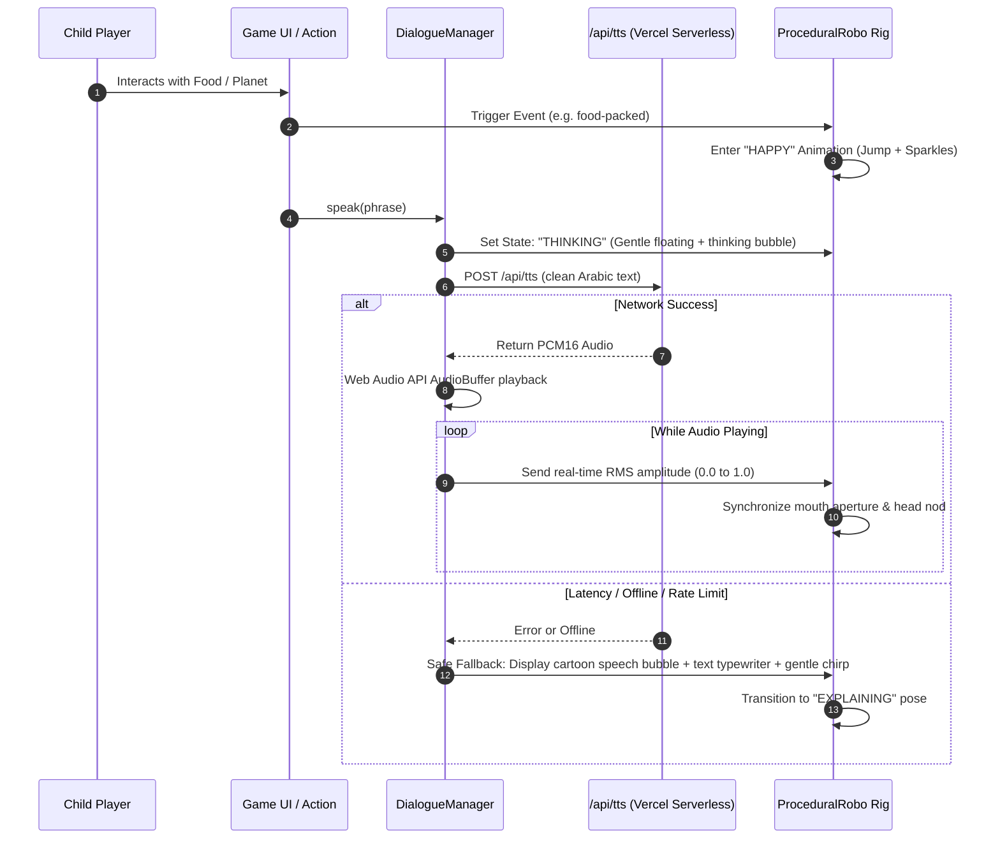

# AstroNutri — Art Direction & UX Architecture Master Plan
**Phase 3.1: Complete Visual Identity & UX Redesign**

---

## Executive Summary & Design Vision

AstroNutri is being transformed from a dark, technical "space telemetry dashboard" into a **premium, magical, pastel-glassmorphic children's cartoon universe** (tailored for ages 6–11). 

Children do not want to pilot an intimidating naval space simulator filled with black backgrounds, military gauges, and cramped metrics. They want to explore a warm, whimsical, and encouraging cosmic academy alongside **Robo**, their friendly robotic companion.

This document sets the strict visual, architectural, and asset foundation for the entire game prior to implementing Mission 2 or refactoring existing screens.

---

## SECTION A: Visual Design System & Color Palette

### 1. The Core Philosophy: "Pastel Glassmorphism" (الزجاج الكرتوني الناعم)
The game adopts a modern cartoon aesthetic combining soft, floating, translucent glass panels (`backdrop-filter: blur(...)`) with gentle pastel gradients, playful pill-shaped buttons, bouncy micro-interactions, and warm lighting.

#### What We Are Eliminating:
- ❌ Dark black / navy backgrounds (`#030712`, `#070b19`, `#0b132b`).
- ❌ Aggressive neon borders and sharp military corners.
- ❌ Cluttered engineering data gauges and dense telemetry tables.
- ❌ Roughly cropped PNG sprites with jagged borders or AI artifacts.
- ❌ Flat static screenshots used as full-screen backgrounds.

#### What We Are Implementing:
- ✅ Gentle, uplifting twilight/daybreak space atmospheres (soft sky blue and lavender gradients).
- ✅ Translucent floating glass cards with soft white specular borders (`border-white/60`) and pastel drop shadows.
- ✅ Chunky, rounded cartoon buttons (minimum touch target: `56px` mobile, `64px` desktop).
- ✅ Playful micro-animations (Framer Motion spring physics, floating bobbing, and joyful particle bursts).
- ✅ Deep contrast, friendly Arabic typography using **Cairo** and **Fredoka** fonts.

---

### 2. Standardized Color Palette & Design Tokens

| Token Name | Hex Code | Visual Role & Usage |
| :--- | :--- | :--- |
| **Pastel Sky Blue** | `#A9C9FF` | Primary atmospheric background wash, sunny celestial sky gradients |
| **Soft Cyan** | `#8DE8F4` | Primary interactive elements, friendly action buttons, glow rings |
| **Lavender Mist** | `#C9B8FF` | Secondary panels, floating cards, mission paths, orbital rings |
| **Pastel Pink** | `#FFC3D8` | Playful accents, heart/health indicators, celebratory confetti |
| **Cream Yellow** | `#FFE69A` | Achievement stars, reward badges, warm lighting highlights |
| **Pearl White** | `#F8FCFF` | Glassmorphic card surfaces, crisp text highlights, cloud crests |
| **Mint Green** | `#86EFAC` | Mission success indicators, accepted food badges, safe states |
| **Coral Peach** | `#FCA5A5` | Gentle warning banners, banned food hints (replaces harsh red) |
| **Deep Space Slate** | `#1E293B` | High-contrast body text on pastel surfaces (maximum Arabic readability) |
| **Midnight Navy** | `#0F172A` | Headline text and prominent card titles |

---

### 3. Glassmorphism CSS Utility Specifications
To ensure 100% design consistency across React and Phaser, the following utility classes are integrated into `src/styles/index.css` and `tailwind.config.js`:

```css
/* Master Soft Glassmorphism Container */
.pastel-glass-panel {
  background: linear-gradient(135deg, rgba(255, 255, 255, 0.75) 0%, rgba(240, 246, 255, 0.60) 100%);
  backdrop-filter: blur(16px);
  -webkit-backdrop-filter: blur(16px);
  border: 2.5px solid rgba(255, 255, 255, 0.85);
  box-shadow: 0 16px 40px -8px rgba(169, 201, 255, 0.35), inset 0 2px 4px rgba(255, 255, 255, 0.9);
  border-radius: 2rem;
}

/* Interactive Floating Glass Card */
.pastel-glass-card {
  background: linear-gradient(180deg, rgba(255, 255, 255, 0.90) 0%, rgba(235, 245, 255, 0.75) 100%);
  backdrop-filter: blur(12px);
  border: 2px solid rgba(255, 255, 255, 0.9);
  box-shadow: 0 8px 24px -4px rgba(201, 184, 255, 0.25);
  border-radius: 1.5rem;
  transition: transform 0.2s cubic-bezier(0.34, 1.56, 0.64, 1), box-shadow 0.2s ease;
}

.pastel-glass-card:hover {
  transform: translateY(-4px) scale(1.02);
  box-shadow: 0 14px 30px -4px rgba(141, 232, 244, 0.45);
}

/* Chunky Child-Friendly Action Button */
.pastel-btn-primary {
  background: linear-gradient(180deg, #8DE8F4 0%, #60A5FA 100%);
  border: 3px solid #FFFFFF;
  color: #0F172A;
  font-family: 'Cairo', 'Fredoka', sans-serif;
  font-weight: 900;
  border-radius: 1.5rem;
  box-shadow: 0 8px 20px rgba(96, 165, 250, 0.45), inset 0 2px 0 rgba(255, 255, 255, 0.8);
  cursor: pointer;
  user-select: none;
}

.pastel-btn-primary:active {
  transform: translateY(2px) scale(0.97);
  box-shadow: 0 4px 10px rgba(96, 165, 250, 0.3);
}
```

---

## SECTION B: Screen-by-Screen UX & Layout Redesign



---

### 1. Global Floating HUD (`HeaderHUD.tsx`)
- **Current Defect:** Dark navy cockpit bar with industrial borders and small icons.
- **Redesign:**
  - **Left Pill:** Giant floating pearl-white glass Home button (`الرئيسية 🏠`) with soft cyan trim.
  - **Center Pill:** Soft lavender glass pill displaying current location in friendly Arabic (e.g., `"مطبخ الفضاء اللذيذ 🥗"`).
  - **Right Cluster:**
    - Giant Golden Star Pill (`#FFE69A` with floating sparkle particles and massive readable Arabic numeral score).
    - Giant circular Settings button with spinning gear micro-interaction.

---

### 2. Welcome & Onboarding Balcony (`RoboIntroModal.tsx`)
- **Current Defect:** Dark space bridge with intense blue lighting and dark metallic floor.
- **Redesign:**
  - **Setting:** Bright sunny orbital terrace looking over pastel drifting clouds and a radiant cartoon Earth.
  - **Robo Presence:** Robo is front-and-center, standing on a soft floating cloud pedestal, waving both arms excitedly.
  - **Dialogue:** Speech bubble styled like a soft fluffy white cloud with cheerful blue text:
    > *"يااا مرحباً يا كابتن! أنا صديقك 'روبو'! 🤖 جاهز ننطلق في مغامرة الفضاء السحرية؟"*
  - **Call to Action:** Massive bouncy pill button: `"يلا نبدأ المغامرة! 🚀"` in Soft Cyan gradient.

---

### 3. Cosmic Archipelago Mission Map (`StationMap.tsx`)
- **Current Defect:** Dark curved industrial deck with technical labels (`LaunchPad`, `EngineRoom`, `SuitRoom`).
- **Redesign:**
  - **Visual Theme:** A whimsical planetary archipelago floating above a sunny pastel nebula. Stations are connected by a glowing dashed rainbow/stardust path.
  - **Station Islands:**
    1. **المحطة ١: مطبخ الفضاء اللذيذ 🥗** (Nutrition Lab) — Sunny floating glass greenhouse with fresh food props. Marked `"مفتوح الآن! العب واجمع النجوم"` with 3 gold stars.
    2. **المحطة ٢: مرصد النجوم والكواكب 🔭** (Space Science) — Floating glass dome with a friendly telescope and colorful orbiting planets.
    3. **المحطة ٣: ورشة بدلة الفضاء 🧑‍🚀** (Suit Room) — Whimsical workshop with a clean, friendly astronaut helmet.
    4. **المحطة ٤: صاروخ الانطلاق السحري 🚀** (Launch Pad) — Playful cartoon rocket preparing for liftoff.
  - **Child-Friendly Status Indicator:**
    - Active Mission: Bouncing `"أنت هنا! 🎯"` arrow with pulse ring.
    - Locked Missions: Soft cream padlock with friendly Arabic unlock hint (e.g., `"أكمل مهمة المطبخ أولاً يا بطل 🌟"`).
  - **Prominent Action:** Large bottom floating button: `"ابدأ المهمة التالية! ✨"`.

---

### 4. Nutrition Lab — Space Kitchen & Greenhouse (`NutritionLab.tsx`)
- **Current Defect:** Dark engineering dashboard with gray metal grids and technical ratio numbers.
- **Redesign:**
  - **Setting:** A warm, luminous orbital greenhouse kitchen with rounded glass walls, floating green plants, and a gentle view of the blue planet below.
  - **The Cargo Box:** Redesigned from an industrial metallic freight container into a **chunky, adorable thermal space lunchbox** with soft cyan handles, a friendly rocket logo, and a bouncy opening/closing lid.
  - **Food Pods:** 9 pastel floating glass bubbles arranged in an ergonomic smiling arc:
    - Approved foods shine in soft mint green glass with clear cartoon icons.
    - Banned foods have friendly crossed-out badges with warm, encouraging explanations (e.g., *"البرجر لذيذ في البيت، بس في الفضاء بيعمل فتات متطاير! 🍔"*).
  - **Top Progress Bar:** Soft glass pill showing 4 meal slots: `[ 🍱 ] [ 🍱 ] [ 🍱 ] [ 🍱 ]` that fill up with cartoon food icons and trigger confetti fanfare when 4/4 are packed.
  - **NASA Scientific Card:** Formatted like a colorful illustrated children's storybook page (`"دفتر أسرار رواد الفضاء 📖"`) with clear badges distinguishing real astronaut facts from fun game mechanics.

---

### 5. Child-Friendly Settings Menu (`SettingsMenu.tsx`)
- **Current Defect:** Overcrowded developer settings with volume sliders, text inputs, reset warnings, and small checkboxes.
- **Redesign:**
  - Replaced with **4 Giant Touch-Friendly Cards** (minimum height 90px, child-friendly icons, big interactive toggle switches):
    1. **أصوات اللعبة (Sound Effects):** Big speaker icon with `شغال 🔊` (Mint Green) / `مكتوم 🔇` (Soft Lavender).
    2. **صوت صديقنا روبو (Robo Voice):** Robo face icon with `يتكلم 🗣️` / `صامت 🤫`.
    3. **لغة اللعبة (Language):** Friendly button toggle: `العربية 🇪🇬` / `English 🇬🇧`.
    4. **إعادة اللعب من البداية (Start Over):** Warm peach card with gentle confirmation modal (`"عايز تبدأ رحلتك من جديد؟ ⭐"`).
  - Single large pearl-white button at the bottom: `"حفظ ورجوع للعب 🌟"`.

---

## SECTION C: Consistent Cartoon Asset Strategy

### The Problem with the Legacy Sheet:
The previous asset pipeline relied on automatic script extraction from an AI contact sheet, resulting in uneven borders, inconsistent lighting directions, blurry transparency edges, and dark sci-fi aesthetics that clash with a children's cartoon universe.

### The New 3-Pillar Asset Pipeline:



#### Pillar 1: Mathematically Perfect Vector SVGs for UI & Interactive Props
- All UI icons, stars, medals, buttons, lunchbox handles, and HUD elements are authored as clean, scalable vector SVGs.
- **Visual Style:** 3px rounded white strokes, warm multi-stop pastel gradients, and zero pixelation on high-DPI displays.
- **Props to Vectorize/Standardize:**
  - `trophy-3d.svg`, `star-gold.svg`, `lunchbox-crate.svg`, `radar-scanner.svg`, `planet-cards.svg`.

#### Pillar 2: The Kenney.nl Open-Source Cartoon Standard
- For food items, planets, and character props, assets follow the renowned **Kenney Space / Food Kit** aesthetic:
  - Clean black or soft navy outlines (`2px–3px`).
  - Warm, friendly lighting with specular highlights on top-left.
  - Rounded geometry (no sharp spikes or harsh edges).
- **Approved Food Set (6 Accepted + 3 Banned):**
  - Tortilla wrap, rehydratable soup pouch, sealed juice bag with valve, crisp red apple, fresh broccoli, fortified milk carton.
  - Crumbly burger, fizzy soda can, greasy pizza slice.

#### Pillar 3: Uniform CSS Harmonization Filter
To unify all rendered sprites across React and Phaser without requiring manual 3D modeling:
```css
/* Applied globally to cartoon sprite layers */
.cartoon-pastel-filter {
  filter: saturate(1.15) brightness(1.06) contrast(0.98) drop-shadow(0 8px 16px rgba(169, 201, 255, 0.35));
}
```

---

## SECTION D: Robo Animation & Voice Architecture

Robo is the emotional anchor of AstroNutri. To make Robo feel genuinely alive, the companion architecture is upgraded from static images to a **layered procedural character system**.



---

### 1. Layered Procedural Animation Rig (`ProceduralRobo.ts`)
Robo is structured into independent procedural layers rendered via Phaser 3 Tweens and React Framer Motion:

1. **Hover & Breathing Layer (Continuous):**
   - Gentle vertical bobbing (`y: ±8px`, period: `3.2s`, sinusoidal ease).
   - Subtle torso squashing and stretching (`scaleY: 1.0 -> 1.03 -> 1.0`, period: `2.6s`).
2. **Visor & Eye Layer (Natural Blinking):**
   - Natural randomized blinking: visor opens wide for `3s–5s`, blinks shut for `140ms`, with occasional double-blinks.
   - Emotional eye expressions: Star eyes (`CELEBRATING`), happy arcs (`HAPPY`), thinking dots (`THINKING`), attentive circles (`IDLE`).
3. **Voice-Synchronized Mouth Layer:**
   - Easing function directly connected to `dialogueManager.getAudioAmplitude()`.
   - The mouth aperture opens and closes **strictly when sound waves are actively vibrating from the Web Audio AudioBuffer**.
   - Zero mouth movement when audio has ended or is buffering.
4. **Jetpack Particle Trail:**
   - Emits soft pastel star dust (`#8DE8F4` and `#FFE69A`) when Robo flies across the stage to inspect items.

---

### 2. Audio Stability & Gemini TTS Latency Protection
To solve API latency and voice overlapping permanently:
- **Strict Single-Utterance Lock:** `dialogueManager.speak()` immediately cancels in-flight fetch requests via `AbortController`, stops active `AudioBufferSourceNode`, and flushes queues so overlapping voices are physically impossible.
- **Visual "THINKING" Feedback:** The instant `speak()` is called, Robo adopts the `THINKING` state with a playful thinking cloud (`"روبو بيفكر... 💭"`). The child understands that Robo is getting ready to speak.
- **Silent Visual Fallback (Zero Crash Guarantee):**
  - If the user is offline (`navigator.onLine === false`), or if the free-tier rate limit returns `HTTP 429/502`, the audio system gracefully skips playback without throwing errors.
  - The speech bubble displays the full text with a smooth typewriter animation accompanied by a cute, pre-cached Web Audio synthesizer "chirp".
- **Zero Frontend Key Exposure:** All Gemini requests remain securely proxied through `/api/tts` with IP rate limiting and payload validation.

---

## SECTION E: Regression Protection Plan for Nutrition Lab

The visual overhaul must **never** break the verified gameplay logic established in Phase 2.3. The following safeguards are locked:

| Feature / Logic | Protection & Verification Mechanism | Quality Gate |
| :--- | :--- | :--- |
| **Strict 4/4 Cargo Capacity** | Keep `GameContext.tsx` strict capacity guard (`totalPacked >= 4`) and Phaser synchronous reservation (`committedItemIds.size >= 4`). | Unit test + Playwright test must confirm 5th item is blocked. |
| **Duplicate Prevention** | Keep `alreadyPacked` check in React reducer and per-pod `isDelivering` lock in `NutritionLabScene.ts`. | Burst click test (5 rapid clicks on 1 item) must yield exactly 1 item. |
| **Banned Food Rejection** | Maintain `isBanned` rejection logic for burger, soda, and pizza with siren SFX and `ممنوع 🚫` badge. | Drag test on 3 banned foods must keep packed counter at `0/4`. |
| **Star Rating Calculation** | Maintain `starCount` algorithm (`4 packed + >=2 unique categories = 3 stars`). | Visual DOM check of 3 golden stars on mission completion. |
| **Offline PWA Precache** | Maintain `dist/sw.js` Workbox caching for all new pastel SVGs, sounds, and React bundles. | Chrome `context.setOffline(true)` reload must play mission offline. |
| **Bundle Size Budget** | Keep dynamic imports (`React.lazy`) and lazy Phaser loading. | Production build entry bundle must remain `< 100 kB` raw. |

---

## Conclusion & Next Step Authorization

With this architecture plan established:
1. No application code has been modified during Phase 3.1.
2. The visual guidelines, pastel color tokens, asset strategies, and animation pipelines are clearly defined.
3. Upon your review and approval, we will proceed to execute the visual overhaul screen-by-screen, verifying each step with automated Playwright browser tests.
