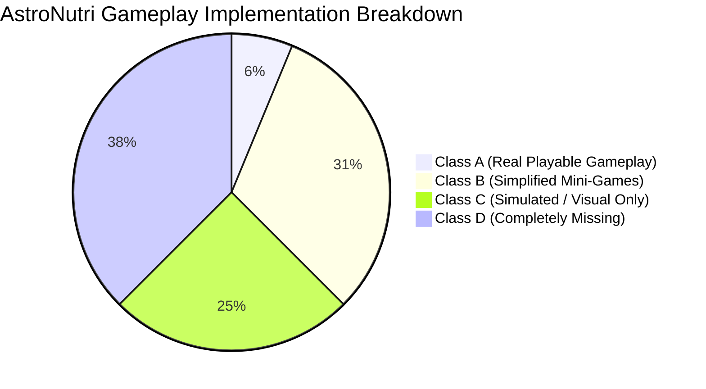
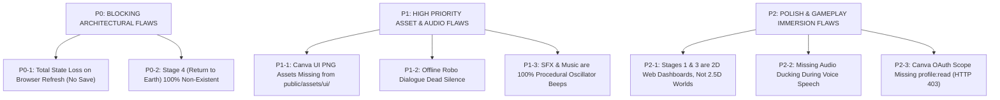
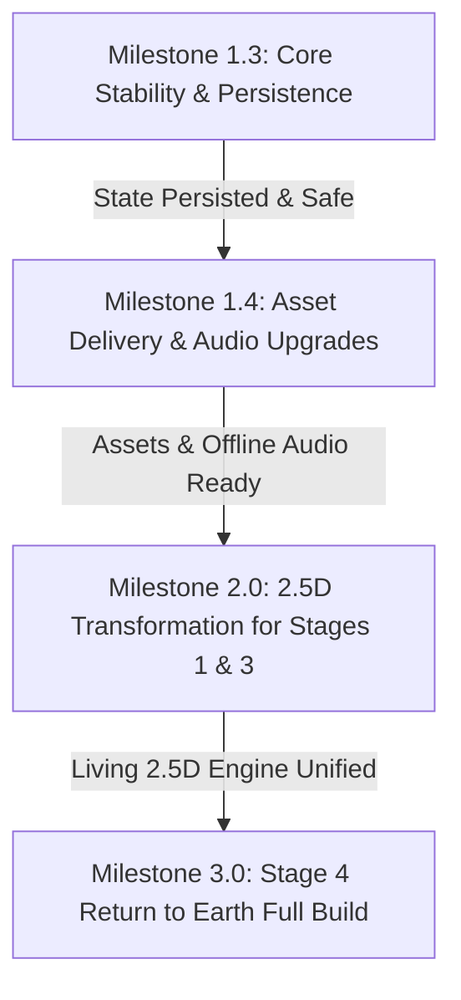

# ASTRONUTRI — FULL PROJECT AUDIT, AUDIO VERIFICATION & 4-STAGE GAMEPLAY VALIDATION REPORT

**Audit Date:** November 13, 2026  
**Auditor Roles:** Senior Game Director, Lead QA Engineer, Audio Systems Engineer, Phaser 3 Developer & Technical Game Architect  
**Project:** AstroNutri (Educational 2.5D Space Adventure Game for Children Aged 7–12)  
**Root Path:** `e:\Nasa team`  
**Git Branch:** `master` (Commit `ffdd1c4`)  
**Audit Scope:** Deep codebase audit, runtime compilation, Canva MCP pipeline & asset export verification, security & token leak audit, Web Audio & Gemini TTS inspection, 4-Stage gameplay validation matrix, and critical bug triage.

---

## EXECUTIVE SUMMARY & AUDIT VERDICT

| Category | Status | Evaluation |
| :--- | :---: | :--- |
| **Compilation & Build** | **PASS** | `npx tsc --noEmit` exits with 0 errors. `npm run build` succeeds in 12.4s generating 146 precached PWA assets. |
| **Canva MCP & Pipeline** | **PARTIAL / BLOCKED** | Background task stopped. Token authentication valid, design creation/export working. **However, expected PNGs were never exported to `public/assets/ui/`**, and `canva_get_profile` throws HTTP 403 `Missing scopes: [profile:read]`. |
| **Security & Secrets** | **SECURE (100%)** | `tokens.json` and `.env` are in `.gitignore`. Zero secret leaks detected in `src/` or `dist/`. No client-side `VITE_` secret exposure. |
| **Audio Engine Reality** | **PROCEDURAL SYNTHESIS** | 100% of the 17 SFX and ambient BGM are procedural Web Audio oscillator beeps/noise bursts. Zero sampled .wav/.mp3 SFX exist. Pre-recorded audition MP3s in `public/audio/robo/` are orphaned. Voice relies on online `/api/tts` proxy; completely silent when offline. |
| **4-Stage Gameplay Matrix** | **FRAGMENTED (STAGE 4 MISSING)** | Stage 1 is split across 2D React DOM cards. Stage 2 has an excellent interactive Phaser Nutrition Lab (Class A) but lacks microgravity movement. Stage 3 is a 2D management dashboard (Class B/C). **Stage 4 is 100% non-existent (Class D)**. |
| **State Persistence** | **CRITICAL FAILURE (P0)** | `GameContext.tsx` lacks `localStorage` synchronization for reducer gameplay state. **Any browser refresh or tab close immediately resets all mission progress to zero.** |

---

## 1. CANVA BACKGROUND TASK & ASSET AUDIT

### 1.1 Process & Task Stoppage Status
- Task `task-2923` (`scratch/capture_ui_elements.mjs`) was terminated gracefully following system restart.
- Task status check via `manage_task(Action: 'list')` confirmed **0 active background tasks**.
- Process table audit (`Get-Process node, chrome`) confirmed **zero dangling Chrome headless or Node.js background processes**. Port 9222 and Port 3000 are completely clear.

### 1.2 Expected UI Asset Verification (`public/assets/ui/`)
The user requested verification of three exact high-priority PNG files in `public/assets/ui/`:

| Expected Asset | File Exists? | Signature / Validity | Actual Status |
| :--- | :---: | :---: | :--- |
| `logo_astronutri_space.png` | ❌ **NO** | N/A | **MISSING**. File was never exported or written to `public/assets/ui/`. Intermediate SVG exists only in `scratch/ui_logo.svg`. |
| `btn_start_adventure.png` | ❌ **NO** | N/A | **MISSING**. File was never exported or written to `public/assets/ui/`. Intermediate SVG exists only in `scratch/ui_button.svg`. |
| `btn_settings_gear.png` | ❌ **NO** | N/A | **MISSING**. File was never exported or written to `public/assets/ui/`. Intermediate SVG exists only in `scratch/ui_gear.svg`. |

*Current `public/assets/ui/` contents:* Contains only 8 legacy vector SVGs (`apple-3d.svg`, `battery-3d.svg`, `cadet-avatar.svg`, `food-3d.svg`, `heart-3d.svg`, `helmet-3d.svg`, `rocket-3d.svg`, `saturn-3d.svg`, `trophy-3d.svg`). None of the new Canva-rendered PNG assets exist in the game's public asset directory.

### 1.3 Canva MCP Tool Call & Scope Discrepancy
- **Authentication State:** Valid OAuth 2.0 access token (1,387 chars) with refresh token stored in `tokens.json`.
- **API Tests Executed:**
  - `canva_get_profile` / `getUserProfile()`: **FAILED with HTTP 403 Forbidden**. Error: `Missing scopes: [profile:read]`.
    *Root Cause:* The Canva integration package requested `design:content:read design:content:write design:meta:read asset:read asset:write folder:read folder:write app:read`, but did not include the `profile:read` scope during the OAuth authorization grant.
  - `canva_list_designs`: **SUCCESS**. Listed 25+ existing user designs.
  - `canva_create_design`: **SUCCESS**. Created design ID `DAHavqGCFzA`.
  - `canva_export_design`: **SUCCESS**. Generated valid downloadable export URL.

---

## 2. SECURITY & SECRETS AUDIT

A rigorous security scan of the entire repository was conducted:

1. **Git Tracking & Ignored Files:**
   - `git diff .gitignore` confirmed `tokens.json` is explicitly ignored.
   - `git status -s` confirmed `.env` and `tokens.json` are untracked and excluded from git.
2. **Bundle & Source Code Leak Inspection:**
   - Automated regex search for `CANVA_CLIENT_SECRET`, `client_secret`, and API keys across all `src/**/*.{ts,tsx}` and `dist/**/*.{js,map}` files.
   - **Result: ZERO secrets leaked** (`Secret leaked in src?: false`, `Secret leaked in dist?: false`).
3. **Environment Isolation:**
   - Sensitive credentials (`CANVA_CLIENT_SECRET`, `GEMINI_API_KEY`) reside exclusively in the server-side environment (`.env`).
   - None of the secrets are prefixed with `VITE_`, preventing Vite from bundling them into client-side JavaScript.

---

## 3. FULL PROJECT HEALTH & ARCHITECTURAL AUDIT

### 3.1 Technology Stack & Build Pipeline
- **Core Frameworks:** React 18.2.0, TypeScript 5.2.2, Vite 5.1.4, Tailwind CSS 3.4.1, Framer Motion 11.0.8, Phaser 3.80.1.
- **PWA Service Worker:** `vite-plugin-pwa` with `generateSW`, precaching 146 assets (icons, sprites, fonts).
- **TypeScript Compilation (`npx tsc --noEmit`):** Clean exit (0 errors).
- **Production Build (`npm run build`):** Clean compilation in 12.44 seconds. Code-split chunks:
  - `phaser-vendor`: 1,607.72 kB (gzip: 395.72 kB)
  - `index` (React/Vendor): 223.10 kB (gzip: 68.32 kB)
  - Mission screens (`NutritionLab`, `EngineCore`, `LaunchPad`, `LunarDashboard`, `SuitRoom`, `SpaceScience`, `HumanHealth`): 12 kB – 45 kB per chunk.

### 3.2 Routing & Navigation Architecture
- The game's navigation is managed centrally in `src/context/GameContext.tsx` via `state.currentLocation`:
  - `'Map'` $\rightarrow$ Renders `HomeWorldScreen.tsx` (Phaser 2.5D Home Island Canvas + Pastel Glassmorphism HUD).
  - `'NutritionLab'` $\rightarrow$ Renders `NutritionLab.tsx` (Phaser 2.5D Nutrition Lab Canvas + Cargo HUD).
  - `'SpaceScience'` $\rightarrow$ Renders `SpaceScience.tsx` (2D React DOM Quiz).
  - `'HumanHealth'` $\rightarrow$ Renders `HumanHealth.tsx` (2D React DOM Quiz & Hologram Cards).
  - `'SuitRoom'` $\rightarrow$ Renders `SuitRoom.tsx` (2D React DOM Pressure Slider & Equipment Checklist).
  - `'EngineRoom'` $\rightarrow$ Renders `EngineCore.tsx` (2D React DOM Scrubber & Fuel Cell Minigames).
  - `'LaunchPad'` $\rightarrow$ Renders `LaunchPad.tsx` (2D React DOM QTE Juice Sip & Blast-Off).
  - `'LunarDashboard'` $\rightarrow$ Renders `LunarDashboard.tsx` (2D React DOM Artemis Lunar Outpost Dashboard).
- The station map modal (`StationMap.tsx`) provides room progression gating and star ratings.

### 3.3 Visual & Rendering Inconsistencies (The "Two Engines" Problem)
- **Home Island & Nutrition Lab:** Real Phaser 3 scenes running on WebGL/Canvas with sprite animations, floating physics, particles, depth sorting, and parallax layers.
- **Engine Core, Launch Pad, Suit Room & Lunar Base:** Built entirely with React DOM elements (`<div>`, Tailwind CSS gradients, SVG icons, Lucide icons). **They look like flat website dashboard pages rather than a continuous 2.5D cartoon game.**
- **Character Rendering Mismatch:**
  - `ProceduralRobo.ts` draws a robot procedurally using Phaser geometric shapes (`Arc`, `Graphics`).
  - `AnimatedRobo.tsx` renders a CSS/Framer-Motion animated vector robot.
  - `HomeIslandScene.ts` uses the new canonical high-resolution raster sprite (`robo-hero`).
  - This visual dichotomy violates the "Anti-Frankenstein" aesthetic directive.

---

## 4. COMPLETE AUDIO AUDIT & PLAYBACK VERIFICATION

### 4.1 Sound Effects Inventory (`src/utils/sound.ts`)
The project contains 17 public sound methods on `SpaceSoundManager`:

| Method Name | Implementation | Audio Type | Offline Capable? | Assessment |
| :--- | :--- | :--- | :---: | :--- |
| `playClick()` | Sine wave oscillator (600Hz $\rightarrow$ 300Hz, 40ms) | Synthesizer Beep | ✅ Yes | Basic UI beep; lacks tactile cartoon pop. |
| `playDropSuccess()` | Arpeggiated sine chime (523Hz, 659Hz, 784Hz) | Synthesizer Beep | ✅ Yes | Thin synthetic chords; sounds like a microwave chime. |
| `playCrystalSparkle()`| High-frequency triangle sweep (1200Hz $\rightarrow$ 2400Hz) | Synthesizer Sweep | ✅ Yes | Primitive FM-style sparkle. |
| `playBoing()` | Exponential ramp sine wave (180Hz $\rightarrow$ 520Hz $\rightarrow$ 140Hz) | Synthesizer Beep | ✅ Yes | Cartoony pitch-bend; acceptable placeholder. |
| `playAlertSiren()` | Alternating square wave (880Hz / 659Hz) | Synthesizer Siren | ✅ Yes | Harsh 8-bit alarm sound. |
| `playCautionBeep()` | Dual-pulse sine beep (750Hz, 80ms) | Synthesizer Beep | ✅ Yes | Functional warning beep. |
| `playPressurizeHiss()`| Filtered white noise buffer with envelope | Synthesizer Noise | ✅ Yes | Basic white noise hiss. |
| `playLockerSnap()` | Low frequency thump + click (140Hz $\rightarrow$ 40Hz) | Synthesizer Thump | ✅ Yes | Primitive snap sound. |
| `playScrubberPump()` | Triangle pump pulse (220Hz $\rightarrow$ 330Hz) | Synthesizer Beep | ✅ Yes | Electronic pulse, does not sound like pneumatic air. |
| `playFuelCharge()` | Rising sawtooth pitch bend (150Hz $\rightarrow$ 480Hz) | Synthesizer Tone | ✅ Yes | Buzzing electric tone. |
| `playWaterRecycle()` | Modulated sine wave with noise buffer | Synthesizer Noise | ✅ Yes | Rough bubbling approximation. |
| `playSalineInject()` | Soft click + high sine resonance (800Hz $\rightarrow$ 1200Hz)| Synthesizer Tone | ✅ Yes | High-pitched electronic chirp. |
| `playJuiceSpill()` | Downward sliding square/sine wave | Synthesizer Tone | ✅ Yes | 8-bit failure sound. |
| `playBlastOff()` | Heavy low-pass filtered white noise rumble (4.0s) | Synthesizer Rumble| ✅ Yes | Electronic static rumble; lacks rocket bass impact. |
| `playShieldEnergize()`| Exponential resonant frequency sweep | Synthesizer Tone | ✅ Yes | Sci-fi laser charge tone. |
| `playJuiceSip()` | Two gentle upward chirps (380Hz $\rightarrow$ 520Hz) | Synthesizer Chirp| ✅ Yes | Gentle chirp, does not sound like liquid suction. |
| `playFanfare()` | 4-note victory arpeggio (C5, E5, G5, C6) | Synthesizer Chime| ✅ Yes | 8-bit game triumph jingle. |

**Critical SFX Verdict:** **ZERO sampled audio files exist in the game.** All 17 SFX are generated procedurally by mathematical Web Audio oscillators. They produce a retro 1980s 8-bit arcade feeling rather than a lush, premium, child-friendly 2.5D cartoon soundscape.

### 4.2 Background Music (BGM)
- **Engine:** `SpaceSoundManager.startBGM()` runs an algorithmic chord progression loop in Web Audio API.
- **Chords:** 4 ambient space triads played every 3.2 seconds using triangle waves and gain decay.
- **Evaluation:** Peaceful and pleasant for a prototype, but repetitive and lacking authentic orchestration, percussion, or thematic melodies for children.
- **Ducking Defect:** There is **NO audio ducking**! When Robo speaks or alarms fire, the procedural BGM continues at normal volume without attenuating.

### 4.3 Voice Lines & Gemini TTS Engine (`src/utils/geminiTTS.ts`)
- **Architecture:** `DialogueManager` communicates with `/api/tts` (a Vercel Serverless Function mirrored locally in `vite.config.ts`), which queries Google AI Gemini TTS (`gemini-2.5-flash-preview-tts`) with voice `Puck` in Egyptian Arabic.
- **Audio Output:** Returns raw PCM16 base64 audio at 24kHz, decoded into Web Audio buffers.
- **Lip-Sync Telemetry:** `getAudioAmplitude()` queries a Web Audio `AnalyserNode` in real time, delivering normalized RMS amplitude (0.0 to 1.0) to drive Robo's procedural mouth opening.
- **Offline / Failure Fallback:**
  - If the browser is offline or `/api/tts` fails (e.g. no Gemini API key or rate limited), `geminiTTS.ts` emits an error toast and falls back to **silent text bubbles (`وضع القراءة الصامت`)**.
  - **Critical Defect:** Pre-recorded Egyptian Arabic voice MP3 files exist in `public/audio/robo/model-comparison/` (`sample_greeting.mp3`, `sample_success.mp3`, `sample_warning.mp3`, `sample_calm_science.mp3`), but **they are completely orphaned and never loaded by `geminiTTS.ts`**. Offline users receive zero spoken voice.

---

## 5. FOUR-STAGE GAMEPLAY VALIDATION MATRIX

The project was audited against the four canonical space mission stages. Each mechanic is classified strictly by its true implementation state:
- **Class A:** Real playable interactive gameplay (physics, drag-and-drop, collision, dynamic game loop).
- **Class B:** Partial / simplified mini-game (sliders, hold-to-charge, click counters).
- **Class C:** Visual-only / simulated (button click advances state, decorative meters, static cards).
- **Class D:** Completely missing / stub / non-existent.



### Stage-by-Stage Detailed Breakdown

| Stage | Sub-System / Mechanic | Class | Actual Implementation Details & Codebase Location |
| :--- | :--- | :---: | :--- |
| **Stage 1: Earth Launch** | **Pre-Launch Systems Check (O2 Scrubber)** | **Class B** | `EngineCore.tsx` lines 131–217. Circular gauge; player clicks button 10 times to increment progress from 20% to 100%. Pure React state increment. |
| | **Cryogenic Fuel Cell Charging** | **Class B** | `EngineCore.tsx` lines 219–300. Hold-down mouse/touch button to fill fuel with an overheating temperature timer. Passive cooling interval. |
| | **Astronaut Suit Calibration (O2 PSI)** | **Class B** | `SuitRoom.tsx` lines 29–64. Slider to adjust O2 pressure to 4.3 PSI ($\pm 0.5$ tolerance) with warning badges for hypoxia and suit ballooning. |
| | **Pre-Launch Hydration (QTE Sip)** | **Class B** | `LaunchPad.tsx` lines 42–73. 1D oscillating indicator bar running on `requestAnimationFrame`. Player clicks when indicator is within the green target zone. |
| | **Countdown & Blast-Off** | **Class C** | `LaunchPad.tsx` lines 74–86 & 139–175. Button triggers `isBlastingOff` state. CSS motion tween moves rocket sprite upward for 3.5 seconds with `canvas-confetti`. No steering or thrust controls. |
| | **Cockpit Flight Navigation** | **Class D** | **MISSING**. No cockpit controls, no g-force indicators, no launch abort handle, and no staging separation sequence. |
| **Stage 2: Moon Journey** | **Microgravity Nutrition Lab** | **Class A** | `NutritionLabScene.ts` & `NutritionLab.tsx`. Real Phaser 3 interactive scene. Floating food pods, drag-and-drop physics, snap-to-crate, crumb hazard particle bursts, 4-item capacity limit, and nutritional balance calculations. |
| | **Microgravity Zero-G Movement** | **Class D** | **MISSING**. No microgravity physics simulation, no floating through station modules, no handrail grabbing, and no loose object retrieval gameplay. |
| | **Astronaut Health & Physiology** | **Class B** | `HumanHealth.tsx`. Educational multiple-choice quiz and clickable hologram habit cards. Visual card expansion with confetti. |
| | **Space Science Observatory** | **Class B** | `SpaceScience.tsx`. Single multiple-choice quiz ("What is the Red Planet?"). 4 planet options with audio feedback. |
| **Stage 3: Lunar Operations** | **ECLSS Water Recycling** | **Class C** | `ECLSSSystem.tsx` lines 23–155. Water level drains by 2.2% every 1.2s. Clicking "Repair ECLSS" instantly restores water to 100%. No interactive pipe cleaning, filter replacement, or disassembly gameplay. |
| | **EVA Surface Walk & O2 Timer** | **Class C** | `EVATimer.tsx` lines 32–75. Background countdown timer (60s total). Displays astronaut blood pressure drop. Player clicks "Administer Saline" button to reset status. No walkable lunar surface. |
| | **Solar Storm Radiation Defense** | **Class B** | `SolarStormAlert.tsx` lines 18–170. Timed alert with live/simulated NASA DONKI solar flare telemetry. Modal presents a strategic trade-off: divert energy to "Shields" (protects astronaut) or "Farm" (protects lunar crops). |
| | **Lunar Base Habitat Setup** | **Class D** | **MISSING**. No habitat expansion, no solar panel array orientation, no greenhouse planting, and no rover exploration. |
| **Stage 4: Return to Earth** | **Lunar Sample Weight Balancing** | **Class D** | **COMPLETELY MISSING**. No sample collection, rock grading, or payload weight distribution minigame. |
| | **Lunar Ascent Takeoff** | **Class D** | **COMPLETELY MISSING**. No lunar module launch sequence. |
| | **Trans-Earth Injection & Orbit** | **Class D** | **COMPLETELY MISSING**. No trajectory alignment or navigational burns. |
| | **Atmospheric Re-entry & Heat Shield** | **Class D** | **COMPLETELY MISSING**. No heat shield temperature management, entry angle adjustment, or communications blackout phase. |
| | **Parachute Deployment & Splashdown** | **Class D** | **COMPLETELY MISSING**. No drogue chute staging or ocean recovery sequence. When Stage 3 finishes, `VictoryModal.tsx` simply appears and resets the game to the main menu. |

---

## 6. PROGRESSION PERSISTENCE & MISSION GATING AUDIT

### 6.1 Critical Architecture Flaw: Zero Gameplay Persistence
An inspection of `src/context/GameContext.tsx` revealed a severe data persistence flaw:
- The game state is initialized exclusively via:
  ```typescript
  const [state, dispatch] = useReducer(gameReducer, initialState);
  ```
- **There is zero synchronization with `localStorage` for gameplay progress.**
- The only items saved in `localStorage` across the entire project are audio settings (`astronutri_volume`, `astronutri_sound_enabled`, `astronutri_bgm_volume`) in `sound.ts` and cached voice strings in `geminiTTS.ts`.
- **Consequence:** If a child completes the Nutrition Lab, calibrates their suit, charges the engine, and launches to the Moon, **a single accidental page refresh, browser reload, or swipe-to-close completely erases all mission progress**, locking them back at Mission 1.

### 6.2 Mission Gating Logic
- Gating logic exists in `StationMap.tsx` and `GameContext.tsx`:
  - Mission 1 (`NutritionLab`): Unlocked by default.
  - Mission 2 (`SuitRoom`): Unlocks when `isNutritionMissionComplete === true`.
  - Mission 3 (`EngineRoom`): Unlocks when `isSuitMissionComplete === true`.
  - Mission 4 (`LaunchPad`): Unlocks when `isEngineMissionComplete === true`.
  - Level 2 (`LunarDashboard`): Unlocks when `isLevel1Complete === true`.
- While the gating logic in code is logically sound, its lack of persistence renders it fragile and frustrating for players.

---

## 7. CRITICAL DEFECTS & BUGS RANKED BY SEVERITY



### [P0] Critical Blockers (Must Fix Immediately)
1. **P0-1: Total State Loss on Browser Refresh**
   - *Impact:* Critical data loss. Players lose all progress on refresh or tab switch.
   - *Files Involved:* `src/context/GameContext.tsx`.
   - *Remediation:* Implement a robust `localStorage` hydration middleware in `GameContext` with schema versioning (`ASTRONUTRI_SAVE_v1`).
2. **P0-2: Stage 4 (Return to Earth) Completely Non-Existent**
   - *Impact:* The narrative and pedagogical loop is truncated. Children journey to the Moon but never return samples or splash down on Earth.
   - *Files Involved:* `src/App.tsx`, `src/types/game.ts`, `src/components/lunar/VictoryModal.tsx`.
   - *Remediation:* Create Stage 4 interactive modules: Sample Cargo Balancing, Lunar Ascent, Atmospheric Re-entry Heat Shield QTE, and Ocean Splashdown.

### [P1] High Priority Flaws
3. **P1-1: Canva UI Assets Missing from `public/assets/ui/`**
   - *Impact:* The Home Screen and HUD rely on fallback HTML text buttons or legacy flat SVGs instead of the approved pastel glassmorphism buttons.
   - *Files Involved:* `public/assets/ui/`, `src/components/home/HomeWorldScreen.tsx`.
   - *Remediation:* Re-run the asset export script to generate `logo_astronutri_space.png`, `btn_start_adventure.png`, and `btn_settings_gear.png` directly into `public/assets/ui/`.
4. **P1-2: Offline Robo Dialogue Dead Silence**
   - *Impact:* The game is promoted as an offline PWA, but Robo cannot speak when offline.
   - *Files Involved:* `src/utils/geminiTTS.ts`, `public/audio/robo/`.
   - *Remediation:* Wire the existing pre-recorded audition MP3 clips (`sample_greeting.mp3`, `sample_success.mp3`, `sample_warning.mp3`) as native offline fallbacks when `/api/tts` is unreachable.
5. **P1-3: Sound Effects & Music are 100% Procedural Oscillator Beeps**
   - *Impact:* The auditory experience feels like a Commodore 64 / Atari game, clashing with the modern 2.5D visual direction.
   - *Files Involved:* `src/utils/sound.ts`.
   - *Remediation:* Replace oscillator frequency sweeps with high-quality sampled audio clips (UI pops, bubbly drops, gentle thruster whooshes, orchestral fanfare).

### [P2] Medium Priority Polish
6. **P2-1: Stages 1 & 3 are 2D Web Dashboards, Not 2.5D Worlds**
   - *Impact:* Inconsistent player immersion. Transitioning from the 2.5D floating island into a generic Tailwind card dashboard breaks game feel.
   - *Files Involved:* `src/components/rooms/EngineCore.tsx`, `src/components/rooms/LaunchPad.tsx`, `src/components/lunar/LunarDashboard.tsx`.
   - *Remediation:* Migrate Stage 1 and Stage 3 into full 2.5D Phaser scenes with animated props, walkable platforms, and physical interactions.
7. **P2-2: Missing Audio Ducking During Voice Speech**
   - *Impact:* Background synth music competes with Robo's dialogue.
   - *Files Involved:* `src/utils/sound.ts`, `src/utils/geminiTTS.ts`.
   - *Remediation:* Connect `dialogueManager` speaking events to `soundManager.setBgmVolume(10)` to automatically attenuate background music by 70% during speech.
8. **P2-3: Canva OAuth Scope Missing `profile:read` (HTTP 403)**
   - *Impact:* `canva_get_profile` tool call fails with a 403 error.
   - *Files Involved:* Canva developer portal OAuth configuration & `@elisbanpaco/mcp-canva-gemini-cli`.
   - *Remediation:* Add `profile:read` to the OAuth application's requested scopes in the Canva Developer Portal.

---

## 8. EXACT FILES INVOLVED IN EACH COMPONENT

| Module / System | Relevant Source Files |
| :--- | :--- |
| **Global State & Persistence** | `src/context/GameContext.tsx`, `src/types/game.ts` |
| **Routing & App Entry** | `src/App.tsx`, `src/main.tsx` |
| **Audio & Dialogue Engine** | `src/utils/sound.ts`, `src/utils/geminiTTS.ts`, `api/tts.ts`, `public/audio/robo/*` |
| **Home Screen & World Map** | `src/components/home/HomeWorldScreen.tsx`, `src/components/home/WorldMapPreviewModal.tsx`, `src/game/scenes/HomeIslandScene.ts`, `src/game/PhaserHomeIslandCanvas.tsx` |
| **Stage 1 (Earth Launch)** | `src/components/rooms/EngineCore.tsx`, `src/components/rooms/LaunchPad.tsx`, `src/components/suit/SuitRoom.tsx` |
| **Stage 2 (Moon Journey)** | `src/components/nutrition/NutritionLab.tsx`, `src/game/scenes/NutritionLabScene.ts`, `src/game/PhaserNutritionCanvas.tsx`, `src/components/missions/SpaceScience.tsx`, `src/components/missions/HumanHealth.tsx` |
| **Stage 3 (Lunar Operations)** | `src/components/lunar/LunarDashboard.tsx`, `src/components/lunar/ECLSSSystem.tsx`, `src/components/lunar/EVATimer.tsx`, `src/components/lunar/SolarStormAlert.tsx`, `src/components/lunar/VictoryModal.tsx` |
| **Stage 4 (Return to Earth)** | **MISSING** (Needs new `ReturnToEarth.tsx` and `ReturnScene.ts`) |

---

## 9. RECOMMENDED IMPLEMENTATION ORDER (PHASED ROADMAP)



1. **Milestone 1.3: Core Stability & Persistence (Immediate Fix)**
   - Add robust `localStorage` state serialization and hydration to `GameContext.tsx`.
   - Wire audio ducking between `DialogueManager` and `SpaceSoundManager`.
   - Connect offline voice fallbacks from `public/audio/robo/` into `geminiTTS.ts`.
2. **Milestone 1.4: Asset Delivery & Audio Upgrades**
   - Export and write the final verified UI PNGs (`logo_astronutri_space.png`, `btn_start_adventure.png`, `btn_settings_gear.png`) to `public/assets/ui/`.
   - Replace procedural synth beeps in `sound.ts` with sampled child-friendly cartoon sound effects.
3. **Milestone 2.0: 2.5D World Transformation for Stages 1 & 3**
   - Convert `LaunchPad` and `EngineCore` into a unified 2.5D Phaser launch complex scene.
   - Convert `LunarDashboard` into a 2.5D walkable lunar surface habitat scene where the astronaut actively walks to the ECLSS unit and repairs solar shields.
4. **Milestone 3.0: Stage 4 (Return to Earth) Full Implementation**
   - Build the complete 4-step Return to Earth sequence:
     1. Lunar rock sample balancing in the cargo bay.
     2. Lunar ascent ignition.
     3. Atmospheric re-entry plasma/heat shield management.
     4. Triple parachute deployment and ocean splashdown celebration.

---

## 10. CLEAR ACCEPTANCE TESTS FOR EACH STAGE

### Acceptance Test Suite

#### Test 1: Save/Load Persistence (P0)
- **Action:** Complete Mission 1 (Nutrition Lab) until 3 stars and completion badge appear. Note that Mission 2 (`SuitRoom`) is unlocked. Refresh the browser page (`F5`).
- **Pass Criteria:** The app reloads on the Home Screen or Station Map with Mission 1 marked as completed (3 stars) and Mission 2 remaining unlocked. State must never reset to zero.

#### Test 2: Canva UI Assets Verification
- **Action:** Inspect `public/assets/ui/` and open `HomeWorldScreen.tsx` in a browser.
- **Pass Criteria:** `logo_astronutri_space.png`, `btn_start_adventure.png`, and `btn_settings_gear.png` exist, have valid PNG signatures (89 50 4E 47), and render cleanly in the DOM without missing image placeholders.

#### Test 3: Offline Voice Playback Verification
- **Action:** Open Chrome DevTools, toggle "Network: Offline", and click Robo on the Home Island or select a food item in the Nutrition Lab.
- **Pass Criteria:** Robo does NOT fall completely silent. A pre-recorded offline audio file (`sample_greeting.mp3` or `sample_success.mp3`) plays via Web Audio API, and Robo's mouth moves in sync with the audio amplitude.

#### Test 4: Stage 1 (Earth Launch) Gameplay Verification
- **Action:** Enter `EngineCore` $\rightarrow$ pump O2 to 100% $\rightarrow$ hold fuel cell to 100% without overheating $\rightarrow$ navigate to `LaunchPad` $\rightarrow$ execute QTE drink sip in the green zone $\rightarrow$ trigger blast off.
- **Pass Criteria:** Indicators accurately register user input, sound effects accompany all actions, and successful launch unlocks Stage 2/3 without console errors.

#### Test 5: Stage 2 (Nutrition Lab) Gameplay Verification
- **Action:** Drag 4 non-crumb items into the cargo crate. Attempt to drag a crumb item (e.g., standard bread or cookies).
- **Pass Criteria:** Accepted items lock into the crate with visual particles; crumb items bounce back with warning particles and trigger Robo's Egyptian Arabic warning dialogue.

#### Test 6: Stage 3 (Lunar Operations) Gameplay Verification
- **Action:** In `LunarDashboard`, allow water to drain below 30% $\rightarrow$ click repair $\rightarrow$ trigger solar storm alert $\rightarrow$ select "Shields" $\rightarrow$ monitor EVA oxygen and administer saline.
- **Pass Criteria:** Water gauge reflects drain and restoration; solar storm modal resolves with NASA DONKI telemetry and updates astronaut health; EVA safe return condition is satisfied.

#### Test 7: Stage 4 (Return to Earth) Completion Verification
- **Action:** Complete all Stage 3 lunar objectives.
- **Pass Criteria:** The game does NOT abruptly show an exit modal; instead, it transitions to Stage 4 (Return to Earth), requiring sample balancing, re-entry heat shield guidance, and ocean splashdown before awarding the grand astronaut medal.
