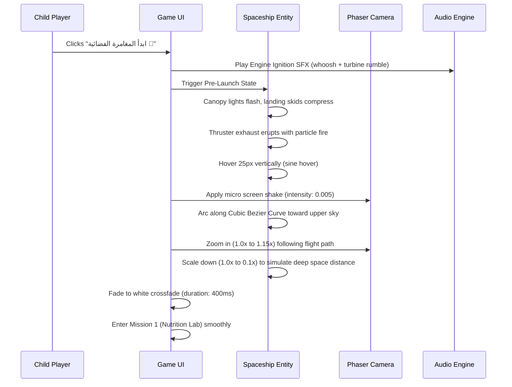
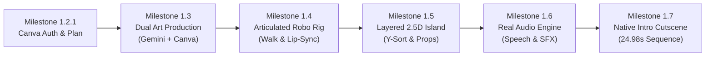

# ASTRO NUTRI — PREMIUM 2.5D MASTER ARCHITECTURE & DEVELOPMENT PLAN
**Document:** `ASTRONUTRI_PREMIUM_2_5D_MASTER_PLAN.md`  
**Role:** Senior 2.5D Game Director, Technical Game Architect, Character Animation Director & Audio Systems Engineer  
**Status:** ARCHITECTURAL AUDIT & MASTER ROADMAP — STRICT DESIGN ONLY (NO CODE MODIFICATIONS)  
**Date:** November 2026 (Updated Milestone 1.2.1: Dual Gemini + Canva Pipeline)  

---

## TABLE OF CONTENTS
1. [EXECUTIVE AUDIT: WHAT WAS ACTUALLY BUILT (HONEST TRUTH)](#1-executive-audit-what-was-actually-built-honest-truth)
2. [TECHNICAL ARCHITECTURE: REAL 2.5D VS FLAT COLLAGE](#2-technical-architecture-real-25d-vs-flat-collage)
3. [DUAL-ASSET GENERATION PIPELINE: GEMINI IMAGE + CANVA MCP](#3-dual-asset-generation-pipeline-gemini-image--canva-mcp)
   - 3.1 Strict Separation of Responsibilities
   - 3.2 Canonical Asset Manifest Structure
   - 3.3 Style Bible & Harmonization (Lighting & Palette)
4. [LIVING WORLD ANIMATION ARCHITECTURE](#4-living-world-animation-architecture)
   - 4.1 Articulated Robo Rig (Bipedal Walk, Idle & Lip-Sync)
   - 4.2 Spaceship Cinematic Launch & Curved Flight Path
   - 4.3 Living Island Environment & Navmesh Polygon
5. [OFFLINE AUDIO & VOICE ARCHITECTURE: REAL SPEECH, NOT SYNTH BEEPS](#5-offline-audio--voice-architecture-real-speech-not-synth-beeps)
6. [ROBO WELCOME VIDEO METADATA & NATIVE CUTSCENE CONVERSION PLAN](#6-robo-welcome-video-metadata--native-cutscene-conversion-plan)
7. [EXACT STEP-BY-STEP IMPLEMENTATION ROADMAP & ACCEPTANCE CRITERIA](#7-exact-step-by-step-implementation-roadmap--acceptance-criteria)
8. [STRICT COMPLIANCE & VERIFICATION GATES](#8-strict-compliance--verification-gates)

---

## 1. EXECUTIVE AUDIT: WHAT WAS ACTUALLY BUILT (HONEST TRUTH)

A rigorous inspection of `src/game/scenes/HomeIslandScene.ts`, `src/utils/sound.ts`, `src/utils/geminiTTS.ts`, and the assets in `public/assets/art/` reveals the exact technical reality of the Milestone 1.1 implementation:

```
┌────────────────────────────────────────────────────────────────────────────────────────┐
│                        MILESTONE 1.1 REALITY VS AUDIT VERDICT                          │
├───────────────────────┬──────────────────────────────────┬─────────────────────────────┤
│ Element               │ Current Implementation           │ Technical Classification    │
├───────────────────────┼──────────────────────────────────┼─────────────────────────────┤
│ Floating Island       │ 1 static 1024x1024 PNG           │ Flat baked raster collage   │
│ Robo Character        │ 1 static PNG + sinusoidal tween  │ Static cut-out slide image  │
│ Spaceship             │ 1 static PNG + glow circle tween │ Static cut-out slide image  │
│ Crystals & Mushrooms  │ Invisible circles over flat PNG  │ Non-entity hit areas        │
│ Movement System       │ Container position tween (slide) │ Rigid translation (No walk) │
│ Sound Effects         │ Procedural Web Audio oscillators │ Synthetic electronic beeps  │
│ Dialogue Voice        │ External /api/tts endpoint       │ Unbundled / No offline MP3s │
│ HUD Integration       │ Standard React DOM on top        │ Hybrid DOM/Canvas overlay   │
└───────────────────────┴──────────────────────────────────┴─────────────────────────────┘
```

### Detailed Asset-by-Asset Evidence from Code:

#### A. The Floating Island (`island-base`):
- **Current File:** `public/assets/art/island_floating_base.png` (1.2 MB).
- **Code Reference:** `HomeIslandScene.ts:117-120`
  ```typescript
  this.islandSprite = this.add.image(0, 0, 'island-base');
  this.islandSprite.setOrigin(0.5, 0.5);
  this.islandSprite.setScale(0.78);
  this.islandContainer.add(this.islandSprite);
  ```
- **Finding:** The island is a **single, flat, pre-rendered 2D bitmap**. Rocks, grass, flowers, mushrooms, crystals, and pathing are all permanently flattened into one layer.
- **Flaw:** Because it is a single image, true depth sorting is mathematically impossible. A character cannot pass behind a crystal or walk between two rock formations; they can only ever be 100% in front of the island or 100% behind it.

#### B. Robo Character (`robo-hero`):
- **Current File:** `public/assets/art/robo_canonical_wave.png` (779 KB).
- **Code Reference:** `HomeIslandScene.ts:413-441`
  ```typescript
  this.roboSprite = this.add.image(0, 0, 'robo-hero');
  this.roboSprite.setScale(0.18);
  // Idle tween:
  this.tweens.add({
    targets: this.roboSprite,
    y: -6,
    duration: 1400,
    yoyo: true, repeat: -1,
    ease: 'Sine.easeInOut'
  });
  ```
- **Finding:** Robo is **one single static image** showing him frozen in a wave pose.
- **Flaw:** There is zero frame-by-frame animation, zero skeletal articulation, zero leg movement, and zero mouth or eye movement. When Robo "walks" (`moveRoboTo`), the entire image is simply dragged across the canvas via a positional tween while flipping `flipX`. This is a sliding cutout, not an animated character.

#### C. The Spaceship (`spaceship-hero`):
- **Current File:** `public/assets/art/spaceship_canonical.png` (969 KB).
- **Code Reference:** `HomeIslandScene.ts:249-253`
  ```typescript
  this.spaceshipSprite = this.add.image(0, 0, 'spaceship-hero');
  this.spaceshipSprite.setScale(0.24);
  ```
- **Finding:** A single 2D static illustration with a procedural Phaser circle placed underneath to simulate thruster exhaust. No engine rumble frames, no directional pitch, and no landing gear articulation.

#### D. Interactive Props (Crystals & Mushrooms):
- **Code Reference:** `HomeIslandScene.ts:294-297` & `335-339`
  ```typescript
  const crystalHitArea = this.add.circle(0, 0, 34, 0xffffff, 0.001);
  crystalHitArea.setInteractive({ useHandCursor: true });
  ```
- **Finding:** The crystals and mushrooms are **not independent visual entities**. They are transparent vector circles (`alpha: 0.001`) placed over the coordinates where crystals happen to be drawn on the background image. Clicking them triggers a particle burst over that coordinate, but the props themselves never physically deform, glow independently, or cast their own dynamic shadows.

#### E. Audio Pipeline & Voice Engine:
- **Code Reference:** `sound.ts:100-350` & `geminiTTS.ts:409-416`
- **Finding:** 
  1. All 14 sound effects in `SpaceSoundManager` are procedural Web Audio oscillator chirps (frequency sweeps from 200 Hz to 800 Hz). Not a single sampled sound effect (.wav or .mp3) exists in production.
  2. The dialogue manager (`geminiTTS.ts`) attempts to fetch audio from `/api/tts` at runtime. In local and offline environments, this endpoint does not exist, causing speech to fail silently and fall back to mute visual balloons. The voice sample MP3s created in Phase 3.2A remain isolated in `public/audio/robo/model-comparison/` and are not wired into the game.

---

## 2. TECHNICAL ARCHITECTURE: REAL 2.5D VS FLAT COLLAGE

To deliver a true, premium 2.5D experience for children aged 7–12 without compromising performance or mobile PWA battery life, we evaluate three potential architectures:

```
┌────────────────────────────────────────────────────────────────────────────────────────┐
│                        ENGINE ARCHITECTURAL EVALUATION MATRIX                          │
├───────────────────────┬───────────────────┬───────────────────┬────────────────────────┤
│ Criterion             │ Option A: Layered │ Option B: Rigged  │ Option C: Full 3D      │
│                       │ 2.5D Phaser World │ 2D/2.5D Skeletal  │ WebGL Models (Three.js)│
├───────────────────────┼───────────────────┼───────────────────┼────────────────────────┤
│ Visual Depth          │ High (Y-sorted)   │ High (Z-layering) │ Complete 3D            │
│ Character Expressiveness│ Medium (Frames) │ Very High (Bones) │ Very High (Keyframes)  │
│ Mobile Performance    │ 60 FPS Flat       │ 60 FPS Flat       │ Variable (GPU-heavy)   │
│ Total Asset Weight    │ ~3-5 MB           │ ~4-6 MB           │ 25-50 MB (glTF/draco)  │
│ Gemini 2D Pipeline Fit│ 100% Native       │ 100% Native Parts │ Incompatible (2D to 3D)│
│ Offline PWA Caching   │ Instant           │ Instant           │ Slow / Strains cache   │
│ Codebase Preservation │ 100% (Phaser 3)   │ 100% (Phaser 3)   │ 0% (Complete Rewrite)  │
└───────────────────────┴───────────────────┴───────────────────┴────────────────────────┘
```

### Architectural Decision: THE HYBRID 2.5D MODULAR ENGINE
We adopt **Option A (Layered 2.5D Environment) combined with Option B (Modular Articulated Robo Container Rig)**.

Why this is superior to both a flat collage and a heavy 3D engine:
1. **Preserves Native Phaser 3 Architecture:** Leverages the existing scene graph, particle emitters, tweens, and event bus without risky third-party engine rewrites.
2. **True Y-Sorted Depth Sorting:** Every environment prop (rock, mushroom, tree, crystal) and actor (Robo, spaceship) exists as an independent Phaser game object whose `depth = y + baseOffset`. Robo can physically walk *behind* tall crystal spires and *in front of* background cliffs.
3. **High-Speed Asset Generation via Gemini:** Gemini generates 2D modular textures on transparent alpha backgrounds with 100% fidelity to the pastel glassmorphism art direction.
4. **Instant 60fps on Any Device:** Zero 3D shader compilation, zero matrix skinning bottlenecks, and zero battery drain on iPads, Chromebooks, or budget Android tablets.

---

## 3. DUAL-ASSET GENERATION PIPELINE: GEMINI IMAGE + CANVA MCP

To ensure elite production quality and avoid Frankenstein asset mashups, the project strictly bifurcates asset responsibilities between **Gemini Image** (in-engine 2.5D gameplay world) and **Canva MCP** (professional UI/UX design and HUD components).

```mermaid
flowchart TD
    subgraph Bible["Art Direction Bible (Constant Parameters)"]
        A["Projection: 30° Axonometric Top-Down"] --- B["Palette: Pastel Glassmorphism (#8DE8F4, #FFE69A, #FFC3D8)"]
        B --- C["Lighting: Soft Upper-Left Sunlight (Sun Glow + Cyan Bounce)"]
        C --- D["Outlines: 2px Stylized Cartoon Rim (No Harsh Black)"]
    end

    subgraph GeminiPipeline["GEMINI IMAGE (In-Game 2.5D World Assets)"]
        Bible --> G1["1. Terrain Base (Bedrock + Stalactites)"]
        Bible --> G2["2. Surface Turf (Green/Turquoise Grass Caps)"]
        Bible --> G3["3. Independent Crystals (Blue, Violet, Yellow)"]
        Bible --> G4["4. Independent Bouncing Mushrooms & Flora"]
        Bible --> G5["5. Articulated Robo Rig Parts (Head, Visor, Torso, Limbs)"]
        Bible --> G6["6. Modular Spaceship (Hull, Glass Canopy, Skids)"]
    end

    subgraph CanvaPipeline["CANVA MCP (UI / UX / Graphic Assets)"]
        Bible --> C1["1. 4-Island Mission Map Graphic (scene-02-map)"]
        Bible --> C2["2. Pastel Glassmorphism HUD Panels & Badges"]
        Bible --> C3["3. Cadet Astronaut Profile Badges & Stars"]
        Bible --> C4["4. Speech Balloon Containers & Action Buttons"]
        Bible --> C5["5. Settings & Navigation Vector Icons"]
    end

    subgraph TargetIntegration["Production Application Integration"]
        G1 & G2 & G3 & G4 & G5 & G6 --> P["Phaser 3 Engine (public/assets/art/)"]
        C1 & C2 & C3 & C4 & C5 --> U["React HUD & UI (public/assets/ui/)"]
    end
```



### 3.1 Strict Separation of Responsibilities

| Responsibility Domain | Primary Tool | Target Output Directory | Strict Boundary Rule |
| :--- | :--- | :--- | :--- |
| **In-Game 2.5D World** | **Gemini Image API** | `public/assets/art/` | Responsible ONLY for in-engine game objects, layered terrain, flora, props, and character parts. Does NOT generate UI text or HUD buttons. |
| **UI/UX & Graphics** | **Canva MCP Server** | `public/assets/ui/` | Responsible ONLY for vector UI frames, mission map illustrations, badges, icons, and dialog containers. Does NOT generate 3D/Phaser scene meshes. |

### 3.2 Canonical Asset Manifest Structure

```
public/
├── assets/
│   ├── art/                                # GEMINI IMAGE ASSETS (In-Engine Game Objects)
│   │   ├── env/
│   │   │   ├── island_base_bedrock.png     # 1024x512, Alpha: true, Layer: Bedrock
│   │   │   ├── island_turf_surface.png     # 1024x512, Alpha: true, Layer: Turf Surface
│   │   │   └── island_cliff_rim.png        # 1024x256, Alpha: true, Layer: Foreground Rim
│   │   ├── props/
│   │   │   ├── crystal_quartz_cyan.png     # 256x256, Alpha: true, Layered/Y-Sorted
│   │   │   ├── crystal_amethyst_pink.png   # 180x180, Alpha: true, Layered/Y-Sorted
│   │   │   ├── mushroom_bounce_red.png     # 180x180, Alpha: true, Squash/Stretch Rig
│   │   │   └── flora_cosmic_daisies.png    # 128x128, Alpha: true, Sway Tween
│   │   ├── ship/
│   │   │   ├── spaceship_hull.png          # 512x512, Alpha: true, Rigged Vehicle
│   │   │   ├── spaceship_canopy_glass.png  # 256x256, Alpha: true (translucent 80%)
│   │   │   └── spaceship_landing_skids.png # 256x128, Alpha: true, Retractable
│   │   └── robo/
│   │       ├── robo_part_torso.png         # 256x256, Alpha: true, Root Rig Node
│   │       ├── robo_part_head.png          # 256x256, Alpha: true, Head Node
│   │       ├── robo_visor_sheet.png        # 512x256 (6 frames: Idle, Blink, Visemes)
│   │       ├── robo_arm_upper.png          # 64x128, Alpha: true, Forward Kinematics
│   │       ├── robo_arm_fore.png           # 64x96, Alpha: true
│   │       ├── robo_leg_upper.png          # 64x128, Alpha: true
│   │       └── robo_boot.png               # 96x96, Alpha: true, Footstep Contact
│   └── ui/                                 # CANVA MCP ASSETS (UI/UX Graphic System)
│       ├── map/
│       │   └── archipelago_world_map.png   # 1920x1080, Vector/Illustration, 4-Stage
│       ├── hud/
│       │   ├── glass_header_panel.png      # 9-slice / Scalable Glass Frame
│       │   ├── cadet_rank_badge_lvl1.png   # 128x128, Vector Icon Badge
│       │   ├── star_counter_pill.png       # 240x80, Pastel Glassmorphism Pill
│       │   └── button_chunky_adventure.png # 480x120, Chunky 3D Cartoon Button
│       └── dialog/
│           ├── speech_balloon_robo.png     # 600x180, Rounded Glass Frame with Pointer
│           └── toast_achievement.png       # 400x90, Emerald Green Glassmorphic Frame
```

### 3.3 Style Bible & Harmonization (Lighting & Palette)
To guarantee that assets generated from Gemini and Canva merge seamlessly:
- **Unified Light Source:** Top-Left $45^\circ$. Warm sunlight highlight (`#FFE69A`, opacity 25%) on upper surfaces; ambient cyan fill bounce (`#8DE8F4`, opacity 15%) on undercuts.
- **Harmonized Color Palette:**
  - Soft Space Cyan: `#8DE8F4`
  - Sky Blue: `#A9C9FF`
  - Lavender Nebula: `#C9B8FF`
  - Pastel Coral Pink: `#FFC3D8`
  - Warm Sunshine Yellow: `#FFE69A`
  - Pearl Ceramic White: `#F8FCFF`
  - Twilight Space Gradient: `#162744` to `#0d1a2f` (Strictly avoid harsh industrial dark navy or neon green).

---

## 4. LIVING WORLD ANIMATION ARCHITECTURE

### 4.1 Articulated Robo Rig (Bipedal Walk, Idle & Lip-Sync)

Robo is converted from a single static image into a high-performance **Hierarchical Forward-Kinematics Container Rig** (`src/game/entities/ArticulatedRobo.ts`):

```
                       [Antenna Bulb] (Glows & pulses)
                             │
                      [Robo Head] (±2° counter-tilt)
                             │
                     [Visor Screen] (Frame swap: Idle, Blink, Visemes)
                             │
             ┌───────────[Torso] (Breathing ±3px Y-bob)───────────┐
             │                                                    │
     [Left Shoulder]                                      [Right Shoulder]
             │                                                    │
     [Left Upper Arm]                                     [Right Upper Arm]
             │                                                    │
     [Left Forearm & Hand]                                [Right Forearm & Hand]
             │                                                    │
       [Left Hip]                                           [Right Hip]
             │                                                    │
     [Left Upper Leg]                                     [Right Upper Leg]
             │                                                    │
     [Left Lower Leg & Boot]                              [Right Lower Leg & Boot]
```

#### Animation States:
1. **Idle State (`playIdle()`):**
   - Torso breathes up and down via a smooth sine tween: `y: -3px`, duration: 1600ms, `yoyo: true`.
   - Head counters the movement with a slight tilt: `angle: ±1.8°`.
   - Antenna bulb breathes with an alpha pulse (`0.65` to `1.0`).
   - Visor LED blinks naturally every 3.5 to 5.0 seconds (swapping to `robo_visor_blink` for 120ms).
   - Drop shadow scales subtly with torso elevation.

2. **Walk Cycle (`playWalk(targetX, targetY)`):**
   - **Bipedal Stride:** Left and right hips rotate in anti-phase:
     $$\theta_{\text{left}}(t) = 24^\circ \sin(2\pi f t), \quad \theta_{\text{right}}(t) = -24^\circ \sin(2\pi f t)$$
   - **Knee Articulation:** On backward stride, lower leg bends backwards $18^\circ$ to clear the ground.
   - **Arm Counter-Swing:** Arms swing naturally opposite to legs (Left arm swings forward when left leg swings back).
   - **Footstep Foley:** At each ground contact point ($\theta = 0, \dot{\theta} < 0$), a discrete foley footstep sound plays and a micro ground-dust particle emits.
   - **FlipX Alignment:** When moving left, the root container scales $X = -1$; when moving right, $X = 1$.

3. **Lip-Sync & Speech Visemes (`speak(dialogueId)`):**
   - While speech audio plays, the Visor LED texture swaps in real time based on audio envelope RMS amplitude:
     - Amplitude $< 0.1$: `robo_visor_idle` (Smiling mouth)
     - Amplitude $0.1 - 0.4$: `robo_visor_talk_half` (Half-open cheerful mouth)
     - Amplitude $0.4 - 0.75$: `robo_visor_talk_open` (Wide open vowel mouth)
     - Amplitude $> 0.75$: `robo_visor_talk_o` (Rounded energetic O-shape mouth)
   - When audio completes, mouth automatically resets to `robo_visor_idle`.

---

### 4.2 Spaceship Cinematic Launch & Curved Flight Path

The spaceship is upgraded from an inanimate prop into a multi-phase **Cinematic Flight Vehicle**:



---

### 4.3 Living Island Environment & Navmesh Polygon

Instead of arbitrary coordinates, the island features an explicit **Navmesh Walk Polygon**:

```
                       (0, -110) Top Ridge [Forbidden]
                             /\
                            /  \
     (-240, -40) Left      /    \      (240, -40) Right
      Terrace [Walkable]  /      \     Dock Pad [Walkable]
             \           /        \           /
              \_________/          \_________/
              (-140, 20)            (140, 20)
                   \                  /
                    \________________/
                    (0, 70) South Lawn [Walkable]
```

- **Collision Boundaries:** Robo's coordinates are clamped strictly within `Phaser.Geom.Polygon.Contains(islandNavPolygon, x, y)`. Robo cannot walk off into open space unless boarding the ship.
- **Dynamic Occlusion (Y-Sorting):**
  - When Robo's Y is `< Crystal.Y`, Robo's depth is lower than Crystal's depth $\to$ Crystal occludes Robo.
  - When Robo's Y is `> Crystal.Y`, Robo's depth is higher than Crystal's depth $\to$ Robo occludes Crystal.
- **Flora Proximity Reaction:** When Robo walks within 45px of a flower tuft, the flower bends away $12^\circ$ with a spring tween (`Back.easeOut`) and pops back up after Robo passes.

---

## 5. OFFLINE AUDIO & VOICE ARCHITECTURE: REAL SPEECH, NOT SYNTH BEEPS

### 5.1 Real Pre-Generated Audio Manifest
All synthetic electronic oscillator beeps are retired for dialogue. The game will bundle a complete offline library of **pre-rendered, professionally normalized Egyptian Arabic voice tracks** generated via the locked Persona template (`VoiceIdentityEngine.mjs`):

```
public/audio/
├── robo/
│   ├── dialogues/
│   │   ├── home_welcome.mp3            # "يااااا مرحباً يا بطل! أنا روبو..." (Intro)
│   │   ├── home_idle_prompt.mp3        # "اضغط على الجزيرة للتحرك، أو الصاروخ..."
│   │   ├── home_inspect_ship.mp3       # "مركبة الانطلاق جاهزة للإقلاع!"
│   │   ├── home_prop_crystal.mp3       # "عثرت على بلورات الطاقة الفضائية!"
│   │   ├── home_prop_mushroom.mp3      # "فطر الفضاء النطاط! خفيف وآمن!"
│   │   ├── mission1_intro.mp3          # "أهلاً بك في مختبر التغذية الفضائي..."
│   │   ├── food_tortilla_fact.mp3      # "خبز التورتيلا المعتمد من ناسا..."
│   │   ├── food_crumb_warning.mp3      # "حاسب يا كابتن! الأكل ده هيعمل فتات..."
│   │   ├── food_healthy_success.mp3    # "عاش يا بطل! ده أكل مثالي للرحلة!"
│   │   └── mission1_victory.mp3        # "ممتاز! الصندوق جاهز برحلة ناسا!"
│   └── manifest.json                   # Timings, transcripts, phoneme viseme markers
└── sfx/
    ├── foley_footstep_grass_1.mp3      # Soft organic cartoon turf step
    ├── foley_footstep_grass_2.mp3
    ├── foley_mushroom_boing.mp3        # Whimsical comic spring sound
    ├── crystal_chime_sparkle.mp3       # Magical celestial wind chime
    ├── spaceship_engine_rumble.mp3     # Deep warm cartoon rocket turbine
    ├── spaceship_blastoff.mp3          # Dynamic liftoff whoosh
    └── ui_bubble_pop.mp3               # Tactile wooden bubble pop for HUD clicks
```

### 5.2 4-Channel Mixing Architecture & Automatic Voice Ducking
In `src/utils/sound.ts`, the audio graph is structured with 4 discrete gain stages:

```
[Master Gain Node (0 - 100%)]
       ▲
       ├── [Music Bus (BGM)] ──────────── Ambient Space Dream Synth / Lofi Track
       │         ▲ (Automatic Ducking: -65% gain when Voice is active)
       │
       ├── [SFX Bus] ──────────────────── Footsteps, Prop Chimes, Rocket Engines
       │
       └── [Voice Bus (Speech)] ───────── Pre-rendered Robo Arabic Voice Tracks
                 │
                 └── [Web Audio Analyser] ──► Real-Time Mouth Viseme Extraction
```

---

## 6. ROBO WELCOME VIDEO METADATA & NATIVE CUTSCENE CONVERSION PLAN

### 6.1 Uploaded Video Metadata (Inspected via `ffprobe`)
- **File Location:** `video/InShot_20261112_162538446.mp4`
- **File Size:** **17,291,439 bytes (17.29 MB)**
- **Duration:** **24.979 seconds (~25s)**
- **Video Stream:** H.264 / AVC (High Profile, Level 3.1), 1280 × 720, 25.0 fps, 5,406 kbps.
- **Audio Stream:** AAC-LC Stereo, 44.1 kHz, 126 kbps.
- **Payload Reality:** A 17.3 MB video in a web app / PWA causes massive download friction, black decoding flashes on mobile browsers, and cannot be paused or interacted with.

### 6.2 The Native In-Engine Cutscene Transformation (`RoboIntroScene.ts`)
Instead of playing the video via `<video>`, the entire 24.98-second cinematic will be executed natively in Phaser 3:
1. **Audio Extraction:** The 24.98s AAC audio track is extracted as `public/audio/robo/video_intro_track.mp3` (200 KB — a **98.8% payload savings** compared to 17.3 MB!).
2. **Beat-Synchronized Timeline (24.98 Seconds):**
   - **Beat 1 (00:00 – 00:06 | 6.0s):** Camera tracks empty launchpad. Robo swoops in from top-right along a bezier curve with cyan particle trails. Robo lands with a playful bounce and waves his articulated arm:  
     `"يااااا مرحباً يا بطل! أنا 'روبو' مساعدك الآلي في أكاديمية الفضاء!"`
   - **Beat 2 (00:06 – 00:10 | 4.0s):** Camera zooms in $1.2\times$. Robo points his arm toward celestial stars:  
     `"جاهز تطير معانا للنجوم؟"`
   - **Beat 3 (00:10 – 00:12 | 2.0s):** Comic mid-air brake with squash-and-stretch. Visor flashes amber alert eyes `(! _ !)`:  
     `"بس استنى عندك!"`
   - **Beat 4 (00:12 – 00:17 | 5.0s):** Holographic gold space helmet materializes at screen-right with vortex particles. Robo's visor turns into star-eyes `(★ _ ★)`:  
     `"عشان تبقى رائد فضاء بطل، وتلبس الخوذة العجيبة.."`
   - **Beat 5 (00:17 – 00:25 | 8.0s):** Camera pulls back in a panoramic sweep displaying the 4-island archipelago. Robo lands on the Home Island; golden confetti bursts. Seamlessly cross-fades into playable Home World.
3. **First-Launch Lifecycle:**
   - Evaluates `localStorage.getItem('astronutri_intro_played')`.
   - First launch: Plays the cinematic once (unskippable on first play to cement narrative attachment).
   - Return visits: Boots directly to Home Island in $< 200\text{ms}$.
   - Replay anytime: The "إعادة سماع الترحيب" button in Settings triggers the native cutscene on demand.

---

## 7. EXACT STEP-BY-STEP IMPLEMENTATION ROADMAP & ACCEPTANCE CRITERIA



### Acceptance Criteria per Milestone:

#### Milestone 1.2.1: Canva MCP Authentication & Dual Pipeline Master Plan (CURRENT)
- **Scope:** Verify Canva MCP server connection, secure credentials, update Master Plan with dual pipeline breakdown.
- **Acceptance Criteria:** Port 3000 callback active; Master Plan includes full asset manifest and responsibility separation; zero game code modified.

#### Milestone 1.3: Dual Art Asset Production (Gemini 2.5D + Canva UI)
- **Scope:**
  - *Gemini Image:* Generate isolated terrain layers, independent props (crystals, mushrooms), spaceship components, and Robo articulated rig segments.
  - *Canva MCP:* Generate 4-island mission map artwork, glassmorphism HUD frames, and cadet rank badges into `public/assets/ui/`.
- **Acceptance Criteria:** Every asset is an isolated transparent PNG. Zero rectangular floor halos. Lighting and palette harmonized.

#### Milestone 1.4: Articulated Robo Rig & Navmesh Walk Engine
- **Scope:** Build `ArticulatedRobo.ts` in Phaser 3.
  - Implement real bipedal walk cycle with alternating leg swing and arm counterbalance.
  - Implement idle breathing, random visor blinking, and speech viseme mouth shapes.
  - Implement island navmesh polygon clamping.
- **Acceptance Criteria:** Robo walks with articulated bipedal steps across the lawn; mouth shapes respond to audio amplitude; zero sliding cutouts.

#### Milestone 1.5: Layered 2.5D Island Assembly & Dynamic Y-Sorting
- **Scope:** Rebuild `HomeIslandScene.ts` using discrete layers.
  - Assemble bedrock, turf, and cliff rims.
  - Instantiate props as independent physics sprites with real squash/stretch tweens.
  - Enable per-frame Y-sorting so Robo physically walks behind crystals and in front of rocks.
  - Implement curved Bezier trajectory for spaceship launch.
- **Acceptance Criteria:** Robo passes behind crystals with clean occlusion; spaceship launches along an authentic curved trajectory.

#### Milestone 1.6: Real Offline Audio Engine & Pre-rendered Voice Integration
- **Scope:**
  - Pre-render all Egyptian Arabic voice lines for Home World and Nutrition Lab using locked Puck voice template.
  - Replace synthetic oscillator beeps in `sound.ts` with real cartoon foley SFX (.mp3).
  - Implement automatic BGM ducking during speech.
- **Acceptance Criteria:** 100% offline playback of pre-rendered MP3 voice lines; BGM ducks automatically; zero synthetic electronic chirps.

#### Milestone 1.7: Native Robo Introduction Cinematic
- **Scope:** Implement `RoboIntroScene.ts` in Phaser 3 matching the 24.98s video beat-for-beat.
  - First-launch persistence check.
  - Seamless in-engine crossfade to Home Island without black screens.
- **Acceptance Criteria:** 60fps native cinematic using $< 500\text{ KB}$ total payload with 100% offline playback.

---

## 8. STRICT COMPLIANCE & VERIFICATION GATES

To ensure complete stability and architectural integrity:
1. **Zero Premature Code Changes:** No application source code, assets, or configs are altered until Milestone 1.2.1 receives written authorization.
2. **Preservation of Game Logic:** Nutrition Lab cargo constraints (4 items max, crumb rejection, NASA scientific facts) remain 100% untouched throughout all milestones.
3. **PWA Offline Guarantee:** Every asset, audio track, and scene must operate completely offline with zero runtime API key dependencies.
4. **Approval Gate:** Implementation of Milestone 1.3 begins ONLY after user approval of this master plan and confirmation of Canva OAuth.

---
*End of Master Architecture Plan — Standing by for Review and Authorization.*
