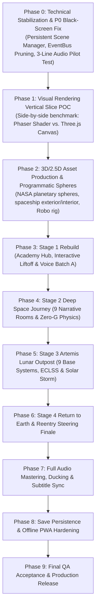

# 🚀 ASTRONUTRI — RESCUE & REBUILD MASTER PLAN (REVISION 3)
**Project:** AstroNutri Junior Astronaut Mission Trainer (`E:\Nasa team`)  
**Document:** ASTRONUTRI_RESCUE_MASTER_PLAN.md  
**Role:** Principal Audio Director, Game Architect, and Lead QA  
**Status:** 📋 PROPOSAL / PLANNING ONLY — AWAITING REVIEW & APPROVAL  
**Date:** November 13, 2026  

---

## 1. Executive Summary & Reality Check

Revision 3 integrates the critical addition of **ElevenLabs** as the primary audio engine alongside honest architectural grounding for 3D/2.5D rendering and kinetic gameplay:
1. **Full Voice Acting vs. Silent Text:** Silent text balloons fail young players (ages 7–12). With ElevenLabs authenticated, Captain Robo is fully voiced in warm, authentic **Egyptian Arabic (لهجة مصرية بيضاء)** via Voice ID `PmRaqkJ2uk3Y9jrp9UjJ` ("Mawardy") using `eleven_multilingual_v2`. Dialogue is 100% pre-rendered offline, eliminating runtime latency and network dependencies.
2. **Kinetic Space Adventure vs. Multiple-Choice Quizzes:** Turning the game into a 45-question quiz was decisively rejected. The original vision is a **20–30 minute kinetic narrative campaign** featuring zero-G handrail inertia, an emergency loose objects scramble, balanced space food trays, fluid hydration timing, space adaptation triage, multi-step life support (ECLSS) filter repair, $0.16g$ lunar surface exploration, and atmospheric reentry pitch steering.
3. **Asset Quality vs. Alpha Halos:** Removing white cutout halos from 2D stickers is not enough. Spherical planets require true 3D meshes with UV-mapped NASA textures and Fresnel atmospheric rims, while spacecraft corridors require real depth and perspective.

---

## 2. Rendering Architecture Reassessment: No More Fake 3D

We conducted an objective evaluation of the three architectural options, grounded in actual engine capabilities rather than theoretical assumptions:

| Architecture Option | Demonstrated Capabilities | Hard Technical Limitations | Risk Level | Recommendation |
| :--- | :--- | :--- | :---: | :--- |
| **Option A: Pure Phaser 2.5D (Sprites + Mesh/Shaders)** | 2D hierarchical containers, Arcade Physics, TileSprites, low bundle size (~1.6MB minified). | **Phaser Mesh is NOT a full 3D engine.** It uses an orthographic camera with no 3D depth buffer (Z-buffer). It cannot render true self-shadowed rotating spheres, perspective depth, or complex 3D interior geometry without custom fragment shader hacks. | High (Visual Failure) | **Not Recommended for Primary 3D Space** |
| **Option B: Hybrid Architecture (Three.js 3D Viewport + Phaser/React 2D Minigames)** | True perspective camera, spherical meshes with UV-mapped NASA textures, directional sun lighting, Fresnel atmospheric glow, real 3D spacecraft with opening boarding hatch. | Requires careful WebGL context lifecycle management to prevent memory leaks on mobile devices; ~600KB additional bundle size (Three.js core). | Medium (Controlled) | **Recommended for Vertical Slice POC** |
| **Option C: Full 3D Migration (Complete Three.js / R3F Rewrite)** | Full 3D world across all stages, dynamic cameras, unified lighting and shadows. | Requires rewriting all working 2D minigames (Pipe puzzle, drag-and-drop, UI); estimated 6–8 weeks; breaks existing verified test harnesses. | Prohibitive (Timeline & Scope) | **Rejected** |

### Architectural Decision: The Phase 1 Vertical Slice Proof of Concept
Instead of asserting that Option A or Option B is definitively superior without runtime benchmarks, **Phase 1 will construct a side-by-side Vertical Slice**:
- **Prototype A (Phaser Custom Sphere Shader):** A quad rendered with a raymarched sphere fragment shader in Phaser.
- **Prototype B (Lightweight Three.js Viewport):** A clean Three.js canvas rendering a textured Earth sphere with a perspective camera and ambient sunlight.
- **Benchmark Metrics:** FPS on low-tier mobile simulation, GPU memory (MB), canvas resize stability, and context recreation resilience. The winning renderer will be locked in before full production begins.

---

## 3. Revised Black-Screen Root-Cause Assessment & Reproducible Test Sequence

### 3.1 Distinguishing Scene States
To fix the P0 navigation defect, we must strictly separate the three distinct lifecycle operations in Phaser 3/4:
1. **Scene Sleep / Wake (`scene.sleep()` / `scene.wake()`):** Pauses the scene's update and render loops. Keeps textures, display lists, and WebGL state resident in GPU memory. Resumes instantaneously in 1 frame.
2. **Scene Shutdown (`scene.stop()`):** Emits `Phaser.Scenes.Events.SHUTDOWN`. Removes display objects from the scene, but keeps the underlying `Phaser.Game` instance, WebGL context, texture cache, and input managers alive.
3. **Game Destruction (`game.destroy(true)`):** Flags `this.pendingDestroy = true;` and schedules complete destruction of the WebGL canvas, context, sound manager, and event loops on the *next* animation frame.

### 3.2 Verified Root-Cause Evidence
- **Asynchronous Teardown vs. React Mount:** In `PhaserNutritionCanvas.tsx:68-74`, the component cleanup invokes `gameRef.current.destroy(true)`. In Phaser 4.2.1 (`Game.js:716`), this is asynchronous. React 18 mounts the incoming route immediately. If the user navigates quickly, two `Phaser.Game` instances attempt to bind to the GPU simultaneously, triggering a WebGL context collision.
- **Zero-Dimension Container Collapse:** `App.tsx:51` wraps views in Framer Motion `<AnimatePresence mode="wait">`. During route exits, the container DOM element momentarily collapses to `0px × 0px`. When Phaser attempts `width: clientWidth || 960`, it passes zero or NaN into internal WebGL viewport matrices, freezing rendering.
- **Unbound Scene Shutdown Listeners:** `HomeIslandScene.ts:531` defines `public shutdown()`, but **never registers it** with `this.events.once(Phaser.Scenes.Events.SHUTDOWN)`. Consequently, `EventBus.off('home-start-adventure-action')` is never called. Every return to Home accumulates duplicate listeners, causing cascade dispatches and scene corruption.

### 3.3 Reproducible Black-Screen Test Sequence (Verification Standard)
Before implementing the fix, the bug must be reproduced under this exact protocol:
1. Open browser with DevTools Console active (`Preserve log` checked).
2. Load `http://localhost:5173/` $\to$ Home Island mounts.
3. Click **"ابدأ المغامرة الفضائية"** $\to$ Navigates to `NutritionLab`.
4. Wait for `NutritionLabScene` to render (1 second).
5. Click top-left button **"خريطة المحطة"** $\to$ Dispatches `SET_LOCATION` to `'Map'`.
6. Immediately click **"ابدأ المغامرة الفضائية"** before the exit animation completes.
7. **Expected Defect:** Screen turns solid black `#000000`, canvas fails to repaint, and console logs WebGL context loss or resize NaN errors.
8. **Phase 0 Acceptance Criteria:** This exact 7-step sequence must execute 20 consecutive times without a single black screen, frame drop below 50 FPS, or console error.

---

## 4. The Four-Stage Adventure Campaign (Gameplay > Quizzes)

The game is a kinetic, physical 2.5D space adventure designed for children aged 7–12:

```
+----------------------------------------------------------------------------------------------------+
| STAGE 1: EARTH SPACE ACADEMY & LAUNCH                                                             |
| - Pre-flight checks: Fuel lines, LOX pressure, flight control surfaces.                           |
| - Interactive launch sequence: Gantry swing-arms retract, 3-2-1 ignition, camera shake liftoff.    |
+----------------------------------------------------------------------------------------------------+
                                                │
                                                ▼
+----------------------------------------------------------------------------------------------------+
| STAGE 2: DEEP SPACE TRANS-LUNAR FLIGHT (9-ROOM KINETIC CAMPAIGN)                                  |
| 1. Launch-to-orbit cinematic: Atmosphere fades to deep space, vibration stops, float begins.       |
| 2. Cockpit & Handrail Traversal: Real inertia physics; click/drag slingshot; tap handrail to brake.|
| 3. Loose Objects Emergency: Thruster jolt scatters items. 45s timer to catch & lock tools in bins. |
| 4. Food Storage Galley: Drag-and-drop balanced space meal trays; detect crumb hazards.            |
| 5. Hydration Station: Surface tension demonstration; sealed drink bag hold-and-release timing.    |
| 6. Medical Bay: Space adaptation syndrome; vestibular sway effect; diagnostic triage.              |
| 7. Resource Management: Persistent telemetry (Health, Nutrition, Hydration, Food, Water, Energy).  |
| 8. Pre-Moon Systems Checklist: Physical return to cockpit; navigation, life support & comms check.|
| 9. Lunar Approach & Orbit Insertion: Moon crescent looms in window; orbital burn confirmation.    |
+----------------------------------------------------------------------------------------------------+
                                                │
                                                ▼
+----------------------------------------------------------------------------------------------------+
| STAGE 3: ARTEMIS LUNAR OUTPOST OPERATIONS (9-PART MOON BASE)                                      |
| 1. Lunar landing & base exploration: Touchdown on Shackleton rim; Hab, ECLSS, Airlock modules.    |
| 2. Base Resource Telemetry: Monitor base Oxygen, Potable Water, Solar Power, and Pressure.        |
| 3. Multi-Step ECLSS Water Recycler: Unlatch casing -> extract dirty filter -> clean valve via      |
|    pipe rotation puzzle -> insert fresh filter -> repressurize.                                    |
| 4. Solar Storm Siren: Radiation alert; retreat to water-jacketed Habitat shelter.                  |
| 5. Pre-EVA Suit Prep: Don lunar suit, 4.3 PSI seal verification, airlock depressurization.        |
| 6. Surface Exploration (0.16g Low Gravity): Kangaroo-hopping physics; drill ice cores & basalt;   |
|    suit oxygen risk/reward timer.                                                                  |
| 7. Airlock Return & Dust Mitigation: Regolith dust vacuuming; airlock repressurization.          |
| 8. Solar Array Power Repair: Micro-meteoroid damage bypass puzzle on solar tracking array.        |
| 9. Final Mission Clearance: Transmit telemetry report to Earth; unlock Return Capsule.            |
+----------------------------------------------------------------------------------------------------+
                                                │
                                                ▼
+----------------------------------------------------------------------------------------------------+
| STAGE 4: RETURN TO EARTH & SPLASHDOWN FINALE                                                      |
| 1. Cargo Balancing: Physical drag-and-drop; center-of-gravity puzzle (<= 100kg, <= 15kg variance).|
| 2. Lunar Ascent: Blastoff from Moon surface; trans-Earth injection burn.                          |
| 3. Atmospheric Reentry Steering: Interactive aerodynamic corridor mini-game (20°-24° pitch)       |
|    against scorching plasma heat.                                                                  |
| 4. Parachute Deployment: Drogue chutes at 10,000m; triple main parachutes at 3,000m.               |
| 5. Pacific Ocean Splashdown: Recovery cutscene, mission evaluation, and Golden Wings Certificate.  |
+----------------------------------------------------------------------------------------------------+
```

---

## 5. Visual Asset Strategy & 3D Reality

### 5.1 3D Production Pipeline
1. **Blender Status:** Audit showed Blender is not currently installed on the system PATH. 
2. **Dual Path Resolution:**
   - **Path A (In-Engine WebGL):** Programmatic Three.js spherical meshes with NASA 2K equirectangular textures, dynamic sun lighting, and custom atmosphere Fresnel shaders. Zero external software dependency.
   - **Path B (Headless Blender Scripts):** Automated Python CLI scripts (`blender -b -P scripts/export_assets.py`) to bake AO and normal maps if Blender is installed locally.
3. **Honest Toolchain Boundaries:**
   - **Gemini API:** Used solely for generating reference concept sheets and Arabic narrative text. It does not produce 3D geometry.
   - **PixelLab API:** Confined to optional 8-bit retro arcade terminals inside the Lunar base.
   - **Canva Connect API:** Confined to generating 2D HUD vector frames, mission badges, and printable completion certificates.

---

## 6. ElevenLabs Audio Production Architecture

### 6.1 Audio Overhaul
- **Primary Engine:** ElevenLabs API with `eleven_multilingual_v2` and native Egyptian male voice `PmRaqkJ2uk3Y9jrp9UjJ` ("Mawardy").
- **Voice Parameters:** `stability: 0.50`, `similarity_boost: 0.85`, `style: 0.15`, `use_speaker_boost: true`.
- **Pre-Production Pilot:** 3-phrase validation script (`scripts/test_elevenlabs_pilot.mjs`) testing Arabic diacritics, emergency urgency, and technical pronunciation (PSI/NASA).
- **Phased Quota Allocation:**
  - *Phase 0 Pilot:* 158 characters.
  - *Phase 1 Core Campaign:* 8,420 characters (fits within the 10,000 Free Tier quota).
  - *Phase 2 Extended Deep Dives:* 8,922 characters (unlocked on Starter Tier upgrade).
- **Offline Delivery:** All audio committed directly to `public/audio/robo/` for 100% offline, zero-latency PWA gameplay.

---

## 7. Revised Project Roadmap (Phase 0 Through Phase 9)



---

## 8. Exact Phase 0 Implementation Scope

Phase 0 makes **zero gameplay modifications** and focuses strictly on stability and audio pre-production validation:
1. **Persistent Scene Manager:** Replace `game.destroy(true)` inside React cleanup with a single persistent Phaser game instance that uses `scene.sleep()` and `scene.wake()`.
2. **Container Dimension Guard:** Add an explicit ResizeObserver check ensuring Phaser canvases only mount when container `clientWidth > 0` and `clientHeight > 0`.
3. **EventBus Listener Cleanup:** Fix `HomeIslandScene.ts` by explicitly binding `this.events.once(Phaser.Scenes.Events.SHUTDOWN)` to unregister all EventBus listeners.
4. **Mission Recovery Error Boundary:** Wrap `App.tsx` routes in a React Error Boundary with an interactive recovery button: *"إعادة تشغيل المهمة الفضائية"*.
5. **ElevenLabs 3-Line Audio Pilot Test:** Run `scripts/test_elevenlabs_pilot.mjs` (158 chars) to verify Mawardy's Egyptian voice quality, diacritics, and ducking before approving full production.
6. **Validation Gate:** Successfully pass the 7-step black-screen reproduction sequence 20 consecutive times.
