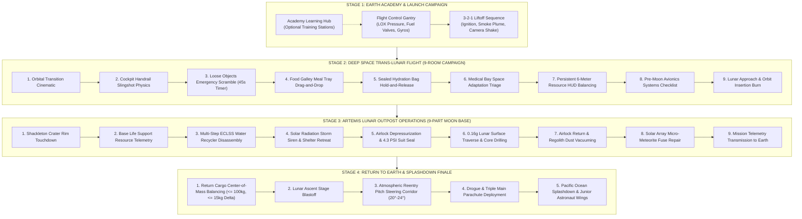

# 📜 ASTRONUTRI — STAGE DESIGN SPECIFICATION (REVISION 3)
**Project:** AstroNutri Junior Astronaut Mission Trainer (`E:\Nasa team`)  
**Document:** ASTRONUTRI_STAGE_DESIGN_SPEC.md  
**Role:** Principal Audio Director, Game Architect, and Lead QA  
**Status:** 📋 PROPOSAL / PLANNING ONLY — GROUNDED IN KINETIC GAMEPLAY & VOICED NARRATIVE  
**Date:** November 13, 2026  

---

## 1. Global Campaign Vision: Kinetic Space Adventure (Gameplay > Quizzes)

AstroNutri is **NOT** a textbook test or a 45-question multiple-choice quiz. It is a **kinetic 20–30 minute space mission campaign** designed for children aged 7–12. 

The Earth Space Academy stations remain available as an **interactive training hub**, while the core experience is driven by hands-on physical interactions and **full Egyptian Arabic voice acting** powered by ElevenLabs: grasping handrails to counteract zero-G momentum, catching runaway floating tools during an emergency scramble, timing sealed water pouches, repairing physical life-support filtration cartridges, kangaroo-hopping across lunar craters, and steering a spacecraft through blazing reentry plasma.

---

## 2. Stage 1: Earth Space Academy & Interactive Liftoff

### 2.1 Academy Training Hub (Optional Exploration)
The existing Academy stations (`NutritionLab`, `SpaceScience`, `HumanHealth`, `SuitRoom`, `EngineCore`) are retained as an interactive training center for children who wish to explore background science at their own pace:
- **Nutrition Garden:** Overview of hydroponics and NASA space food categories (`s1_c02_academy_tour`).
- **Observatory Dome:** Interactive touchable orrery displaying planets and orbital facts (`s1_c03_solar_system`).
- **Zero-G Gym:** Overview of bone calcium protection and cardiovascular fitness (`s1_c04_bone_density`).
- **Suit Calibration:** Tactile spacesuit layers with the $4.3\,\text{PSI}$ pressure regulator (`s1_c05_suit_pressure_guide`).

### 2.2 Main Campaign: The Launch Control & Liftoff Sequence
The primary storyline launches immediately from the Launch Pad:
1. **Flight Line Checklist:**
   - Valve 1: Pressurize Liquid Oxygen (LOX) line (hold until pressure needle enters green arc) — *Robo cue:* `s1_c06_lox_check`.
   - Valve 2: Verify Liquid Hydrogen fuel flow — *Robo cue:* `s1_c07_fuel_flow`.
   - Sensor 3: Perform aerodynamic gimbal sweep on the 4 main engine bells.
2. **Interactive Countdown Sequence:**
   - The child presses the physical illuminated launch key — *Robo cue:* `s1_c08_ignition_countdown`.
   - 3-2-1 voice countdown accompanied by ground gantry swing-arms retracting.
   - Main engine ignition: Volumetric particle smoke plumes billow outward with deep rumble audio (`ship_cabin_hum.mp3`) and procedural camera shake.
   - Rocket ascends smoothly through Earth's blue troposphere, transitioning through stratosphere into the blackness of orbit.

---

## 3. Stage 2: Deep Space Trans-Lunar Flight (9-Room Kinetic Campaign)

### Part 1: Orbital Transition Cinematic
- The rocket second-stage separates. Earth recedes through the observation window.
- Engine vibration ceases into deep silence. Small loose items and Robo gently float upward.
- Physics locomotion mode automatically switches from `EARTH_1G` (walk) to `TRANSIT_0G` (drift & thrusters).
- *Robo voiceover:* `s2_c01_orbit_float` ("يا سلام! وصلنا لمدار الأرض! بص يا بطل، الجاذبية اختفت!").

### Part 2: Cockpit Handrail Slingshot Physics
- **Mechanic:** Arcade Physics with Zero-G momentum, low drag ($18\,\text{px/s}^2$), and wall restitution ($0.75$).
- **Controls:** Click/touch and drag away from an EVA handrail or Robo to display an elastic bungee trajectory line. Releasing launches Robo across the corridor with velocity up to $580\,\text{px/s}$.
- **Braking Challenge:** The child must tap the next handrail or press `E` as Robo nears it to latch on safely; failing to brake bounces Robo gently off the padded bulkhead.
- *Robo voiceover:* `s2_c02_handrail_tutorial`.

### Part 3: Loose Objects Emergency Scramble (45-Second Timer)
- A mid-course thruster correction jolts the spacecraft, triggering a yellow caution strobe:
  *Robo voiceover:* `s2_c03_loose_objects_alert` ("إنذار في الممر! مناورة المحركات طيرت الأدوات في كل مكان!").
- **Gameplay:** 5 loose items (wrench, freeze-dried strawberry pouch, flight telemetry drive, water bag, roll of kapton tape) drift chaotically across the corridor.
- The player navigates Robo across the corridor, clicks/taps each floating item to catch it, carries it to the magnetic wall lockers, and releases it into the matching bin.
- Completing the scramble within 45 seconds preserves ship avionics and awards bonus stars.
- *Success voiceover:* `s2_c04_cabin_secured`.

### Part 4: Food Storage Galley (Meal Tray Assembly)
- Enter the galley food pantry. The child must assemble a balanced space meal on a magnetic meal tray.
- *Robo voiceover:* `s2_c05_galley_intro` ("حان وقت الغداء الفضائي! هنا بنحفظ وجباتنا بطريقة خاصة").
- **Drag-and-Drop Gameplay:** Choose 4 items from 12 NASA pantry options:
  - *Carbohydrate:* Space Tortilla (safe) vs. Regular Crumbly Bread (hazardous).
  - *Protein:* Irradiated Turkey Sausage or Beef Pouch.
  - *Vegetables/Minerals:* Freeze-dried Broccoli or Sweet Corn.
  - *Fluid:* Vacuum-sealed Berry Juice Pouch with septum valve.
- **Crumb Detection:** If the child attempts to select regular bread or chips, the tray sensor beeps red:
  *Robo warning cue:* `s2_c06_crumb_warning` ("حاسب يا بطل! بلاش عيش عادي أو شيبسي! الفتات المتطاير بيدخل فلاتر الهواء وعيون الرواد!").

### Part 5: Sealed Hydration Station (Hold-and-Release Timing)
- Demonstrates fluid surface tension in microgravity (water forms floating spheres).
- *Robo voiceover:* `s2_c07_hydration_physics`.
- **Gameplay:** Clamp a sealed drink bag under the potable water dispenser nozzle.
- Press and hold the pressurize toggle. A fluid fill gauge rises toward the $250\,\text{ml}$ target line.
- Release within the target zone ($\pm 10\,\text{ml}$). Releasing too early leaves the astronaut dehydrated; overfilling triggers safety relief valve hiss.

### Part 6: Space Medical Bay (Vestibular Adaptation Triage)
- The astronaut experiences Space Adaptation Syndrome (slight vestibular screen roll and blurred peripheral vision).
- *Robo voiceover:* `s2_c08_medbay_diagnosis` ("الدم وسوائل الجسم بتطلع للرأس في انعدام الوزن، وده بيعمل شوية دوخة واحتقان").
- **Gameplay:** Examine the vital signs monitor (Blood Pressure, Heart Rate, Vestibular Balance).
- Select proper recovery treatment: Administer electrolyte hydration pack, adjust cabin oxygen to $21\%$, and strap astronaut into the sleep restraint bag for a 20-minute rest cycle. Health meter restores to $100\%$.

### Part 7: Dynamic Resource Management HUD
- A persistent 6-meter telemetry HUD monitors:
  1. `Health` (Astronaut physiological stability)
  2. `Nutrition` (Caloric energy balance)
  3. `Hydration` (Fluid balance)
  4. `Food Supply` (Pantry reserves)
  5. `Water Supply` (Potable water tank level)
  6. `Ship Energy` (Fuel cell battery level)
- Every mission choice directly impacts these meters, teaching children resource conservation.

### Part 8: Pre-Moon Avionics Systems Checklist
- Physically return to the Cockpit forward console.
- Run the interactive flight computer verification:
  - Check 1: Trajectory coordinates locked to Shackleton Crater rim.
  - Check 2: Retro-rocket propellant primed.
  - Check 3: Cabin pressure equalized at $14.7\,\text{PSI}$.
  - Check 4: Communications link confirmed with Houston Mission Control.
- *Robo voiceover:* `s2_c11_avionics_ready`.

### Part 9: Lunar Approach & Orbit Insertion Burn
- Send flight clearance report to Mission Control.
- Press **"تأكيد الهبوط على القمر"**.
- View the cinematic approach as the cratered lunar surface fills the forward cockpit viewport, followed by retro-rocket deceleration burn into Stage 3.
- *Robo voiceover:* `s2_c12_lunar_burn`.

---

## 4. Stage 3: Artemis Lunar Outpost Operations (9-Part Moon Base)

### Part 1: Lunar Landing & Habitat Exploration
- Touchdown on the rim of Shackleton Crater.
- Exit spacecraft into the lunar base vestibule. Explore Central Hab, ECLSS Recycling Unit, Hydroponic Dome, and Airlock Chamber.
- *Robo voiceover:* `s3_c01_lunar_touchdown`.

### Part 2: Base Life Support Resource Telemetry
- Base telemetry display tracking `Base Oxygen (kg)`, `Potable Water (L)`, `Solar Array Output (kW)`, and `Habitat Pressure (kPa)`.
- *Robo voiceover:* `s3_c02_base_telemetry`.

### Part 3: Multi-Step ECLSS Water Recycler Maintenance
- The primary life-support water recycler suffers a blockage (water level drains toward danger threshold).
- *Robo voiceover:* `s3_c03_eclss_alert` ("مضخة تنقية المياه عطلانة! في الفضاء بنعيد تدوير 98% من المياه، لازم نصلحها فوراً!").
- **Interactive Multi-Step Repair:**
  1. **Step 1 (Unbolt Casing):** Click/tap 4 corner bolts to release the outer titanium maintenance panel.
  2. **Step 2 (Cartridge Extraction):** Drag the contaminated, discolored filtration cartridge out of the chamber.
  3. **Step 3 (Valve Flow Alignment):** The catalytic oxidation valve requires proper flow alignment. Solve the $3\times 3$ rotating pipe puzzle to restore continuous fluid passage from Cabin Waste Inlet to Processor Outlet.
  4. **Step 4 (Insert Fresh Filter & Repressurize):** Drag the clean blue filter cartridge into the slot, seal the panel, and engage the main pump switch. Base water reserves smoothly recover to $100\%$.
- *Success voiceover:* `s3_c04_eclss_restored`.

### Part 4: Solar Radiation Storm Siren & Shelter Retreat
- Deep space radar detects a Coronal Mass Ejection (CME). Mission Control sounds the emergency alarm siren (`SFX-ALARM-01`).
- *Robo voiceover:* `s3_c05_solar_storm_siren` ("إنذار أحمر! عاصفة شمسية هتوصل خلال دقيقة! ادخل فوراً لمخبأ المياه المحمي!").
- **Gameplay:** A 30-second evacuation countdown begins.
- Navigate Robo and the crew through the outpost into the central **Water-Jacketed Habitat Core** (a reinforced vault shielded by base water tanks that absorb high-energy solar radiation).
- Close the heavy vault blast door and monitor the radiation dosimeter until the storm subsides.
- *All clear voiceover:* `s3_c06_storm_cleared`.

### Part 5: Pre-EVA Spacesuit Preparation
- Enter the equipment airlock. Don the Lunar Surface Spacesuit:
  - Step 1: Slide on the liquid cooling and ventilation garment (LCVG).
  - Step 2: Latch the lower torso assembly and boots.
  - Step 3: Snap on the hard upper torso (HUT) and secure the helmet ring.
  - Step 4: Adjust the digital oxygen regulator needle to **$4.3\,\text{PSI}$ pure $O_2$**.
    *Robo voiceover:* `s3_c07_suit_4_3_psi` ("اضبط الضغط على 4.3 بي إس آي! ده الضغط المثالي عشان مفاصل البدلة ما تتصلبش في الفراغ!").
  - Step 5: Lock gold-plated solar visor down over the faceplate.

### Part 6: Lunar Surface Exploration ($0.16g$ Low Gravity)
- Outer airlock hatch slides open, stepping onto the stark, sunlit rim of Shackleton Crater.
- *Robo voiceover:* `s3_c08_eva_kangaroo_hop`.
- **Locomotion Physics:** $0.16g$ lunar gravity with signature kangaroo-hopping mechanics (high parabolic leaps with low forward terminal velocity).
- **Geological Sample Mission:**
  - Suit oxygen tank provides a 3-minute exploration window.
  - Navigate to marked geological sites:
    - *Site A (Permanently Shadowed Crater):* Deploy core drill to extract deep lunar ice cores ($25\,\text{kg}$).
    - *Site B (Crater Rim):* Use rock hammer to chip out titanium-rich basalt ($30\,\text{kg}$).
    - *Site C (Upper Ridge):* Scoop pristine regolith soil ($45\,\text{kg}$).
  - Balance risk vs. reward: Mandatory ice sample required for base water; optional minerals award science stars but consume suit oxygen.

### Part 7: Airlock Return & Regolith Dust Mitigation
- Return to the outer airlock before suit oxygen depletes below $15\%$.
- Close outer door. Activate the electrostatic regolith dust-removal vacuum to clean abrasive, jagged dust particles off the suit fabric before entering the clean habitat living quarters.
- *Robo voiceover:* `s3_c09_dust_vacuum`.
- Deliver sample containers to the scientific analysis station.

### Part 8: Solar Array Power Repair
- Outpost electrical grid reports an electrical drop on Array Beta.
- Inspect the solar tracking wing. A micro-meteorite impact severed a primary circuit bridge.
- Solve the circuit bypass puzzle by connecting matching positive and negative semiconductor conduits, restoring solar tracking and charging base batteries.
- *Robo voiceover:* `s3_c10_solar_repaired`.

### Part 9: Final Mission Clearance & Telemetry Transmission
- Transmit the comprehensive lunar mission telemetry report to Earth Mission Control.
- Mission Control grants clearance to board the Lunar Ascent Vehicle and advance to Stage 4.
- *Robo voiceover:* `s3_c11_lunar_complete`.

---

## 5. Stage 4: Return to Earth & Splashdown Finale

### Part 1: Cargo Balancing & Center-of-Mass Puzzle
- Inside the Return Capsule cargo hold, the player must load collected lunar samples and telemetry equipment into Left and Right storage bays.
- *Robo voiceover:* `s4_c01_cargo_balance_intro` ("لازم نوزن العينات بدقة! الوزن الكلي ميزيدش عن 100 كيلو، والفرق بين الجنبين ميزيدش عن 15 كيلو عشان توازن الكبسولة!").
- **Mechanic:** Framer Motion unified pointer drag-and-drop.
- **Educational Balancing Rules:**
  - Total weight constraint: $\sum W_i \le 100\,\text{kg}$.
  - Center-of-mass balance constraint: $\|W_{\text{left}} - W_{\text{right}}\| \le 15\,\text{kg}$.
  - If overloaded or unbalanced, the capsule trim is aerodynamically unsafe, and the launch button is disabled with contextual Arabic feedback.
  - When balanced, the magnetic bay locks engage with an audible chime, arming the ascent thrusters.
- *Robo voiceover:* `s4_c02_cargo_locked`.

### Part 2: Lunar Ascent Liftoff
- Launch Ascent Stage from the Moon surface.
- Perform trans-Earth injection burn, watching the Moon recede and Earth grow from a blue marble to a giant curved horizon.

### Part 3: Atmospheric Reentry Pitch Steering Mini-Game
- The capsule strikes the upper atmosphere at $11\,\text{km/s}$. A raging orange plasma sheath envelops the heat shield.
- *Robo voiceover:* `s4_c03_reentry_plasma` ("دخلنا الغلاف الجوي! حرارة البلازما مولعة! حافظ على زاوية الكبسولة بين 20 و24 درجة!").
- **Gameplay:** Aerodynamic turbulence buffets the capsule angle.
- The child must use touch drag or keyboard arrows to steer the capsule's pitch, keeping the nose reticle within the **$20^\circ-24^\circ$ safe aerodynamic entry corridor**.
- Steering too steep ($>24^\circ$) overheats the ablative heat shield; steering too shallow ($<20^\circ$) causes the capsule to skip off the atmosphere back into space!
- Holding the corridor for 30 seconds bleeds off hypersonic velocity safely.

### Part 4: Parachute Sequence & Pacific Ocean Splashdown
- Plasma flames dissipate as speed drops below Mach 1.
- Barometric sensor triggers drogue parachutes at $10,\text{000m}$ to stabilize capsule roll.
- At $3,\text{000m}$, three giant orange-and-white main parachutes deploy and inflate with a loud canopy snap (`SFX-CHUTE-01`).
- *Robo voiceover:* `s4_c04_chute_splashdown` ("المظلات فتحت تمام! بنهبط على المحيط الهادي بسلام!").
- Gentle splashdown into the Pacific Ocean with volumetric water splash effects and flotation collar inflation.

### Part 5: Mission Debrief & Graduation
- US Navy recovery ship helicopters arrive.
- Comprehensive Mission Performance Evaluation across Nutrition, Zero-G Navigation, ECLSS Life Support, and Reentry Steering.
- *Robo graduation voiceover:* `s4_c05_graduation` ("مبروك يا بطل! أتممت مهمة الفضاء بنجاح واستحقيت وسام رائد الفضاء الصغير!").
- Child receives the printable **"وسام رائد الفضاء الصغير" (Junior Astronaut Wings)** graduation certificate with their customized cadet name!
