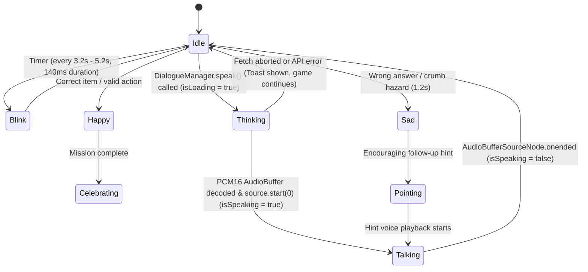

# ASTRO NUTRI — PHASE 1: TECHNICAL AUDIT, ASSET PIPELINE & GAME ENGINE PLAN

**Document Version:** 1.0 (Phase 1 Architecture & Asset Audit)  
**Project:** AstroNutri — Junior Astronaut Mission Trainer  
**Status:** Phase 1 Complete (Awaiting Review & Approval Before Phase 2)

---

## 1. Existing Architecture Audit

### 1.1 Current Codebase & Runtime Stack
An inspection of `package.json`, `vite.config.ts`, `tsconfig.json`, and `src/` confirms the current project is a Single-Page Progressive Web Application (PWA) built with:

| Layer | Technology | Installed Version | Current Role in Project |
| :--- | :--- | :--- | :--- |
| **UI Framework** | `react` / `react-dom` | `^18.3.1` (`18.3.1`) | Component hierarchy, state-driven screen routing, modals |
| **Build Tool** | `vite` / `@vitejs/plugin-react` | `^5.4.10` (`5.4.21`) / `^4.3.3` | ESModule bundling, HMR, static asset serving |
| **Type System** | `typescript` | `^5.6.3` | Strict typing (`noUnusedLocals`, `noUnusedParameters`) |
| **Styling** | `tailwindcss` / `postcss` / `autoprefixer` | `^3.4.14` / `^8.4.47` / `^10.4.20` | RTL utility styling, responsive Flex/Grid layouts |
| **UI Animation** | `framer-motion` | `^11.11.17` | DOM tweening, drag-and-drop gestures, spring physics |
| **Icons & VFX** | `lucide-react` / `canvas-confetti` | `^0.460.0` / `^1.9.3` | HUD vector icons and celebration particle bursts |
| **Offline / PWA** | `vite-plugin-pwa` | `^0.20.5` | Workbox service worker precaching (`maximumFileSizeToCacheInBytes: 10MB`) |
| **State Management** | `src/context/GameContext.tsx` | Custom React `useReducer` | Global mission state, cargo items, suit/engine/lunar state |
| **Audio & Voice** | `src/utils/geminiTTS.ts` & `sound.ts` | Web Audio API + `fetch` | `DialogueManager` queue + Gemini 3.1 Flash TTS PCM16 decoding |

### 1.2 Architectural Strengths & Current Limitations
- **Strengths:**
  - Clean separation of global mission state in `GameContext.tsx`.
  - `DialogueManager` in `src/utils/geminiTTS.ts` uses `AbortController`, sequential utterance queuing, `AudioContext` PCM16 decoding (`24000 Hz`), in-memory `AudioBuffer` caching, `localStorage` caching, and zero browser `speechSynthesis` fallback.
  - RTL Arabic typography (`Cairo` / `Tajawal`) and accessible HUD modals work reliably in React DOM.
- **Limitations Blocking a True 2D/2.5D Game Experience:**
  - DOM-based layout (`<div>` and `` nodes animated via Framer Motion) lacks a continuous `requestAnimationFrame` world loop, camera viewport culling, 2D arcade physics (gravity, velocity, platform collisions, trigger zones), multi-layer GPU parallax tile-sprites, and dynamic lighting/particle emitters.
  - Character representation currently relies on a single static image bobbing up and down rather than a multi-part animated rig or frame-sequenced state machine.

---

## 2. Tooling & Game Engine Audit

### 2.1 Evaluation of Candidate Approaches

| Criterion | Option A: Pure React + Framer Motion (Current) | Option B: Phaser 3 + React Hybrid Overlay (Recommended) | Option C: Rive Runtime (`@rive-app/react-canvas`) |
| :--- | :--- | :--- | :--- |
| **2D/2.5D World & Physics** | Poor — DOM bounding-box checks only; no real platformer/floating physics or camera | **Excellent** — Built-in Arcade & Matter.js physics, tilemaps, cameras, and collision groups | Not a scene engine — Rive is a character/UI vector state machine, not a world physics engine |
| **Parallax & Particles** | Heavy on DOM — CSS transforms on many nodes cause layout thrashing on mobile | **Excellent** — WebGL `TileSprite` layers, GPU particle emitters, lights, and post-FX pipelines | Limited to artboard bounds |
| **Character Animation** | Basic container transforms only | **Strong** — Supports multi-part Container skeletons, frame-by-frame spritesheets, and Spine/Rive canvas | **Excellent** *if* an authored `.riv` file exists; cannot auto-rig raster PNGs without manual Rive Editor authoring |
| **RTL Arabic UI & Accessibility** | **Excellent** — Native browser RTL layout, crisp Arabic font shaping, screen-reader friendly | Weak inside WebGL canvas (Arabic right-to-left ligature shaping in WebGL `Text` can break on mobile browsers) | Requires custom font embedding inside `.riv` |
| **Gemini TTS Synchronization** | **Excellent** — Direct subscription to `DialogueManager` | **Excellent via EventBus** — Phaser scenes subscribe to `DialogueManager` events & Web Audio `AnalyserNode` | **Excellent** — State machine numeric/boolean inputs can bind to `isSpeaking` / `rmsVolume` |

### 2.2 Recommended Architecture: **Phaser 3 (`phaser@^3.87.0`) + React RTL HUD Hybrid**
We recommend a **Hybrid Canvas + DOM Architecture**:
1. **World Canvas Layer (Phaser 3 WebGL/Canvas):**
   - Renders the 2D/2.5D interactive space academy, floating platforms (`platform-*`), stargate portals (`portal-stargate`), parallax space backgrounds (`planet-earth`, `planet-saturn`, `asteroid-*`, `ufo-saucer`), collectible stars/coins/gems (`star-tier-*`, `coin-star-*`), interactive food objects (`food-*`), particle emitters, and the multi-part animated Robo character rig.
2. **UI & Dialogue Overlay Layer (React 18 + Tailwind CSS + Framer Motion):**
   - Renders the RTL Egyptian Arabic HUD (`HeaderHUD`), Arabic speech bubbles, quiz/mission modals, settings menu, and manages the `DialogueManager` (`geminiTTS.ts`).
   - Why keep Arabic UI in React DOM? Browser HTML/CSS engines handle Arabic RTL bidi text shaping, font fallback, and responsive touch accessibility far more reliably than raw WebGL bitmap text.
3. **Bridge Layer (`EventBus` Typed Pub/Sub):**
   - A lightweight TypeScript event emitter (`src/game/EventBus.ts`) connects Phaser scenes with React `GameContext` and `DialogueManager` without tight coupling or React re-render lag during 60 FPS gameplay.

### 2.3 Rive Evaluation & Honest Assessment
- **Rive Web Runtime (`@rive-app/react-canvas`):** Rive is an industry-standard runtime for skeletal and mesh character state machines. However, Rive requires an authored `.riv` binary file exported from the Rive Editor.
- **Honest Assessment:** Because the supplied asset source (`E:\Nasa team\image\file_00000000a3a48210af46275e7adfdf17.png`) is a **raster PNG sprite sheet** (not a `.riv` or vector `.svg` rig), claiming Rive CLI alone can turn a flat PNG into a skeletal animation would be false.
- **Practical Solution:** In Phase 2, Robo will be animated using a **Multi-Part Composite Sprite Rig & Frame-Swapping State Machine** (combining the 6 extracted full-body poses `robo-*`, 5 extracted facial expression heads `head-*`, and 5 extracted hand sprites `hand-*` with procedural Phaser/Framer Motion tweening and Web Audio `AnalyserNode` lip-sync). If a `.riv` file is authored in the Rive Editor later, the `<RoboRig />` component interface is designed so a Rive canvas can drop in with zero changes to game logic.

### 2.4 Installed Tools & Asset Pipeline Diagnostics
- **Sharp Installation Checkpoint Diagnosis:**
  - During the previous session, `npm install --save-dev sharp` was interrupted due to sandbox network restrictions / internet disconnection.
  - Inspection of `package.json`, `package-lock.json`, and `node_modules/` confirmed `sharp` was not installed (`node_modules/sharp exists: false`).
- **Offline Recovery & Native Extraction Engine:**
  - Rather than blocking on external binary downloads, we engineered a deterministic, zero-dependency **C# / .NET `System.Drawing` (`Format32bppArgb`) Image Segmentation & Alpha-Feathering Pipeline** (`extract_master_assets.ps1`) executed natively on Windows PowerShell.
  - It performs custom bounding-box cropping, neighbor-overlap polygon masking, border-seeded + cavity-seeded flood-fill background removal (preserving all interior white pixels on Robo's helmet/armor and UI text), 1px boundary alpha feathering, automatic transparent bounding-box trimming (`2px` padding), and automated contact-sheet generation.

---

## 3. Asset Extraction Results & Directory Structure

### 3.1 Master Asset Sheet Verification
- **Source File:** `E:\Nasa team\image\file_00000000a3a48210af46275e7adfdf17.png`
- **Resolution:** `1536 × 1024 px` (`Format24bppRgb`, `2,366,411 bytes`)
- **Extraction Method:** Custom per-sprite coordinate definitions + neighbor exclusion masks + border/cavity flood-fill background removal + 1px soft edge feathering + auto-trim.
- **Visual Contact Sheet:** `public/assets/sprites/contact-sheet.png` (`1,937,606 bytes`)

### 3.2 Directory Structure Under `public/assets/sprites/`
```text
public/assets/sprites/
├── contact-sheet.png                # Visual verification grid (75 extracted sprites on checkerboard)
├── robo/                            # 16 Robo character assets (6 body poses, 5 heads, 5 hands)
├── space/                           # 7 Space bodies & vehicles (planets, asteroids, UFO, rocket, pod)
├── food/                            # 7 Food sprites (apple, broccoli, carrot, lettuce, milk, burger, pizza)
├── collectibles/                    # 22 Collectibles, stars, coins, gems, trophies, flasks & badges
├── ui/                              # 10 UI components (AstroNutri logo, 5 Arabic buttons, sliders, bars)
├── environment/                     # 13 Platforms, stargate portal, buildings, signpost, ladder & terrain
└── [11 legacy root sprites]         # Preserved untouched so existing Phase 0 screens remain unbroken
```

### 3.3 Complete Manifest of All 75 Extracted Master-Sheet Assets

#### A. `public/assets/sprites/robo/` (16 Assets)
| File Path | Trimmed Size (px) | File Size (Bytes) | Alpha % | Quality & Usage Notes |
| :--- | :--- | :--- | :--- | :--- |
| `robo/robo-idle.png` | `173 × 239` | `81,279` | `35.8%` | Clean; standing front-facing base pose (static frame, not a full animation) |
| `robo/robo-talking.png` | `166 × 240` | `78,568` | `36.9%` | Clean; open mouth & slight stride pose |
| `robo/robo-happy.png` | `199 × 246` | `80,687` | `48.5%` | Clean; right hand waving, left hand thumbs-up |
| `robo/robo-pointing.png` | `197 × 217` | `68,261` | `50.2%` | Clean; floating zero-G pose, winking & pointing up-right |
| `robo/robo-celebrating.png` | `162 × 236` | `71,822` | `40.0%` | Clean; holding glowing gold star |
| `robo/robo-thinking.png` | `152 × 242` | `64,351` | `42.6%` | Clean; hand on chin thinking pose |
| `robo/head-happy.png` | `133 × 96` | `27,020` | `25.6%` | Clean; default smiling head for composite rig |
| `robo/head-blink.png` | `127 × 100` | `25,681` | `21.8%` | Clean; happy closed-arc eyes (`^ ^`) for blink state |
| `robo/head-laughing.png` | `134 × 99` | `25,274` | `33.0%` | Clean; wide open mouth with tongue (viseme open) |
| `robo/head-surprised.png` | `137 × 104` | `31,300` | `23.3%` | Clean; rounded `O` mouth (viseme mid/rounded) |
| `robo/head-sad.png` | `130 × 105` | `28,301` | `28.0%` | Clean; sad/worried eyes & frown for wrong-answer state |
| `robo/hand-thumbs-up.png` | `62 × 73` | `9,010` | `41.9%` | Clean; isolated right-hand thumbs-up sprite |
| `robo/hand-pointing.png` | `75 × 64` | `9,305` | `43.2%` | Clean; isolated pointing hand sprite |
| `robo/hand-open-left.png` | `82 × 76` | `10,351` | `46.3%` | Clean; isolated open palm (left) |
| `robo/hand-open-right.png` | `83 × 75` | `10,750` | `46.2%` | Clean; isolated open palm (right) |
| `robo/hand-clapping.png` | `114 × 80` | `18,194` | `35.6%` | Clean; clapping hands pair |

#### B. `public/assets/sprites/space/` (7 Assets)
| File Path | Trimmed Size (px) | File Size (Bytes) | Alpha % | Quality & Usage Notes |
| :--- | :--- | :--- | :--- | :--- |
| `space/planet-earth.png` | `165 × 156` | `60,301` | `19.0%` | Clean; blue/green Earth globe with atmosphere glow |
| `space/asteroid-purple.png` | `102 × 97` | `25,845` | `21.6%` | Clean; cratered purple moon/asteroid |
| `space/planet-saturn.png` | `270 × 180` | `86,342` | `39.2%` | **QA Flag:** Neighboring asteroid/UFO masked out; extreme lower-right ring shadow has minor soft ambient glow from master sheet |
| `space/ufo-saucer.png` | `196 × 115` | `45,775` | `35.7%` | **QA Flag:** Top-left Saturn ring overlap masked; minor bottom cloud wisp from master sheet |
| `space/rocket-blasting.png` | `124 × 222` | `59,297` | `31.2%` | Clean; red/white rocket with flame plume |
| `space/asteroid-brown.png` | `49 × 45` | `4,635` | `41.2%` | Clean; small meteor/asteroid obstacle |
| `space/space-pod-helmet.png` | `112 × 95` | `24,758` | `30.8%` | Clean; red/orange space pod / helmet collectible |

#### C. `public/assets/sprites/food/` (7 Assets)
| File Path | Trimmed Size (px) | File Size (Bytes) | Alpha % | Quality & Usage Notes |
| :--- | :--- | :--- | :--- | :--- |
| `food/food-burger.png` | `114 × 99` | `26,784` | `29.0%` | Clean; sesame-bun burger (crumb hazard in Zero-G) |
| `food/food-lettuce.png` | `96 × 88` | `20,320` | `25.4%` | Clean; fresh leafy greens (hydroponic crop) |
| `food/food-apple.png` | `62 × 64` | `8,553` | `32.0%` | Clean; fresh red apple |
| `food/food-carrot.png` | `80 × 95` | `12,261` | `52.3%` | Clean; orange carrot with leafy top |
| `food/food-broccoli.png` | `71 × 93` | `13,333` | `39.8%` | Clean; green broccoli floret |
| `food/food-milk-carton.png` | `63 × 118` | `17,941` | `20.6%` | Clean; calcium/vitamin-D milk/beverage carton |
| `food/food-pizza.png` | `86 × 63` | `10,680` | `40.9%` | Clean; high-sodium pepperoni pizza slice |

#### D. `public/assets/sprites/collectibles/` (22 Assets)
| File Path | Trimmed Size (px) | File Size (Bytes) | Alpha % | Quality & Usage Notes |
| :--- | :--- | :--- | :--- | :--- |
| `collectibles/star-tier-1.png` | `64 × 48` | `5,592` | `41.4%` | Clean; small gold star |
| `collectibles/star-tier-2.png` | `71 × 70` | `7,618` | `47.9%` | Clean; medium gold star |
| `collectibles/star-tier-3.png` | `77 × 69` | `10,523` | `33.6%` | Clean; glowing gold star |
| `collectibles/star-tier-4.png` | `79 × 74` | `11,587` | `31.9%` | Clean; large bevel gold star |
| `collectibles/star-tier-5.png` | `90 × 76` | `13,162` | `34.5%` | Clean; super star with aura |
| `collectibles/coin-star-1.png` | `83 × 85` | `15,715` | `25.1%` | Clean; gold star coin |
| `collectibles/coin-star-2.png` | `80 × 73` | `13,901` | `24.1%` | Clean; shining gold star medal coin |
| `collectibles/gem-purple.png` | `94 × 109` | `21,813` | `30.9%` | Clean; hexagonal purple crystal |
| `collectibles/gift-box-gold.png` | `122 × 110` | `30,024` | `29.7%` | Clean; red/gold reward box |
| `collectibles/idea-star-badge.png` | `94 × 96` | `13,039` | `55.7%` | Clean; lightbulb + blue star icon |
| `collectibles/diamond-yellow.png` | `44 × 64` | `4,336` | `48.2%` | Clean; yellow diamond pickup |
| `collectibles/lab-flask-blue.png` | `76 × 142` | `19,741` | `42.1%` | Clean; bubbling science flask |
| `collectibles/shield-question.png` | `88 × 93` | `19,938` | `27.8%` | Clean; gold/blue `?` shield |
| `collectibles/trophy-gold-circle.png` | `92 × 82` | `15,517` | `34.4%` | Clean; gold cup emblem |
| `collectibles/energy-bolt-green.png` | `62 × 84` | `11,162` | `31.0%` | Clean; green lightning energy pickup |
| `collectibles/gift-trophy-purple.png` | `77 × 88` | `17,247` | `24.2%` | Clean; purple trophy gift box |
| `collectibles/block-question-yellow.png` | `81 × 88` | `15,274` | `23.2%` | Clean; yellow `?` mystery block |
| `collectibles/badge-check-shield.png` | `87 × 89` | `19,999` | `20.5%` | Clean; green `[✓]` shield |
| `collectibles/badge-cross-circle.png` | `72 × 72` | `10,850` | `27.7%` | Clean; red `[X]` circle |
| `collectibles/medal-gold-ribbon.png` | `64 × 80` | `11,433` | `32.1%` | Clean; gold star ribbon medal |
| `collectibles/shield-star-blue.png` | `65 × 79` | `11,832` | `32.9%` | Clean; blue/gold star shield |
| `collectibles/crown-gold.png` | `72 × 70` | `10,949` | `35.5%` | Clean; golden crown |

#### E. `public/assets/sprites/ui/` (10 Assets)
| File Path | Trimmed Size (px) | File Size (Bytes) | Alpha % | Quality & Usage Notes |
| :--- | :--- | :--- | :--- | :--- |
| `ui/logo-astronutri.png` | `373 × 161` | `145,961` | `13.6%` | Clean; 3D `AstroNutri` emblem |
| `ui/btn-start-play.png` | `272 × 76` | `49,938` | `7.0%` | Clean; `ابدأ اللعب` button |
| `ui/btn-settings.png` | `271 × 72` | `45,813` | `6.7%` | Clean; `الإعدادات` button |
| `ui/btn-achievements.png` | `269 × 72` | `46,777` | `6.7%` | Clean; `الإنجازات` button |
| `ui/btn-info.png` | `268 × 72` | `48,840` | `3.9%` | Clean; `المعلومات` button |
| `ui/btn-exit.png` | `255 × 76` | `44,844` | `9.9%` | Clean; `خروج` button |
| `ui/ui-volume-slider.png` | `267 × 76` | `38,847` | `22.6%` | Clean; speaker + volume bar |
| `ui/ui-robo-dialogue-box.png` | `377 × 124` | `84,083` | `11.1%` | Clean; Robo avatar + speech frame |
| `ui/ui-stars-rating-4.png` | `181 × 54` | `18,444` | `39.9%` | Clean; 4-star row |
| `ui/ui-progress-bar-star.png` | `221 × 68` | `29,455` | `30.3%` | Clean; star progress bar |

#### F. `public/assets/sprites/environment/` (13 Assets)
| File Path | Trimmed Size (px) | File Size (Bytes) | Alpha % | Quality & Usage Notes |
| :--- | :--- | :--- | :--- | :--- |
| `environment/platform-grass-floating-1.png` | `244 × 100` | `56,564` | `22.2%` | Clean; wide floating grass island |
| `environment/platform-metal-hazard.png` | `210 × 76` | `39,303` | `20.3%` | Clean; metallic hazard platform |
| `environment/platform-grass-floating-2.png` | `194 × 96` | `44,606` | `24.3%` | Clean; medium floating grass island |
| `environment/prop-signpost-fence.png` | `202 × 154` | `51,346` | `49.5%` | **QA Flag:** Top-left overlapping grass island masked; bottom grass base touches neighboring portal edge on source sheet |
| `environment/portal-stargate.png` | `206 × 172` | `79,301` | `27.8%` | Clean; glowing cyan stone stargate portal |
| `environment/prop-antenna-bush.png` | `116 × 114` | `28,931` | `36.1%` | Clean; communication antenna & bushes |
| `environment/building-outpost-tower.png` | `146 × 144` | `37,851` | `45.5%` | **QA Flag:** Right-side Space Lab overlap masked; best used as mid-ground prop behind or beside main lab |
| `environment/building-space-lab.png` | `316 × 219` | `177,181` | `19.5%` | Clean; large futuristic space academy building with radar dish |
| `environment/platform-bridge-metal-left.png` | `292 × 82` | `61,247` | `16.7%` | Clean; long industrial metal-topped rock platform |
| `environment/prop-ladder-wood.png` | `63 × 124` | `17,422` | `32.4%` | Clean; wooden ladder with transparent rung spaces |
| `environment/platform-bridge-metal-right.png` | `220 × 88` | `52,509` | `11.6%` | Clean; medium industrial metal-topped rock platform |
| `environment/terrain-grass-bottom-strip.png` | `582 × 112` | `145,536` | `29.7%` | Clean; wide foreground grass/rock strip |
| `environment/platform-cliff-large.png` | `336 × 198` | `175,782` | `8.3%` | Clean; large grass-topped cliff block |

---

## 4. Robo Animation Pipeline & State Machine

> **Important Technical Distinction:** Individual extracted PNG poses (`robo-idle.png`, `robo-talking.png`, etc.) are **static keyframes/poses**, NOT complete animations on their own. True game animation requires combining **frame-swapping**, **layered sub-sprite compositing** (swapping `head-*` and `hand-*` layers), and **continuous procedural motion curves** (breathing, zero-G bobbing, squash-and-stretch, and audio-reactive viseme cycling).

### 4.1 Technical Mapping of the 9 Character States

| Character State | Base Body Sprite | Head Overlay Layer | Hand / Prop Layer | Procedural Motion & VFX Curve | Trigger Condition (Game & Audio Lifecycle) |
| :--- | :--- | :--- | :--- | :--- | :--- |
| **1. `Idle`** | `robo/robo-idle.png` | `robo/head-happy.png` | Integrated | Sinusoidal breathing (`scaleY: 1.0 → 1.025`, `2.4s`), gentle hover (`y: ±4px`) | Default state when no audio is loading/playing and no user action is active |
| **2. `Blink`** | Current active body (`robo-idle` / `robo-happy`) | Swap to `robo/head-blink.png` for `140ms`, then restore | Integrated | Triggered by randomized interval timer (`3200ms – 5200ms`) | Autonomous sub-state layered on top of `Idle`, `Happy`, or `Floating` |
| **3. `Thinking`** | `robo/robo-thinking.png` | `robo/head-surprised.png` ↔ `robo/head-happy.png` | Chin-rest pose | Subtle head tilt (`rotate: -2.5° ↔ +2.5°`, `1.2s`) + floating `...` bubble | `DialogueManager` emits `isLoading: true` (waiting for Gemini TTS audio buffer) |
| **4. `Talking`** | `robo/robo-talking.png` (alternating with `robo-idle` on phrase emphasis) | Audio-reactive viseme cycle: `head-happy` (closed) ↔ `head-surprised` (mid) ↔ `head-laughing` (wide open) at `8–10 Hz` | `hand-open-left.png` / `hand-open-right.png` gesture | Driven strictly by Web Audio `AnalyserNode` RMS volume (`rms > 0.08` opens mouth; `rms <= 0.08` closes mouth) | `DialogueManager` emits `isSpeaking: true` (decoded PCM16 `AudioBuffer` is actively playing) |
| **5. `Happy`** | `robo/robo-happy.png` | `robo/head-blink.png` (`^ ^` joy eyes) ↔ `robo/head-happy.png` | `robo/hand-thumbs-up.png` | Upward spring bounce (`y: -12px`, `stiffness: 280`) + cyan aura pulse | Player selects a valid space food item or inspects an educational card |
| **6. `Sad`** | `robo/robo-idle.png` (slumped `scaleY: 0.96, rotate: -3°`) | `robo/head-sad.png` | Drooped | Gentle horizontal shake (`x: ±5px` decay) for `1.2s`, then transitions to `Pointing` / `Talking` for encouraging hint | Player selects an incorrect quiz answer or attempts to pack a hazardous Zero-G food item |
| **7. `Pointing`** | `robo/robo-pointing.png` | `robo/head-happy.png` | `robo/hand-pointing.png` | Directional lean toward active UI target / portal / planet | Onboarding tutorials, pointing at interactive mission objects, or giving a post-error hint |
| **8. `Floating`** | `robo/robo-pointing.png` | `robo/head-happy.png` + periodic `head-blink.png` | Zero-G outstretched | Dual-axis Lissajous figure-8 drift (`x: ±10px`, `y: ±14px`, `rotate: ±4°`) + jetpack cyan particle trail | Active during Zero-G Transit levels and spacewalk segments |
| **9. `Celebrating`** | `robo/robo-celebrating.png` | `robo/head-laughing.png` ↔ `robo/head-blink.png` | `robo/hand-clapping.png` + `collectibles/star-tier-5.png` | Jump-spin arc + star particle burst emitter + fanfare SFX | Mission completion, level clear, or 3-star achievement unlock |

### 4.2 Audio Lifecycle State Machine Diagram


---

## 5. Background, Parallax & Responsive Rendering Plan

### 5.1 5-Layer Independent Parallax Architecture
To create genuine 2.5D depth without flattening scenes into static screenshots, each level scene will compose 5 independent depth layers driven by camera scroll (`scrollFactor`) and pointer/gyroscope tilt:

1. **Layer 0 — Deep Space Void & Nebula (`scrollFactor: 0.02`):**
   - Procedural radial gradient shader / canvas fill (`#03071e` → `#0c2d6b`).
2. **Layer 1 — Dynamic Starfield & Shooting Stars (`scrollFactor: 0.10`):**
   - GPU particle emitter with 120 twinkling stars (varying alpha and scale) + slow drift.
3. **Layer 2 — Distant Planetary Bodies (`scrollFactor: 0.25`):**
   - Independent floating sprites: `space/planet-earth.png`, `space/planet-saturn.png`, `space/asteroid-purple.png`, and `space/ufo-saucer.png` on slow orbital paths.
4. **Layer 3 — Mid-Ground Outpost Architecture (`scrollFactor: 0.60`):**
   - `environment/building-space-lab.png`, `environment/building-outpost-tower.png`, and `environment/prop-antenna-bush.png` with soft drop shadows and window glow bloom.
5. **Layer 4 — Foreground Gameplay Stage (`scrollFactor: 1.00`):**
   - Interactive physics platforms (`platform-grass-floating-1`, `platform-metal-hazard`, `platform-bridge-metal-*`, `platform-cliff-large`), `prop-ladder-wood`, `portal-stargate` (with cyan particle vortex), collectible stars/coins, draggable/collectible food items, and the player/Robo rig.

### 5.2 Depth, Shadows, Lighting & Particles
- **Dynamic Contact Shadows:** A soft elliptical dark-blue shadow (`rgba(2, 6, 23, 0.55)`) scales inversely with Robo's height above a platform (`scale = 1 - height / 220`).
- **Additive Glow & Bloom:** Stargate portals (`portal-stargate.png`), energy bolts (`energy-bolt-green.png`), and star pickups (`star-tier-*`) use additive blend mode (`BlendModes.ADD`) particle emitters.
- **Camera Transitions:** Smooth camera pan (`camera.pan(x, y, 800, 'Sine.easeInOut')`) and subtle zoom (`camera.zoomTo(1.12, 600)`) when focusing on Robo during mission briefings or portal transitions.

### 5.3 Multi-Device Responsive Rendering Strategy
- **Logical Design Resolution:** `1280 × 720` (16:9 base world coordinate space) managed with `Phaser.Scale.RESIZE` + camera viewport calculation so the aspect ratio **never stretches or distorts sprites**.
- **Breakpoint Adaptation:**
  - **Desktop (`>= 1024px`, Landscape):** Side-by-side HUD panels + full 16:9 world view.
  - **Tablet (`768px – 1023px`):** Compact floating top HUD + docked bottom action bar.
  - **Mobile Landscape (`< 768px` height `< 500px`):** Collapsible side drawers; minimum `48 × 48 CSS px` touch targets; virtual joystick / tap-to-move + drag-and-drop with `touch-action: none`.
  - **Mobile Portrait (`< 640px` vertical):** Camera zooms out (`zoom = 0.78`) to keep horizontal platforms in view, while the React HUD stacks cleanly into a top status bar and a bottom thumb-zone dock (`max-h-[32vh]`).

---

## 6. Scientific Food Content — NASA Accuracy

All educational rules and Robo voice lines in AstroNutri must adhere strictly to verified NASA Human Research Program (HRP) and JSC Space Food Systems Laboratory findings.

### 6.1 Environment A: Zero-G Transit (Microgravity — e.g., ISS / Orion Transit)
1. **Loose Crumbs & Floating Particulate Hazard:**
   - **Verified Science:** In microgravity, crumbs do not fall to the floor. Floating crumbs can be inhaled into an astronaut's respiratory tract, float into eyes, or foul cabin air-filtration screens and sensitive instruments.
   - **Why Tortillas Are Preferred Over Ordinary Crumbly Bread:** Since Space Shuttle missions in 1985 and aboard the ISS, NASA packs specially formulated extended-shelf-life tortillas instead of sliced bread because tortillas significantly minimize loose floating crumbs compared to ordinary bread and make it easy to wrap foods in weightlessness.
2. **Packaging & Controlled Liquids:**
   - **Verified Science:** Free liquids form floating spheres via surface tension that can adhere to faces or bridge electrical contacts. Beverages are packaged as dehydrated powders in sealed pouches with a one-way septum valve; astronauts inject water from the potable water dispenser and drink through a straw with a locking clamp.
3. **Food Categories in Microgravity:**
   - **Rehydratable Foods:** Freeze-dried items (e.g., scrambled eggs, vegetables, macaroni, fruits) where water is removed to save launch mass and inhibit microbial growth, then reconstituted with hot/ambient station water before eating.
   - **Thermostabilized (Ready-to-Eat) Foods:** Heat-processed pouches (e.g., fish, poultry, soups, puddings) that require no water addition—only warming.
   - **Natural Form & Irradiated Foods:** Bite-sized nuts, granola bars, tortillas, and shelf-stable pouches.
4. **Why Carbonated Beverages Are Problematic in Microgravity:**
   - **Verified Science:** On Earth, buoyancy causes dissolved $\text{CO}_2$ gas bubbles to rise to the top of the stomach, allowing gas to be burped separately from liquid. In microgravity, lack of buoyancy keeps gas bubbles mixed throughout stomach liquids (foamy emulsion), causing uncomfortable gastric distension and "wet burps" (acid/liquid reflux). Furthermore, carbonated liquids foam excessively when dispensed without gravity separation.

### 6.2 Environment B: Lunar (`1/6 g`) and Martian (`3/8 g`) Surface Outposts
1. **Partial Gravity vs. Zero Gravity:**
   - **Verified Science:** Neither the Moon ($\approx 0.166\,g$) nor Mars ($\approx 0.376\,g$) is zero gravity! Liquids settle toward the bottom of containers, crumbs fall downward (though more slowly than on Earth), and natural thermal convection partially resumes. Therefore, surface habitats allow more conventional food preparation and dining than microgravity transit vehicles.
2. **Long-Term Storage & Shelf-Life Challenges:**
   - **Verified Science:** While ISS resupply occurs every few months (requiring ~1.5–2 year shelf life), a Mars mission requires a **3-to-5-year shelf life** for pre-packaged rations. Over multi-year storage, vitamins (especially Vitamins C, B1/thiamin, and A) degrade chemically, and food color/texture deteriorates.
3. **Balanced Nutrition, Bone/Muscle Protection & Hydration:**
   - **Verified Science:** Reduced gravity unloading causes bone mineral density (BMD) loss and muscle atrophy. Astronauts require adequate **energy (calories)**, **high-quality protein**, **calcium**, and **Vitamin D** (supplemented because spacecraft shielding blocks UV-B sunlight synthesis), combined with daily resistive exercise and proper hydration (which also reduces renal stone risk).
4. **Controlled Sodium Intake:**
   - **Verified Science:** High dietary sodium increases urinary calcium excretion, which directly accelerates bone loss in space and increases kidney stone risk. NASA reformulated space rations to reduce sodium content while using spices/herbs to maintain palatability.
5. **Bioregenerative Fresh Crops & Food Production Systems:**
   - **Verified Science:** Systems like NASA's **Veggie** and **Advanced Plant Habitat (APH)** grow pick-and-eat leafy greens (red romaine lettuce, mizuna mustard, radishes, dwarf tomatoes, chili peppers) to supplement packaged rations with fresh bioavailable nutrients and psychological crew well-being.
6. **Radiation Protection Reality (Strict Scientific Guardrail):**
   - **Verified Science:** Galactic Cosmic Rays (GCR) and Solar Particle Events (SPEs) are mitigated through **physical spacecraft/habitat shielding** (polyethylene, water walls, regolith), **storm shelters**, **real-time dosimetry/space weather forecasting**, and operational **ALARA** (As Low As Reasonably Achievable) limits.
   - **Forbidden False Claims:**
     - **NEVER** claim that dairy products are banned because of space radiation. (Freeze-dried/shelf-stable dairy and calcium sources are actively used to protect astronaut bone density!)
     - **NEVER** claim that eating ordinary antioxidant foods (like apples or berries) makes an astronaut immune to solar flares or cosmic radiation. While balanced nutrition supports general cellular health, dietary antioxidants do **not** replace physical radiation shielding.
     - **NEVER** describe isotonic saline loading as a universal pre/post-spacewalk (EVA) drink. Isotonic fluid-loading protocols are specifically used prior to **Earth landing / re-entry** (`1 g` return) to counter post-flight orthostatic intolerance, whereas during EVAs astronauts use an **In-Suit Drink Bag (IDB)** filled with plain potable water for hydration.

### 6.3 Summary Matrix: Verified NASA Guidance vs. Game Simplifications

| Topic | Verified NASA Scientific Fact | Game-Design Simplification (Allowed in AstroNutri) | Strictly Forbidden Misconception |
| :--- | :--- | :--- | :--- |
| **Bread vs. Tortillas (Zero-G)** | Tortillas are favored in microgravity because sliced bread creates floating crumbs | Visual `[X]` warning on crumbly burger buns / cake in the Zero-G Transit level | Claiming NASA "outlaws all carbohydrates" |
| **Soda in Space (Zero-G)** | Lack of buoyancy prevents gas-liquid separation in the stomach ("wet burps") | Visual `[X]` warning on fizzy soda cans in Zero-G | Claiming soda "explodes the rocket engine" |
| **Dairy & Calcium** | Dairy/calcium + Vitamin D + resistive exercise counter microgravity bone loss | Awarding Bone Strength points for milk/cheese pouches | Claiming dairy is prohibited due to radiation |
| **Space Radiation** | Protected via physical shielding, storm shelters, and space weather alerts |Robo alerting the player to activate habitat shielding during a Solar Particle Event | Claiming an apple or berry blocks solar radiation |
| **EVA Hydration vs. Re-entry** | Plain water in the In-Suit Drink Bag (IDB) during EVAs; fluid/salt loading before Earth re-entry | Hydration meter during lunar surface tasks | Claiming astronauts inject/drink saline before every EVA |

### 6.4 Official NASA References
1. **NASA JSC Food & Nutrition:** https://www.nasa.gov/reference/jsc-food-nutrition/
2. **NASA Space Food Systems Laboratory:** https://www.nasa.gov/directorates/esdmd/hhp/space-food-systems/
3. **The Menu for Mars — Designing a Deep Space Food System:** https://www.nasa.gov/humans-in-space/the-menu-for-mars-designing-a-deep-space-food-system/
4. **Artemis II — What's on the Menu:** https://www.nasa.gov/missions/artemis/artemis-2/artemis-ii-whats-on-the-menu/

---

## 7. Risks, Limitations & Phase 2 Implementation Sequence

### 7.1 Identified Risks & Honest Limitations
1. **Static Poses vs. Skeletal Rigging:** The 6 full-body Robo sprites on the master sheet have different limb angles, so rapid cycling between full-body sprites would look like jump-cuts. **Mitigation:** Keep a stable base body per state and animate the overlaid `head-*` expression sprites (`head-happy`, `head-blink`, `head-laughing`, `head-surprised`, `head-sad`) + procedural container transforms (`scaleY`, `y`, `rotate`).
2. **Minor Baked-In Edge Overlaps on 4 Master-Sheet Sprites:**
   - `space/planet-saturn.png`, `space/ufo-saucer.png`, `environment/prop-signpost-fence.png`, and `environment/building-outpost-tower.png` had touching neighbors on the original `1536×1024` sheet. Our polygon masks removed the neighboring objects cleanly, leaving only tiny 1–2px soft edge transitions where they touched.
3. **Offline/Sandbox Package Installation:**
   - Because the execution sandbox blocks external npm registry downloads unless elevated (`BypassSandbox: true`), installing `phaser` for Phase 2 will require a single user-approved `npm install phaser` command at the start of Phase 2.

### 7.2 Phase 2 Implementation Sequence (Awaiting Approval)
1. **Step 1 — Install Phaser 3 & Create `EventBus` Bridge:** Install `phaser@^3.87.0` and create `src/game/EventBus.ts` + `<PhaserGameCanvas />`.
2. **Step 2 — Build `<RoboRig />` Composite Character Controller:** Combine `robo/*` base poses, `head-*` blink/lip-sync layers, Web Audio `AnalyserNode` RMS mouth sync, and `DialogueManager` state bindings.
3. **Step 3 — Implement 5-Layer Parallax Environment & Hub World:** Build the interactive Space Academy platform/portal hub using `environment/*` and `space/*` sprites.
4. **Step 4 — Upgrade Level 1 (Zero-G Transit) & Level 2 (Lunar/Martian Outpost):** Implement the scientifically verified NASA food rules with separate Zero-G vs. Partial-Gravity mechanics.
5. **Step 5 — Responsive QA & PWA Build Verification:** Verify 60 FPS performance and layout across desktop, tablet, and mobile portrait/landscape viewports.
