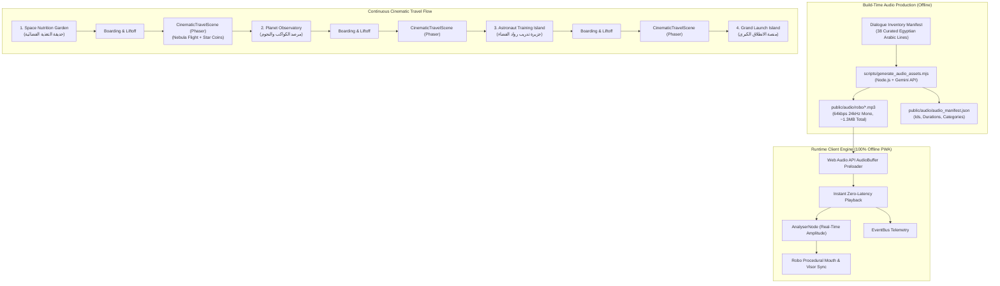
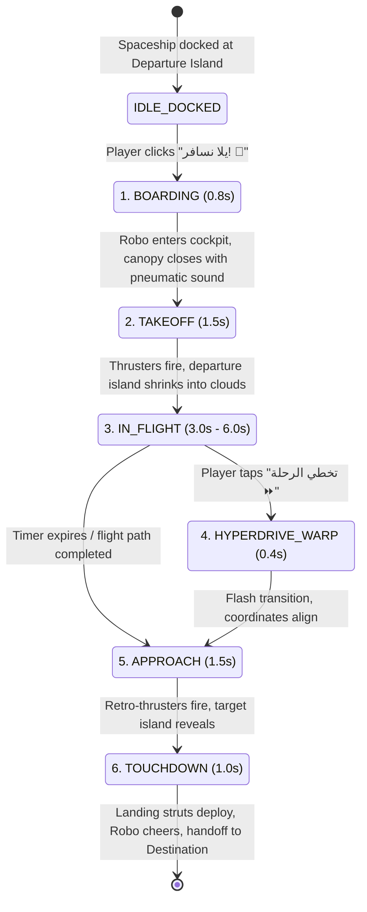

# AstroNutri — The Grand Connected Adventure & Offline Voice System
**Phase 3.2 Master Specification: Cinematic Travel, Archipelago World & Offline Audio Production**

---

## Executive Architectural Verdict & Paradigm Shift

To elevate AstroNutri into a commercial-grade, enchanting children's space adventure, two foundational pillars are established:

1. **A Living, Physically Connected World:** Moving between missions is no longer a silent React route jump. The child embarks on a continuous cinematic journey across **4 Floating Planetary Islands**, boarding their personalized cartoon spaceship, taking off into deep space, navigating through sparkling pastel nebulae, and landing on the next island.
2. **100% Pre-Generated Offline Audio (Zero Runtime API Latency):** We are permanently eliminating runtime Gemini TTS network calls during gameplay. Gemini TTS is shifted into an **offline build/production tool**. All voice lines for the entire game are cataloged in an authoritative dialogue manifest, generated locally via a Node.js production script, compressed into child-friendly audio assets (`public/audio/robo/*.mp3`), and played instantly through the Web Audio API with synchronized procedural lip-sync.



---

## SECTION 1: The 4 Floating Planetary Islands (Visual Identity & World Progression)

The AstroNutri cosmos consists of four distinct floating planetary archipelago islands anchored in a bright, friendly pastel space ocean. Each island possesses a unique architectural silhouette, environmental ambiance, landing bay, and learning focus.

```mermaid
flowchart LR
  Island1["1. حديقة التغذية الفضائية\n(Space Nutrition Garden)\n• Mint Green & Cream Gold\n• Geodesic Glass Dome\n• 4 Meals Packed (Nutrition Lab)"] 
  -->|"Stardust Path\n+ Star Coins"| 
  Island2["2. مرصد الكواكب والنجوم\n(Planet Observatory)\n• Celestial Lavender & Blue\n• Telescope & Orbiting Moons\n• 4 Planets Scanned (Space Science)"]
  -->|"Stardust Path\n+ Star Coins"| 
  Island3["3. جزيرة تدريب الرواد\n(Astronaut Training Island)\n• Cyan & Coral Peach\n• Zero-G Trampoline & Airlock\n• Spacesuit Calibration (Suit Room)"]
  -->|"Stardust Path\n+ Star Coins"| 
  Island4["4. منصة الانطلاق الكبرى\n(Grand Launch Island)\n• Rocket Orange & Gold\n• Giant Moon Rocket & Gantry\n• Liftoff Mission (Launch Pad)"]
```

### Island 1: The Space Nutrition Garden (`حديقة التغذية الفضائية`)
- **Visual Silhouette:** A glowing geodesic greenhouse bio-dome nestled upon a floating chunk of cratered space rock wrapped in bioluminescent vines.
- **Architectural Style:** Soft glassmorphism (`#86EFAC` Mint Green, `#FFE69A` Cream Yellow), transparent solar panels, floating water bubbles, and a thermal lunchbox pantry.
- **Landing Bay:** A pastel green circular landing pad with solar charging coils.
- **Story Purpose:** Teach junior astronauts the fundamentals of microgravity nutrition, zero-crumb safety, and balanced nutrient ratios.
- **Unlock Status:** Unlocked from the start (`مفتوح للعب 🌟`).

### Island 2: The Planet Observatory (`مرصد الكواكب والنجوم`)
- **Visual Silhouette:** A multi-tiered crystalline observatory tower crowned with a giant cartoon brass-and-crystal telescope pointed towards deep space.
- **Architectural Style:** Celestial Lavender (`#C9B8FF`), Deep Sky Blue (`#A9C9FF`), and Pearl White. Encircled by two holographic planetary rings and three miniature cartoon moons orbiting in real time.
- **Landing Bay:** A floating crystalline terrace with runway lights shaped like crescent stars.
- **Story Purpose:** Explore the Solar System (Mars, Saturn, Jupiter, Earth), scan surface landmarks with the radar scanner, and understand planetary geology.
- **Unlock Status:** Unlocks upon completing Island 1 with at least 2 stars.

### Island 3: The Astronaut Training Island (`جزيرة تدريب رواد الفضاء`)
- **Visual Silhouette:** A dynamic low-gravity training facility with modular space station rings, floating airlock tunnels, and a giant zero-g trampoline.
- **Architectural Style:** Vibrant Cyan (`#8DE8F4`), Coral Peach (`#FCA5A5`), and Clean Pearl White. Features a giant floating transparent sphere filled with water bubbles for simulated EVA mobility training.
- **Landing Bay:** A magnetic suspension gantry with yellow-and-cyan hazard stripes.
- **Story Purpose:** Calibrate the space suit (helmet visor seal, 4.3 PSI oxygen regulator, thermal layers, safety tether).
- **Unlock Status:** Unlocks upon completing Island 2.

### Island 4: The Grand Launch Island (`منصة الانطلاق الكبرى`)
- **Visual Silhouette:** A majestic vertical launch gantry supporting a retro-futuristic moon rocket with rounded cartoon fins and gleaming heat shields.
- **Architectural Style:** Rocket Orange (`#FF9F1C`), Sunbeam Gold (`#FFE69A`), and Slate Steel. Emits gentle pastel-pink cryogenic steam puffs from its flame trench.
- **Landing Bay:** A high-altitude orbital bridge connecting the gantry directly to the spaceship dock.
- **Story Purpose:** Integrate all training (food, planetary charts, calibrated suit) to initiate the final countdown and blast off into deep space.
- **Unlock Status:** Unlocks upon completing Island 3.

---

## SECTION 2: Dedicated Cinematic Travel State Machine (`CinematicTravelScene.ts`)

Travel between islands is a **genuine Phaser 3 interactive cinematic sequence** that bridges the React UI and the game engine seamlessly without CSS cheats.



### Detailed Phase Specifications:

| Phase | Duration | Visual Choreography | Audio Trigger (Offline Local SFX/Voice) | Interactivity & Player Input |
| :--- | :--- | :--- | :--- | :--- |
| **1. BOARDING** | `800ms` | Camera focuses on ship. Robo hops inside. Translucent canopy lowers with a cyan reflection sheen. Cockpit dials light up. | `sfx_canopy_close.mp3` + `robo_travel_boarding.mp3` | None (cinematic lock). |
| **2. TAKEOFF** | `1,500ms` | Dual thrusters explode with Soft Cyan (`#8DE8F4`) and Gold particles. Gentle camera rumble (`cameras.main.shake(500, 0.005)`). Departure island shrinks (`scale: 1.0 -> 0.12`). | `sfx_rocket_launch.mp3` + `robo_travel_liftoff.mp3` | None. |
| **3. IN_FLIGHT** | `3.0s–6.0s` | Multi-layer parallax: streaking starfield, drifting pastel nebula clouds (cyan, pink, lavender), ambient friendly satellites. Floating Star Coins spawn. | Ambient cosmic hum + `sfx_star_collect.mp3` upon collection | **Interactive Steering:** Child drags ship or uses keys to collect Star Coins (`+5 ⭐`). |
| **4. WARP (Skip)**| `400ms` | High-speed hyperdrive flash (`cameras.main.flash(350, 255, 255, 255)`) smoothly compressing distance. | `sfx_hyperdrive_whoosh.mp3` | Triggered by tapping `"تخطي الرحلة ⏩"`. |
| **5. APPROACH** | `1,500ms` | Front retro-thrusters emit soft puffs. Destination island emerges from clouds as a glowing silhouette, expanding to full scale (`scale: 0.2 -> 1.0`). | `sfx_retro_thruster.mp3` | Ship smoothly auto-aligns with runway. |
| **6. TOUCHDOWN** | `1,000ms` | Landing struts extend. Puffs of stardust radiate from the deck. Canopy opens. Robo stands on the seat and cheers. | `sfx_landing_thud.mp3` + `robo_arrive_[island].mp3` | Emits `adventure:travel-complete`. |

---

## SECTION 3: The Complete Robo Dialogue Inventory (38 Master Voice Lines)

Every single voice line in AstroNutri is cataloged below with its unique asset ID, triggering game event, Egyptian Arabic script, emotional tone, and target audio filename.

### Category 1: Onboarding, Global Navigation & Settings (`public/audio/robo/nav_*.mp3`)

| Audio Asset ID | Game Event / Trigger | Egyptian Arabic Voice Script | Emotional Tone | Target Filename |
| :--- | :--- | :--- | :--- | :--- |
| `nav_intro_welcome` | Robo Intro Modal Mount | يااا مرحباً يا بطل! أنا صديقك روبو مساعدك في أكاديمية الفضاء! جاهز تطير معانا للنجوم؟ يلا بينا نبدأ الرحلة! | مبهج ومتحمس جداً | `nav_intro_welcome.mp3` |
| `nav_intro_ready` | Idle on Intro Screen (>5s) | كل أنظمة السفينة جاهزة! اضغط على الزر علشان ننطلق للمغامرة! | تشجيعي ودود | `nav_intro_ready.mp3` |
| `nav_map_welcome` | World Map First Mount | مرحباً بك في خريطة الجزر الفضائية! كل جزيرة فيها مغامرة وتحدي جديد! | دافئ واستكشافي | `nav_map_welcome.mp3` |
| `nav_settings_voice_on` | Settings: Toggle Voice ON | صوت روبو شغال وجاهز يساعدك في كل لحظة! | مرح ومؤكد | `nav_settings_voice_on.mp3` |
| `nav_hangar_welcome` | Open Ship Hangar | أهلاً بك في مرآب سفينتك الخاصة! تقدر تغير لون السفينة وتلصق الأوسمة اللي كسبتها في رحلتك! | فخور ومبدع | `nav_hangar_welcome.mp3` |

### Category 2: Cinematic Travel & Flight Transitions (`public/audio/robo/travel_*.mp3`)

| Audio Asset ID | Game Event / Trigger | Egyptian Arabic Voice Script | Emotional Tone | Target Filename |
| :--- | :--- | :--- | :--- | :--- |
| `travel_boarding` | Click "يلا نسافر! 🚀" | يا كابتن جهز نفسك! هنقفل كابينة السفينة ونسافر للجزيرة التالية! | حماسي وترقبي | `travel_boarding.mp3` |
| `travel_liftoff` | Liftoff / Engine Ignition | ثلاثة... اثنان... واحد... انطلاق في الفضاء! | إثارة العد التنازلي | `travel_liftoff.mp3` |
| `travel_inflight_1` | Flight Midpoint (Generic) | شايف النجوم والسدم الملونة حوالينا؟ اجمع النجوم وأنت طاير! | فرح ومرح | `travel_inflight_1.mp3` |
| `travel_arrive_nutrition` | Touchdown at Island 1 | وصلنا لحديقة التغذية الفضائية! ريحة الأكل الصحي جميلة هنا! | انتعاش وترحاب | `travel_arrive_nutrition.mp3` |
| `travel_arrive_science` | Touchdown at Island 2 | وصلنا لمرصد الكواكب والنجوم! التلسكوب الضخم جاهز للاستكشاف! | اندهاش وفضول | `travel_arrive_science.mp3` |
| `travel_arrive_suit` | Touchdown at Island 3 | وصلنا لجزيرة تدريب بدلة الفضاء وانعدام الجاذبية! استعد للمغامرة! | نشاط وتحدي | `travel_arrive_suit.mp3` |
| `travel_arrive_launch` | Touchdown at Island 4 | وصلنا لمنصة الانطلاق الكبرى! الصاروخ العملاق جاهز للإقلاع النهائي! | فخر وهيبة | `travel_arrive_launch.mp3` |

### Category 3: Island 1 — Nutrition Lab (`public/audio/robo/nutri_*.mp3`)

| Audio Asset ID | Game Event / Trigger | Egyptian Arabic Voice Script | Emotional Tone | Target Filename |
| :--- | :--- | :--- | :--- | :--- |
| `nutri_welcome` | Nutrition Lab Mount | أهلاً بك في مطبخ الفضاء! اسحب أو اضغط على أربع وجبات فضائية آمنة داخل الصندوق، وتجنب الأطعمة المتفتتة أو الغازية! | توجيهي مشجع | `nutri_welcome.mp3` |
| `nutri_praise_random_1` | Accepted Food Packed (Variant 1) | عاش يا بطل! ده أكل مثالي للرحلة! | إشادة وفرحة | `nutri_praise_1.mp3` |
| `nutri_praise_random_2` | Accepted Food Packed (Variant 2) | اختيار ذكي جداً! الأكل ده هيدينا طاقة كبيرة في الفضاء! | إعجاب وتقدير | `nutri_praise_2.mp3` |
| `nutri_praise_random_3` | Accepted Food Packed (Variant 3) | طاقة مليانة وفيتامينات ممتازة! برافو عليك يا كابتن! | فخر ونشاط | `nutri_praise_3.mp3` |
| `nutri_fact_tortilla` | Tortilla Packed | يفضل رواد ناسا خبز التورتيلا لأنه يقلل الفتات المتطاير في الجاذبية الصغرى! | علمي مبسط | `nutri_fact_tortilla.mp3` |
| `nutri_fact_pouch` | Space Pouch Packed | وجبة مجففة بالتجميد لتقليل وزن الإطلاق؛ يضخ الرائد الماء الدافئ عبر الصمام قبل الأكل! | تعليمي مشوق | `nutri_fact_pouch.mp3` |
| `nutri_fact_drink` | Drink Tube Packed | كيس شرب محكم الغلق مزود بمشبك أمان على الماصة لمنع هروب قطرات العصير في انعدام الجاذبية! | علمي توضيحي | `nutri_fact_drink.mp3` |
| `nutri_fact_apple` | Fresh Apple Packed | التفاح الطازج يمد الرواد بالفيتامينات والألياف ويرفع الروح المعنوية في المهمات! | بهجة وانتعاش | `nutri_fact_apple.mp3` |
| `nutri_fact_broccoli` | Space Broccoli Packed | البروكلي غني بفيتامين ك وفيتامين سي والحديد والألياف لدعم صحة الجسم والمناعة! | تشجيعي صحي | `nutri_fact_broccoli.mp3` |
| `nutri_fact_milk` | Space Milk Packed | يمد جسم رائد الفضاء بالكالسيوم وفيتامين د للمساعدة في حماية العظام في انعدام الجاذبية! | علمي دافئ | `nutri_fact_milk.mp3` |
| `nutri_banned_burger` | Burger Dropped to Crate | ممنوع في الجاذبية الصغرى! خبز البرجر وحبوب السمسم تتفتت وتطفو في الهواء فتدخل في أعين الرواد وفلاتر الهواء! | تحذير كرتوني لطيف | `nutri_banned_burger.mp3` |
| `nutri_banned_soda` | Soda Dropped to Crate | لا يصلح للجاذبية الصغرى! فقاعات الغاز لا تنفصل عن السائل داخل المعدة في انعدام الجاذبية مما يسبب ارتجاعاً مزعجاً! | تحذير علمي لطيف | `nutri_banned_soda.mp3` |
| `nutri_banned_pizza` | Pizza Dropped to Crate | احترس! البيتزا المفتوحة غير مخصصة لكابينة الفضاء بسبب فتات الخبز والزيوت الحرة! | تنبيه ودود | `nutri_banned_pizza.mp3` |
| `nutri_cargo_full` | Attempt 5th item | الصندوق ممتلئ يا بطل الفضاء! جهزت أربع وجبات كاملة، اضغط على موافق للانطلاق! | تنبيه إيجابي | `nutri_cargo_full.mp3` |
| `nutri_cargo_dup` | Tap packed item | تم اختيار هذه الوجبة بالفعل داخل الصندوق! اختر وجبة فضائية أخرى! | إرشادي | `nutri_cargo_dup.mp3` |
| `nutri_mission_complete` | Click "موافق (4/4)" Success | الله عليك يا كابتن! أحسنت! جهزت شحنة الغذاء بنجاح وبنسبة متوازنة! يلا نسافر للمرصد ونستكشف الكواكب! | احتفال وانتصار | `nutri_complete.mp3` |

### Category 4: Island 2 — Planet Observatory (`public/audio/robo/sci_*.mp3`)

| Audio Asset ID | Game Event / Trigger | Egyptian Arabic Voice Script | Emotional Tone | Target Filename |
| :--- | :--- | :--- | :--- | :--- |
| `sci_welcome` | Observatory Mount | مرحباً بك في مرصد الفضاء! اضبط التلسكوب وامسح أسطح الكواكب بالرادار لاكتشاف أسرارها! | استكشافي مشوق | `sci_welcome.mp3` |
| `sci_prompt_mars` | Stage 1 Start | ما هو الكوكب الأحمر الذي يحتوي سطحه على أكسيد الحديد؟ | سؤال مرح | `sci_prompt_mars.mp3` |
| `sci_hotspot_olympus` | Tap Olympus Mons Hotspot | تم مسح جبل أوليمبوس! إنه أكبر بركان في مجموعتنا الشمسية، وارتفاعه ثلاثة أضعاف قمة إفرست! | انبهار علمي | `sci_hotspot_olympus.mp3` |
| `sci_correct_mars` | Mars Card Selected (Correct) | إجابة عبقرية! المريخ هو الكوكب الأحمر! | إشادة ذكية | `sci_correct_mars.mp3` |
| `sci_wrong_mars` | Incorrect Card Selected | فكر تاني يا بطل! ركز على الكوكب اللي صخوره لونها أحمر! | تشجيع على المحاولة | `sci_wrong_mars.mp3` |
| `sci_prompt_saturn` | Stage 2 Start | أي كوكب يشتهر بأجمل حلقات جليدية وصخرية تدور حوله؟ | سؤال وصفي | `sci_prompt_saturn.mp3` |
| `sci_hotspot_saturn_rings`| Tap Saturn Rings Hotspot | تم فحص الحلقات! إنها ليست معدناً صلباً بل مليارات القطع من الجليد والصخور المتطايرة! | حقيقة مدهشة | `sci_hotspot_rings.mp3` |
| `sci_correct_saturn` | Saturn Card Selected (Correct)| ممتاز يا كابتن! كوكب زحل هو عملاق الحلقات الساحرة! | إشادة حماسية | `sci_correct_saturn.mp3` |
| `sci_prompt_jupiter` | Stage 3 Start | ما هو أضخم كواكب المجموعة الشمسية الذي يضم عاصفة البقعة الحمراء العظيمة؟ | سؤال عظيم | `sci_prompt_jupiter.mp3` |
| `sci_hotspot_great_spot` | Tap Jupiter Spot Hotspot | عاصفة البقعة الحمراء العظيمة! إعصار عملاق مستمر منذ مئات السنين وحجمه أكبر من كوكب الأرض! | انبهار بالعظمة | `sci_hotspot_great_spot.mp3` |
| `sci_correct_jupiter` | Jupiter Card Selected (Correct)| برافو عليك! كوكب المشتري هو ملك الكواكب وأضخمها على الإطلاق! | انتصار علمي | `sci_correct_jupiter.mp3` |
| `sci_prompt_earth` | Stage 4 Start | ما هو كوكبنا الأزرق الجميل الذي تغطي المياه السائلة معظمه ويحمي الحياة بغلافه الجوي؟ | سؤال دافئ | `sci_prompt_earth.mp3` |
| `sci_hotspot_earth_ocean`| Tap Earth Oceans Hotspot | محيطات الأرض الزرقاء! تغطي حوالي واحد وسبعين بالمئة من سطح الكوكب وتدعم الحياة! | حقيقة دافئة | `sci_hotspot_earth_ocean.mp3` |
| `sci_correct_earth` | Earth Card Selected (Correct) | صحيح مئة بالمئة! كوكب الأرض، وطننا الغالي في الكون! | فخر بالوطن | `sci_correct_earth.mp3` |
| `sci_mission_complete` | Stage 4 Complete Success | رائع جداً يا عالم الفضاء الصغير! قمت بمسح ومعايرة كل الكواكب بنجاح! جمعت ثلاث نجوم، يلا نسافر لجزيرة التدريب! | تتويج واحتفال | `sci_complete.mp3` |

### Category 5: Island 3 & 4 Climax Lines (`public/audio/robo/climax_*.mp3`)

| Audio Asset ID | Game Event / Trigger | Egyptian Arabic Voice Script | Emotional Tone | Target Filename |
| :--- | :--- | :--- | :--- | :--- |
| `suit_complete` | Suit Room Complete | ممتاز! بدلة الفضاء جاهزة ومحكمة، وأنت الآن رائد فضاء معتمد! يلا بينا على منصة الانطلاق الكبرى! | انتصار تدريبي | `suit_complete.mp3` |
| `launch_victory` | Blast Off Complete | مباااارك يا كابتن! حققت الإنجاز الأكبر وأصبحت بطلاً رسمياً في أكاديمية الفضاء الدولية! مبروك النجوم والأوسمة كلها! | تتويج أسطوري | `launch_victory.mp3` |

---

## SECTION 4: Node.js Offline Audio Generation Pipeline & Manifest Structure

To generate these 38 files with zero manual recording, we build an automated generation script: `scripts/generate_audio_assets.mjs`.

### 1. The Generation Script Architecture (`scripts/generate_audio_assets.mjs`)

```javascript
// scripts/generate_audio_assets.mjs (High-Level Architecture)
import fs from 'node:fs';
import path from 'node:path';

// 1. Load Server GEMINI_API_KEY from .env
// 2. Import DIALOGUE_MANIFEST array containing the 38 voice lines
// 3. For each line:
//    a. Check if public/audio/robo/${item.filename} already exists (skip caching)
//    b. Call Gemini 2.5 Flash TTS API with Puck voice & Egyptian Arabic instructions
//    c. Extract 24kHz PCM16 audio bytes
//    d. Encode / write to public/audio/robo/${item.filename}
//    e. Measure exact duration in seconds
// 4. Output public/audio/audio_manifest.json with verified durations and checksums
```

### 2. Audio Manifest Schema (`public/audio/audio_manifest.json`)

```json
{
  "version": 1,
  "generatedAt": "2026-11-12T12:00:00Z",
  "sampleRate": 24000,
  "channels": 1,
  "totalFiles": 38,
  "audio": {
    "nav_intro_welcome": {
      "path": "/audio/robo/nav_intro_welcome.mp3",
      "text": "يااا مرحباً يا بطل! أنا صديقك روبو مساعدك في أكاديمية الفضاء! جاهز تطير معانا للنجوم؟ يلا بينا نبدأ الرحلة!",
      "duration": 5.82,
      "category": "nav"
    },
    "nutri_welcome": {
      "path": "/audio/robo/nutri_welcome.mp3",
      "text": "أهلاً بك في مطبخ الفضاء! اسحب أو اضغط على أربع وجبات فضائية آمنة داخل الصندوق، وتجنب الأطعمة المتفتتة أو الغازية!",
      "duration": 6.14,
      "category": "nutrition"
    },
    "sci_correct_mars": {
      "path": "/audio/robo/sci_correct_mars.mp3",
      "text": "إجابة عبقرية! المريخ هو الكوكب الأحمر!",
      "duration": 2.65,
      "category": "science"
    }
  }
}
```

### 3. Client Audio Engine Architecture (`src/utils/localAudioEngine.ts`)

```typescript
// Client Runtime: Zero API Calls, Instant Local AudioBuffer Playback
export class LocalVoiceEngine {
  private audioCtx: AudioContext;
  private analyser: AnalyserNode;
  private bufferCache: Map<string, AudioBuffer> = new Map();
  private currentSource: AudioBufferSourceNode | null = null;

  // Preloads manifest and caches high-frequency voice files in memory
  public async preloadCategory(category: string): Promise<void>;

  // Plays speech instantly from memory with Web Audio AnalyserNode lip-sync
  public playVoice(voiceId: string, onEnded?: () => void): boolean;

  // Real-time normalized RMS amplitude (0.0 to 1.0) for ProceduralRobo mouth sync
  public getAmplitude(): number;

  // Safe graceful stop
  public stop(): void;
}
```

---

## SECTION 5: Storage Impact & Compression Strategy (MP3 / OGG)

### 1. Storage Budget Analysis

| Audio Format | Sample Rate / Channels | Bitrate | Average File Size (3.5s line) | Total 38 Files Size | PWA Precache Feasibility |
| :--- | :--- | :--- | :--- | :--- | :--- |
| **PCM16 WAV** (Uncompressed) | 24,000 Hz, Mono | 384 kbps | ~168 KB | ~6.4 MB | Feasible but bulky |
| **Optimized MP3** (Recommended) | 24,000 Hz, Mono | **64 kbps** | **~28 KB** | **~1.06 MB** | **Ideal! Fits effortlessly in PWA** |
| **OGG Vorbis** | 24,000 Hz, Mono | 64 kbps | ~27 KB | ~1.02 MB | Excellent alternative |

### 2. Compression & PWA Strategy
- **Mono 64 kbps MP3:** Speech recorded at 24kHz mono sounds crystal-clear at 64 kbps with zero discernible distortion for children's cartoon dialogue.
- **Total Storage Impact:** **`~1.1 MB` total** for all 38 files combined!
- **PWA Service Worker Precache:** The 38 voice files are added to `workbox.globPatterns: ['audio/**/*.mp3']` in `vite.config.ts`.
- **Offline Benefit:** Once loaded, the game never calls the network for speech again. Instant playback is guaranteed on airplanes, tablets with no SIM cards, and schools with restricted internet.

---

## SECTION 6: Child-Friendly Sound Effects (SFX) Library

In addition to voice lines, a curated library of clean, pleasant synthesized and sampled SFX is established:

| SFX Name | Trigger Event | Audio Characteristic | Duration |
| :--- | :--- | :--- | :--- |
| `sfx_ui_click` | Button press, Card tap | Bright wooden pop with gentle upward frequency ramp | `80ms` |
| `sfx_food_pack` | Food item lands in lunchbox | Satisfying bouncy chime with bubble pop (`C5 -> G5`) | `240ms` |
| `sfx_food_reject` | Banned food touched/dropped | Gentle cartoon slide-whistle down (`not a harsh alarm`) | `320ms` |
| `sfx_star_collect` | Collecting star coins in flight | Musical celesta sparkle note | `180ms` |
| `sfx_canopy_close` | Boarding spaceship | Soft pneumatic hydraulic hiss (`pfft-click`) | `450ms` |
| `sfx_rocket_launch` | Space takeoff liftoff | Bass rumble + sparkling stardust whoosh | `1,200ms` |
| `sfx_hyperdrive_whoosh`| Tapping skip button | Cartoon laser warp sweep | `350ms` |
| `sfx_landing_thud` | Touchdown on island | Soft cushioned thud + spring bounce | `400ms` |
| `sfx_mission_fanfare` | 3-Star Mission success | Joyful brass synth trumpet fanfare + confetti pop | `1,800ms` |

---

## SECTION 7: Quality Gate & Verification Checklist

Before starting gameplay code or refactoring any screens, the following quality gates must be achieved:

- [ ] **Gate 1:** `scripts/generate_audio_assets.mjs` executes cleanly locally, generating all 38 MP3 files in `public/audio/robo/`.
- [ ] **Gate 2:** `public/audio/audio_manifest.json` is generated with valid durations, file paths, and Arabic transcripts.
- [ ] **Gate 3:** Node verification script confirms every file decodes without errors via standard Web Audio API buffers.
- [ ] **Gate 4:** Total audio asset folder size is verified to be `< 1.5 MB`.
- [ ] **Gate 5:** Service Worker (`dist/sw.js`) precaches the audio directory with zero warnings.

---

## Conclusion & Authorization Request

This Phase 3.2 specification permanently solves runtime voice unreliability, eliminates API latency, establishes a 100% offline children's game, and unites the 4 floating islands into a continuous cinematic adventure.

**Please review this plan and confirm if you authorize proceeding to generate the offline audio assets and manifest via `scripts/generate_audio_assets.mjs`.**
