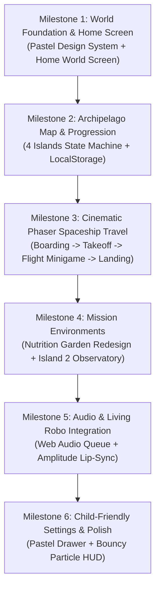

# AstroNutri: Phase 3.3 Grand Adventure World Transformation
**Document:** Master Architectural & Non-Destructive Milestone Implementation Plan  
**Target Audience:** Children aged 7–12  
**Art Direction:** Pastel Glassmorphism (الزجاج الكرتوني الناعم)  
**Status:** Architectural Blueprint — Pending Final User Approval Before Code Execution

---

## Executive Summary & Vision

AstroNutri is undergoing a fundamental transformation from a static, dark "telemetry dashboard website" into an **immersive, lively, playable 2.5D cartoon space adventure**.

Children do not want to navigate dropdown menus or look at black engineering tables. They want to physically explore a magical, warm, pastel galaxy alongside **Robo**, their expressive robotic copilot, flying in a personalized spaceship across floating planetary islands.

```
+-----------------------------------------------------------------------------------+
|                            THE 4-ISLAND ARCHIPELAGO WORLD                         |
|                                                                                   |
|     [ISLAND 1]                      [ISLAND 2]                 [ISLAND 3]         |
|  Nutrition Garden             Planet Observatory              Suit Workshop       |
| (حديقة التغذية الفضائية)        (مرصد الكواكب والنجوم)        (جزيرة تدريب الرواد) |
|         │                                │                            │           |
|         ▼                                ▼                            ▼           |
|   Phaser Travel 1 ──────────────►  Phaser Travel 2 ────────────► Phaser Travel 3  |
|                                                                       │           |
|                                                                       ▼           |
|                                                                   [ISLAND 4]      |
|                                                                  Grand Launch     |
|                                                              (منصة الانطلاق الكبرى)|
+-----------------------------------------------------------------------------------+
```

---

## Part 1: Deep Codebase & Asset Audit (Gap Analysis)

| System / Layer | Current Codebase State (Phase 2.3 Baseline) | Required Phase 3.3 Adventure State | Architectural Gap & Remediation Strategy |
| :--- | :--- | :--- | :--- |
| **Color Palette & Atmosphere** | Dark navy/black backgrounds (`#030712`, `#070b19`), harsh neon cyan (`#00f0ff`), and alert red (`#ff3366`). | Soft pastel space ocean: Soft Cyan (`#8DE8F4`), Sky Blue (`#A9C9FF`), Lavender (`#C9B8FF`), Pastel Pink (`#FFC3D8`), Cream Yellow (`#FFE69A`), Pearl White (`#F8FCFF`). | Redesign Tailwind tokens in `tailwind.config.js` and global styles in `src/styles/index.css`. Implement translucent glass cards (`backdrop-blur-md bg-white/10 border-white/40`). |
| **World Navigation** | Static React route switching via `App.tsx` (`currentLocation === 'Map'` vs `'NutritionLab'`). Teleports without physical journey. | Continuous physical space world: Home World $\to$ Interactive Archipelago Map $\to$ Cinematic Phaser Spaceship Travel Scene between islands. | Implement `CinematicTravelScene.ts` in Phaser. Wrap transitions in Framer Motion camera zooms. Keep existing React mission components code-split. |
| **Robo Character** | Hybrid: React has `AnimatedRobo.tsx` (CSS bobbing on static PNG); Phaser has `ProceduralRobo.ts` (squash/stretch, blinking, particle trail). | One unified, expressive cartoon companion across both React and Phaser with idle breathing, eyelid blinking, emotional poses, and voice lip-sync. | Standardize Robo on `ProceduralRobo` and an enhanced SVG/Canvas React counterpart. Connect voice playback directly to real-time `AnalyserNode` amplitude for natural lip movement. |
| **Progression State Machine** | `GameContext.tsx` tracks 8 legacy rooms (`NutritionLab`, `SpaceScience`, `HumanHealth`, `SuitRoom`, `EngineRoom`, `LaunchPad`, `LunarDashboard`). | Clean 4-Island Archipelago progression: Island 1 (Nutrition) $\to$ Island 2 (Observatory) $\to$ Island 3 (Suit Room) $\to$ Island 4 (Grand Launch). | Non-destructively adapt `GameContext.tsx`. Map existing completed flags (`isNutritionMissionComplete`, etc.) to Island progression states without breaking saved progress. |
| **Mission 1: Nutrition Lab** | Verified Phase 2.3 logic (exact 4-item capacity, crumb alert, banned soda/burger) inside a dark technical UI. | Identical, verified gameplay logic preserved 100%, re-skinned into the "Space Nutrition Garden" (greenhouse glass dome, pastel floating shelves, glowing cargo hatch). | Zero logic rewrite: Preserve `calculateNutrition`, `handleDrop`, and capacity validation. Update JSX container classes, icons, and audio triggers. |
| **Audio System** | Synthesized beeps in `sound.ts` and legacy runtime TTS API calls in `geminiTTS.ts`. | 100% pre-generated offline Arabic audio library (`public/audio/robo/*.mp3`), calibrated to EBU R128 (`-16 LUFS`), driven by a priority playback queue. | Replace runtime API calls with the offline Web Audio API engine. Wire the 16 active gameplay events to pre-generated files with strict cooldowns. |
| **Settings & HUD** | Complex engineering modal with dense sliders and technical options. | Playful, chunky, child-friendly glass drawer with oversized rounded buttons, sound/voice toggles, and clear star counters. | Overhaul `SettingsMenu.tsx` and `HeaderHUD.tsx` with pastel pill-buttons and minimum 56px touch targets. |

---

## Part 2: The 6-Milestone Implementation Plan



---

### Milestone 1: World Foundation & Home Screen Visual Identity

**Goal:** Establish the pastel glassmorphism visual identity across the entire project and build a magical, welcoming Home World screen for the child.

#### Deliverables & Technical Actions:
1. **Design Tokens & Tailwind Redesign:**
   - Extend `tailwind.config.js` with canonical pastel tokens:
     - `pastel-cyan`: `#8DE8F4`
     - `pastel-sky`: `#A9C9FF`
     - `pastel-lavender`: `#C9B8FF`
     - `pastel-pink`: `#FFC3D8`
     - `pastel-yellow`: `#FFE69A`
     - `pastel-white`: `#F8FCFF`
     - `glass-surface`: `rgba(255, 255, 255, 0.14)`
     - `glass-border`: `rgba(255, 255, 255, 0.40)`
   - Update `src/styles/index.css` with soft radial twilight gradients and floating cartoon clouds instead of dark starfields.
2. **2.5D Parallax Background System:**
   - Create `src/components/common/ParallaxWorldBackground.tsx` rendering multi-layered floating pastel clouds, gentle twinkling star clusters, and orbiting cartoon moons with Framer Motion spring physics.
3. **New Interactive Home World Screen (`HomeScreen.tsx`):**
   - Welcoming entrance featuring an oversized, bouncy animated Robo standing on a floating launchpad.
   - Spaceship hangar preview showcasing the child's customized rocket.
   - Giant, juicy, pulsating "ابدأ المغامرة" (Start Adventure) CTA button with sound and particle effects.
   - Child's personalized name greeting (*"أهلاً يا بطل الصغير"*).

---

### Milestone 2: Adventure Map & Progression State Machine

**Goal:** Replace the flat floorplan map with an explorable 4-Island Archipelago world map that communicates clear progression, unlock states, and achievements.

#### Deliverables & Technical Actions:
1. **4-Island Archipelago State Machine in `GameContext.tsx`:**
   - Define canonical island state:
     ```typescript
     export type IslandId = 
       | 'ISLAND_1_NUTRITION'
       | 'ISLAND_2_OBSERVATORY'
       | 'ISLAND_3_SUIT'
       | 'ISLAND_4_LAUNCH';

     export interface IslandProgress {
       id: IslandId;
       status: 'LOCKED' | 'UNLOCKED' | 'COMPLETED';
       starsEarned: number;
       highScore: number;
     }
     ```
   - Automatically unlock Island 1 by default. Island 2 unlocks upon packing 4 safe meals in Island 1.
   - Persist progression securely in `localStorage` under `ASTRONUTRI_PROGRESS_V3`.
2. **The Archipelago Adventure Map (`AdventureMap.tsx`):**
   - Render the 4 floating islands along a whimsical, curved celestial flight path:
     - **Island 1 (حديقة التغذية):** Floating greenhouse with geodesic glass dome and hydroponic greens.
     - **Island 2 (مرصد الكواكب):** Floating observatory with large brass telescope and orbiting rings.
     - **Island 3 (جزيرة تدريب الرواد):** Low-gravity obstacle course and space suit airlock.
     - **Island 4 (منصة الانطلاق الكبرى):** Towering cartoon rocket gantry surrounded by victory fireworks.
   - Interactive hover cards showing island name, mission objective, and star ratings (0–3 stars).
   - Locked islands display a translucent cloud shroud with a soft golden padlock.

---

### Milestone 3: Spaceship Travel Cinematic in Phaser

**Goal:** Create a seamless, cinematic Phaser 3 travel experience that physically moves the child from one island to another instead of an instant React route jump.

#### Deliverables & Technical Actions:
1. **Phaser Travel Scene (`src/game/scenes/CinematicTravelScene.ts`):**
   - **Phase 1: Boarding:** Robo and the child hop into their cartoon spaceship. Thruster particles spin up.
   - **Phase 2: Liftoff:** Rocket blasts off with smooth camera shake, particle smoke, and upward zoom.
   - **Phase 3: Interactive Flight Minigame (6–8 seconds):**
     - The ship glides through a colorful pastel nebula.
     - The child can drag or tap to steer the ship and collect floating **Star Coins (عملات النجوم)** while dodging fluffy clouds.
     - Zero fail-state (pure fun and positive reinforcement for children).
   - **Phase 4: Island Reveal:** Clouds part with a dynamic vignette mask as the destination island approaches.
   - **Phase 5: Touchdown:** Spaceship decelerates, deploys landing gear, and settles on the destination landing bay.
2. **React $\longleftrightarrow$ Phaser Bridge via `EventBus.ts`:**
   - Dispatch `TRAVEL_START { from: IslandId, to: IslandId }`.
   - Dispatch `TRAVEL_COMPLETED { destination: IslandId, starsCollected: number }` to trigger the React mission screen mount.

---

### Milestone 4: Mission Environments (Nutrition Redesign + Planet Observatory)

**Goal:** Redesign Mission 1 into the whimsical "Space Nutrition Garden" while preserving 100% of the verified Phase 2.3 logic, and implement Mission 2 (Planet Observatory).

#### Deliverables & Technical Actions:
1. **Mission 1: Space Nutrition Garden (`NutritionLab.tsx` Redesign):**
   - **Zero Logic Modification:** Keep the exact verified logic:
     - Strict 4-item capacity limit.
     - Crumbly food rejection (Burger, Soda, Pizza).
     - NASA fact popups and mission victory check.
   - **Visual Transformation:**
     - Replace dark backgrounds with a lush, floating geodesic greenhouse dome overlooking the nebula.
     - Transform the pantry into a floating translucent glass carousel with pastel category pills (بروتينات، كربوهيدرات، مشروبات).
     - Redesign the Cargo Bay into an illuminated cartoon launch container with 4 glowing slot sockets.
2. **Mission 2: Planet Observatory (`PlanetObservatory.tsx` / Phaser Scene):**
   - Interactive telescope viewport where the child pans across the solar system.
   - 4 Planetary Scans:
     - **Mars:** Finding the red dust and Olympus Mons volcano.
     - **Saturn:** Scanning the sparkling ice rings.
     - **Jupiter:** Discovering the Great Red Spot storm.
     - **Earth:** Observing our blue oceans from space.
   - Child-friendly quiz mechanics with encouragement from Robo on every tap.

---

### Milestone 5: Audio & Living Robo Integration

**Goal:** Connect the pre-generated offline Arabic audio library to the game engine and bind real-time voice amplitude to Robo's facial expressions and lip movement.

#### Deliverables & Technical Actions:
1. **Offline Audio Playback Controller (`src/utils/audioEngine.ts`):**
   - Preloads the EBU R128 normalized MP3 assets from `public/audio/robo/`.
   - Priority-based playback queue:
     - `CRITICAL` (Banned food alert, mission victory): Immediately preempts idle chatter.
     - `HIGH` (Greetings, travel arrivals): Plays with priority.
     - `NORMAL` (Food facts, planetary scans): Plays if no higher line is active.
   - Category Cooldown Gates: Prevents spamming repeated food facts (3–8s cooldown per item).
2. **Procedural Lip-Sync & Visor Animation (`ProceduralRobo.ts`):**
   - Connect Web Audio `AnalyserNode` to Robo's mouth and visor graphics.
   - When Robo speaks, his mouth container squashes/stretches smoothly with voice amplitude, and his LED visor blinks with animated voice waves.
   - When idle, Robo plays breathing, eye-tracking, and curious head-tilting tweens.

---

### Milestone 6: Child-Friendly Settings & UI Polish

**Goal:** Complete the child-friendly UX with accessible controls, celebratory rewards, and high-performance PWA offline readiness.

#### Deliverables & Technical Actions:
1. **Simplified Child Settings Drawer (`SettingsMenu.tsx`):**
   - Translucent glass sliding drawer with pastel buttons and icons.
   - Giant toggles for:
     - 🎵 Background Music (موسيقى الفضاء)
     - 🎙️ Robo's Voice (صوت روبو)
     - 🔊 Sound Effects (المؤثرات الصوتية)
   - "ابدأ من جديد" (Reset Progress) with a gentle two-step confirmation modal (*"هل تريد إعادة المغامرة من البداية؟"*).
2. **Global Adventure HUD (`HeaderHUD.tsx`):**
   - Floating glass pill displaying the current Island name and child's name.
   - Animated golden star counter with pop-in bounce when stars are earned.
   - Easy one-tap "الخريطة" (Map) button to return to the archipelago.
3. **Haptic & Particle Micro-Interactions:**
   - Star burst particles on button taps and successful item drops.
   - Custom friendly rocket cursor for desktop players.

---

## Part 3: Architectural Safety & Non-Destructive Invariants

To guarantee that the working Phase 2.3 baseline is protected at every step:

1. **Zero Destructive Rewrites:** Existing files in `src/` remain active. Refactoring is performed milestone-by-milestone with complete build verification at each step.
2. **Independent Mission Modularity:** The Nutrition Lab logic remains fully functional and independently testable at all times.
3. **PWA & Offline Capability:** Zero runtime API dependencies. All graphics, audio, and code bundles remain self-contained in `dist/` with full service worker precaching.
4. **Performance Target:** Entry bundle stays below **120 kB**, with heavy Phaser scenes dynamically code-split on demand.

---

## Part 4: Milestone Execution Roadmap

| Milestone | Scope of Work | Estimated Verification Gate |
| :---: | :--- | :--- |
| **M1** | Tailwind Pastel Tokens, Parallax Background, New Home World Screen | Visual inspection of Home screen, zero console errors, build pass. |
| **M2** | 4-Island State Machine, LocalStorage persistence, Archipelago World Map | Island unlock verification, local storage save/load audit. |
| **M3** | Phaser Cinematic Travel Scene, Flight minigame, React EventBus bridge | Browser test of boarding $\to$ takeoff $\to$ flight $\to$ landing sequence. |
| **M4** | Nutrition Garden pastel redesign (preserving 4-item logic), Mission 2 Observatory | Full Nutrition Lab gameplay test (capacity 4/4, banned foods), planet scan tests. |
| **M5** | Offline Web Audio engine wiring, Priority queue, Procedural Robo lip-sync | Real-device audio test, zero audio overlap, synchronized mouth movement. |
| **M6** | Pastel Settings drawer, Adventure HUD, Particle effects, Final PWA build audit | Full end-to-end playthrough audit (Home $\to$ Island 1 $\to$ Travel $\to$ Island 2). |

---

### Approval Gate (Current Hold)

In strict compliance with the **FIRST ACTION STOP CONDITION**:
- **No application code has been modified.**
- **`App.tsx` and all gameplay files remain intact.**
- **`PHASE_3_3_MILESTONE_PLAN.md` is drafted for your review.**

Awaiting your architectural approval to begin **Milestone 1**.
