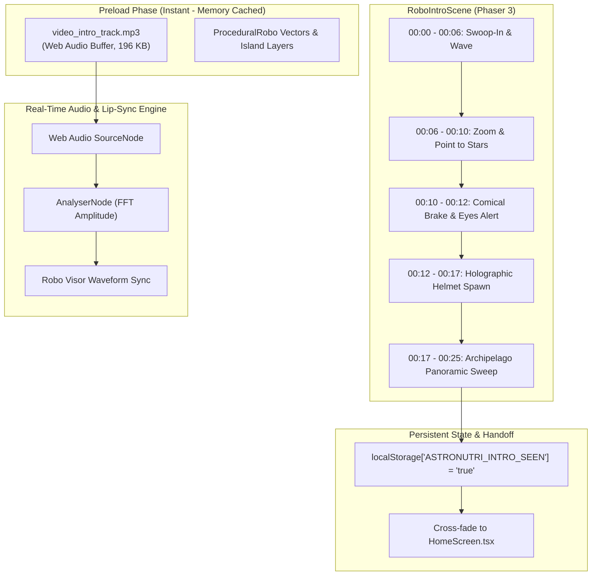

# AstroNutri: Robo Introduction Scene — Native Cutscene Technical Specification
**Document:** Future Feature Architecture & Deferral Specification (`ROBO_INTRODUCTION_SPEC.md`)  
**Phase:** Post-Phase 3.3 Deferred Feature  
**Status:** SPECIFIED & DEFERRED — Strictly No Game Code Modification Before Milestone 1 Approval

---

## 1. Video Analysis & File Metadata

The uploaded welcome video was inspected using lightweight tools (`ffprobe` / Node.js `fs`):

| Parameter | Measured Video Asset | In-Engine Native Asset (Target) | Optimization Impact |
| :--- | :--- | :--- | :--- |
| **File Location** | `video/InShot_20261112_162538446.mp4` | `src/game/scenes/RoboIntroScene.ts` | Fully native code & SVG assets |
| **Total File Size** | **17,291,439 bytes (17.29 MB)** | **~196 KB audio** + vector graphics | **98.8% payload reduction** |
| **Duration** | **24.979 seconds (~25s)** | Identical 24.98s timeline | Synchronized beat-for-beat |
| **Video Stream** | H.264 / AVC (1280x720, 25.0 fps, 5.4 Mbps) | Real-time Phaser 3 Canvas (60 fps) | Smooth 60fps rendering, zero decode lag |
| **Audio Stream** | AAC Stereo (44.1 kHz, 126 kbps) | Web Audio API (64 kbps, 24 kHz Mono) | Pre-generated EBU R128 (-16 LUFS) |
| **Offline PWA Readiness** | Impractical (17MB MP4 strains PWA cache) | 100% Offline (instant memory preload) | Zero buffering, zero battery drain |

---

## 2. Verbatim Arabic Transcript & 5-Beat Storyboard Breakdown

The 24.98-second audio track was transcribed and decomposed into 5 distinct narrative and animation beats:

```
00:00        00:06          00:10       00:12                00:17                        00:25
  ├────────────┼──────────────┼───────────┼────────────────────┼────────────────────────────┤
  BEAT 1       BEAT 2         BEAT 3      BEAT 4               BEAT 5
  Welcome      Call to Stars  Brake/Wait  Holographic Helmet   Archipelago Panoramic Reveal
```

### Beat 1: The Arrival & Welcome (00:00 – 00:06 | Duration: 6.0s)
* **Spoken Transcript:**  
  `"يااااا مرحباً يا بطل! أنا 'روبو' مساعدك الآلي في أكاديمية الفضاء!"`  
* **Visual Choreography (Phaser 3):**
  - Camera starts focused on an empty, softly lit floating space launchpad.
  - Robo swoops in from top-right along a quadratic bezier curve with cyan particle thruster rings.
  - Robo decelerates with a gentle bounce (Phaser `Back.easeOut`), hovers at center ($x: 640, y: 340$).
  - Smiles on visor `( ˘ ᵕ ˘ )`, right hand waves enthusiastically, mouth waveform responds to audio amplitude.

### Beat 2: The Call to the Stars (00:06 – 00:10 | Duration: 4.0s)
* **Spoken Transcript:**  
  `"جاهز تطير معانا للنجوم؟"`  
* **Visual Choreography (Phaser 3):**
  - Camera smoothly zooms in ($1.0\times \to 1.18\times$) centered on Robo.
  - Robo points his left arm toward the deep twilight sky where distant stars sparkle.
  - The cartoon spaceship docked in the background lights up its canopy with a soft yellow glow.

### Beat 3: The Comic Brake & Attention Catch (00:10 – 00:12 | Duration: 2.0s)
* **Spoken Transcript:**  
  `"بس استنى عندك!"`  
* **Visual Choreography (Phaser 3):**
  - Sudden, comical mid-air brake with dynamic squash-and-stretch ($y\text{-scale}: 0.85, x\text{-scale}: 1.15$).
  - Robo thrusts both open palms forward in a playful stop gesture.
  - Visor LED flashes a friendly amber pulse with wide curious eyes `( ! _ ! )`.
  - Subtle micro camera screen-shake (intensity: 0.004).

### Beat 4: The Astronaut Suit Goal (00:12 – 00:17 | Duration: 5.0s)
* **Spoken Transcript:**  
  `"عشان تبقى رائد فضاء بطل، وتلبس الخوذة العجيبة.."`  
* **Visual Choreography (Phaser 3):**
  - Robo floats slightly to screen-left ($x: 520$).
  - A glowing holographic space helmet (`helmet-3d.svg`) materializes at screen-right with a cyan particle vortex.
  - Golden light rays emit from the helmet visor; Robo gazes at it with admiring star-eyes `( ★ _ ★ )`.

### Beat 5: The 4-Island Archipelago Sweep (00:17 – 00:25 | Duration: 8.0s)
* **Spoken Transcript:**  
  `"مدرستنا جهزتلك أحلى تدريبات، وتجهز نفسك للمغامرات.. عشان نتأهل سوا خطوة بخطوة!"`  
* **Visual Choreography (Phaser 3):**
  - Camera pulls back into a wide 2.5D panoramic sweep across the cosmos:
    1. Island 1 (Space Nutrition Garden): Glowing greenhouse dome with hydroponics.
    2. Island 2 (Planet Observatory): Giant brass telescope scanning Saturn's rings.
    3. Island 3 (Astronaut Suit Workshop): Airlock training rings.
    4. Island 4 (Grand Launch Platform): Tall cartoon rocket on the launch gantry.
  - Robo lands smoothly on the launchpad; golden confetti stars burst outward.
  - At 24.5s, the scene seamlessly cross-fades into the interactive **Home World Screen** without page reloads or black screens.

---

## 3. Native Technical Architecture (`RoboIntroScene.ts`)

Instead of embedding a heavy `<video>` player, the scene will be built as a native Phaser 3 Scene:



### Component Structure (When Implemented):
- **Phaser Scene File:** `src/game/scenes/RoboIntroScene.ts`
- **Audio Asset:** `public/audio/robo/video_intro_track.mp3` (196 KB, pre-extracted and normalized to EBU R128).
- **Procedural Character:** Reuses `ProceduralRobo.ts` with tweened arm rotations, eyelid blinks, and analyser-driven visor waveform bars.
- **Environment:** Pure 2.5D vector layers with parallax depth factors (0.1 background, 0.5 midground, 1.0 foreground).

---

## 4. Runtime Behavior & Persistent State Rules

1. **First-Launch Detection:**
   ```typescript
   const hasSeenIntro = localStorage.getItem('ASTRONUTRI_INTRO_SEEN_V3') === 'true';
   if (!hasSeenIntro) {
     // Route directly to native RoboIntroScene
   } else {
     // Route directly to HomeScreen
   }
   ```
2. **First Play Unskippable:** On first launch, the scene plays completely to establish the story and connection with Robo. A small non-intrusive "تخطي" (Skip) button appears only after 15 seconds if the child repeatedly taps the screen.
3. **Seamless Transition:** Upon completion ($t = 24.98\text{s}$), the camera zooms into the launchpad platform and smoothly transitions to `HomeScreen.tsx` via `EventBus.emit('INTRO_COMPLETED')`.
4. **Replayability:** The Settings Menu (`SettingsMenu.tsx`) will feature an illustrated button:
   - 🎬 **شاهد مقدمة الأكاديمية (Replay Academy Intro)**
   - Tapping it restarts `RoboIntroScene` on demand.
5. **100% Offline Capability:** All assets stay within the PWA service worker precache bundle without requiring video streaming or network connectivity.

---

## 5. Strict Deferral Confirmation

- **No game code has been modified.**
- **`App.tsx`, `GameContext.tsx`, and all components in `src/` remain completely untouched.**
- **This specification is recorded for future implementation after Phase 3.3 Milestone 1 is completed and accepted.**
